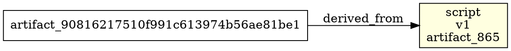

# AI Video Pipeline — Request Flow Atlas

> **What this is:** a code-level map of the pipeline as built through FV-11.
> It answers four questions for every step of a request:
>
> 1. **Which object owns the decision?**
> 2. **Which interface does it cross?**
> 3. **Which SQLite row records it?**
> 4. **What do the actual values look like?**
>
> **What this is not:** the canonical product specification. The canonical
> documents live in `docs/kb/docs/` in this repository. If this atlas and
> a canonical document disagree, the canonical document wins.
>
> **Code baseline:** branch `fv-11-report`, commit `dcfeb0b` (FV-01 through
> FV-11). The contract field appendix is regenerated from the live Pydantic
> models, so it cannot silently drift.

---

## 0. Read this first

### 0.1 The one-paragraph mental model

A **workflow definition** describes a graph of stage nodes. A **workflow run**
binds that graph to one effective configuration and one content package. Each
node becomes one or more **stage instances** (logical items). The pure
**readiness engine** decides which instances are `READY`. The **job dispatcher**
turns a READY instance into a durable **job** plus a **stage attempt**. A worker
claims the job with a **fenced lease**, invokes a **capability**, and writes
**artifacts**. Execution success is not acceptance: a **quality gate** evaluates
the artifacts, and only a gate `PASS` (or an explicit human approval) moves the
instance to accepted. Everything durable lives in SQLite; artifact bytes live in
an immutable content-addressed store.

### 0.2 Reality check: primitives vs. a single run loop

The repository currently implements the **durable primitives** and exercises
them through the CLI and tests. It does **not** yet have one production
orchestrator that creates a run, applies readiness, dispatches every stage, and
runs the quality gate automatically. This atlas marks each segment:

| Marker | Meaning |
|---|---|
| **[W]** | Wired: a CLI command or production code path drives it today. |
| **[P]** | Primitive: implemented and unit/fault tested, but no production caller composes it yet. |
| **[T]** | Target composition: the intended production wiring, not implemented in this codebase. |

The most important consequence: `capabilities invoke` is a **real end-to-end
slice** (CLI → request → executor → provider → SQLite), while `worker run` is a
**safe no-op smoke loop** that claims and completes a job without invoking a
capability or writing artifacts.

### 0.3 Three ways to read this document

| You need to… | Go to |
|---|---|
| Understand one request from start to finish | [§2 Golden path](#2-the-golden-path-one-request-with-real-values) |
| Find the class that does X | [§3 Component atlas](#3-component-atlas) |
| Find an interface or extension point | [§4 Interface catalog](#4-interface-catalog) |
| Find which table stores X | [§5 Database atlas](#5-database-atlas) |
| Understand a status or failure code | [§6 State machines](#6-state-machines-and-vocabularies) |
| Debug a stuck run | [§8 Cheat sheets](#8-where-do-i-look-cheat-sheets) |
| Look up one field of one model | [`CONTRACT_FIELD_ATLAS.md`](CONTRACT_FIELD_ATLAS.md) |

### 0.4 The demo run used throughout

All example IDs below are deterministic and reproducible from
`deterministic_id(prefix, *parts)`:

```text
run_id                 run_67188992ae47bb8b39620dca7d9b8fc2
run_key                rk_c69a136eee668eaf5de76cd3c14f5808
effective_config_id    config_9efec9a57ec9634b68f938cdff132741
content_package_id     package_9efec9a57ec9634b68f938cdff132741
correlation_id         corr_9efec9a57ec9634b68f938cdff132741

research stage         stage_bcf86e2c3ae8b4372947ae78d3dbafa4
research attempt       attempt_0ed59dd3bfda8ea64be36a5ac6cea226
research job           job_0ed59dd3bfda8ea64be36a5ac6cea226
research job key       idem_job_956f239f188e611bdab3cbfa254c80dd
capability execution   capexec_8984cd2c0fa6ff2bf1d9f7346131bf4e
capability idem key    idem_d4ca303b2ec7231e351ffd4648f7cb74
routing decision       route_d4ca303b2ec7231e351ffd4648f7cb74
provider invocation    inv_d4ca303b2ec7231e351ffd4648f7cb74
budget reservation     bres_4aa209aa9bfb4875667ad65b12cd1cd5
script artifact        artifact_86519d91ded5b3c68dff18cf5a785cb1
human review           review_fb22d47c2fc3b7ec9fbdd6ad63e69c14
```

`capexec_` is derived from the attempt ID. `idem_`, `route_`, and `inv_` share
the next digest because they are derived from the capability execution ID; only
the prefix differs. The budget reservation digest is derived from the capability
idempotency key plus `("RUN", run_id)`. The human review digest binds the run,
stage, gate, sorted artifact IDs, sorted `artifact_id:sha256` pairs, and
requested action.

The values are real hashes of the labels in `ids.py`, not hand-waved placeholders.
They are stable unless the input parts change.

### 0.5 ID prefixes are a lookup index

| Prefix | Produced by | Stored in |
|---|---|---|
| `run_` | run creation | `workflow_runs.run_id` |
| `config_` | effective config creation | `effective_configs.effective_config_id` |
| `package_` | content package creation | `content_packages.content_package_id` |
| `stage_` | stage instance creation | `stage_instances.stage_instance_id` |
| `attempt_` | `JobFactory` | `stage_attempts.attempt_id` |
| `job_` | `JobFactory` | `jobs.job_id` |
| `lease` (no prefix) | `LeaseManager` | `leases` row key `(job_id, fencing_token)` |
| `capexec_` | caller / executor request | `capability_executions.capability_execution_id` |
| `route_` | routing | `routing_decisions.routing_decision_id` |
| `inv_` | fake provider | `provider_invocations.invocation_id` |
| `op_` | fake provider | provider operation ID inside the payload |
| `bres_` | budget guard | `budget_reservations.reservation_id` |
| `review_` | `HumanReviewManager` | `human_reviews.review_id` |
| `eval_` | quality evaluator | `quality_evaluations.evaluation_id` |
| `qgr_` | gate evaluator | `quality_gate_results.quality_gate_result_id` |
| `artifact_` | artifact creation | `artifacts.artifact_id` |
| `pointer_` | pointer activation | `artifact_pointers.pointer_id` |
| `outbox_` | `EventOutbox` | `outbox_messages.outbox_id` |
| `evt_` | caller convention; no generator | `workflow_events.event_id` |

`deterministic_id("attempt", stage_id, 1)` and
`deterministic_id("job", stage_id, 1)` share the same digest because only the
prefix differs. That is intentional: the digest identifies the logical unit,
the prefix identifies the record type.

---

## 1. System map

### 1.1 Layers and dependency direction

```text
┌──────────────────────────────────────────────────────────────────────────────┐
│ 1. ENTRY                                                                    │
│    pipeline.cli  ──argparse──►  _run_* command handlers                     │
│    pipeline.__main__ ─────────►  cli.main()                                 │
└───────────────────────────────┬──────────────────────────────────────────────┘
                                │
        ┌───────────────────────┼───────────────────────────┐
        ▼                       ▼                           ▼
┌───────────────────┐  ┌────────────────────────┐  ┌──────────────────────────┐
│ 2. PURE WORKFLOW  │  │ 3. CONTROL PLANE       │  │ 4. ACCEPTANCE PLANE      │
│ workflow.loader   │  │ execution.events       │  │ quality.registry         │
│ workflow.conditions│ │ execution.dispatcher   │  │ quality.evaluators       │
│ workflow.cardinality││ execution.jobs         │  │ quality.gate             │
│ workflow.readiness│  │ execution.leases       │  │ quality.pipeline         │
│                   │  │ execution.retry        │  │ quality.repair           │
│ No DB, no network │  │ execution.recovery     │  │ quality.human_review     │
│ Deterministic     │  │ execution.worker       │  │                          │
└─────────┬─────────┘  └───────────┬────────────┘  └────────────┬─────────────┘
          │                        │                            │
          │                        ▼                            │
          │             ┌────────────────────────┐              │
          │             │ 5. CAPABILITY BOUNDARY │              │
          │             │ capabilities.registry  │              │
          │             │ capabilities.executor  │              │
          │             │ capabilities.fake      │              │
          │             │ capabilities.errors    │              │
          │             └───────────┬────────────┘              │
          │                         │                           │
          └─────────────────────────┼───────────────────────────┘
                                    ▼
┌──────────────────────────────────────────────────────────────────────────────┐
│ 6. CONTRACTS                                                                 │
│    pipeline.contracts.*  ── Pydantic models, literals, vocabularies          │
└───────────────────────────────┬──────────────────────────────────────────────┘
                                ▼
┌──────────────────────────────────────────────────────────────────────────────┐
│ 7. STORAGE                                                                   │
│    storage.database  ── SQLite connection + explicit transactions            │
│    storage.migrations── schema_migrations + 0001_initial.sql                │
│    storage.repositories ── typed repositories over payload JSON              │
│    storage.artifact_store ── immutable content-addressed bytes               │
└──────────────────────────────────────────────────────────────────────────────┘
```

Rules that the arrows encode:

- **Workflow is pure.** `pipeline.workflow` never imports storage. It consumes a
  `ReadinessContext` and returns a `ReadinessResult`.
- **Execution owns transitions.** Capabilities and quality evaluators never
  write stage/job/lease state directly.
- **Capabilities are provider-independent.** A stage requests a capability; it
  does not import a provider SDK.
- **Acceptance is separate.** `StageInstance.execution_status` and
  `StageInstance.acceptance_status` are different columns for a reason.
- **Storage is the only source of truth.** There is no broker, cache, or
  in-memory queue that survives a restart.

### 1.2 Package responsibilities

| Package | Owns | Does **not** own |
|---|---|---|
| `pipeline.cli` | argument parsing, command composition, text/JSON output | business rules |
| `pipeline.workflow` | definition loading, conditions, cardinality, readiness | DB writes, job creation, provider calls |
| `pipeline.execution` | outbox/inbox, jobs, leases, fencing, retry, recovery, worker loop | capability selection, artifact bytes, quality decisions |
| `pipeline.capabilities` | registry, request execution, idempotency, budget guard, fake provider | stage state transitions, quality acceptance |
| `pipeline.quality` | checks, evaluators, gate aggregation, repair plans, human review | job dispatch, lease ownership |
| `pipeline.contracts` | durable shapes, literals, validators, vocabularies | persistence, I/O |
| `pipeline.storage` | SQLite schema, repositories, migrations, artifact bytes | policy decisions |
| `pipeline.report` | read-only validation reports | mutations |
| `pipeline.setup_checks` | environment diagnostics | workflow state |
| `pipeline.ids`, `pipeline.fingerprints` | deterministic IDs and canonical hashes | persistence |

### 1.3 Canonical stage graph (`workflows/explainer_validation_v1.yaml`)

```text
                         ┌──────────┐
                         │  intake  │  manual_topic
                         └────┬─────┘
                              ▼
                         ┌──────────┐
                         │   idea   │  idea_development
                         └────┬─────┘
                              ▼
                         ┌──────────┐     research_gate_v1
                         │ research │◄──── quality gate
                         └────┬─────┘
                              ▼
                         ┌──────────┐     script_gate_v1
                         │  script  │◄──── quality gate
                         └────┬─────┘
                 ┌────────────┴─────────────┐
                 ▼                          ▼
          ┌──────────────┐           ┌──────────────┐
          │ visual_plan  │           │    speech    │  one_to_many
          └──────┬───────┘           └──────┬───────┘
                 ▼                          │
          ┌──────────────┐                  │
          │    assets    │  one_to_many     │
          └──────┬───────┘                  │
                 └────────────┬─────────────┘
                              ▼
                       ┌──────────────┐     composition_gate_v1
                       │ composition  │◄──── quality gate
                       └──────┬───────┘
                              ▼
                    ┌──────────────────┐   render_gate_v1
                    │ long_form_render │◄── quality gate (one_to_many chunks)
                    └────────┬─────────┘
                             ▼
                  ┌────────────────────┐   assembly_gate_v1
                  │ long_form_assembly │◄── quality gate
                  └─────────┬──────────┘
                            │
        ┌───────────────────┴───────────────────┐
        ▼                                       ▼
┌──────────────────┐                   ┌──────────────────┐
│ short_derivative │                   │   final_review   │  technical_content_review
└────────┬─────────┘                   └────────┬─────────┘
         │                                      ▼
         │                            ┌──────────────────┐
         └───────────────────────────►│  human_approval  │  human_publication_gate_v1
                                      └──────────────────┘
```

Cardinality modes in this workflow:

| Node | Mode | Meaning |
|---|---|---|
| `intake`, `idea`, `research`, `script`, `visual_plan` | `one_to_one` | one instance per parent |
| `assets`, `speech` | `one_to_many` | manifest children become separate instances |
| `composition`, `long_form_assembly`, `final_review` | `many_to_one` | fan in |
| `long_form_render` | `one_to_many` | one instance per render chunk manifest |
| `short_derivative` | `one_to_many` with `count: 1` | exactly one short |

### 1.4 CLI command map

| Command | Reads | Writes | Marker |
|---|---|---|---|
| `check-setup [--json]` | environment, paths | creates empty `PIPELINE_HOME` dirs | [W] |
| `contracts export-schemas [--check]` | Pydantic registry | `schemas/` (unless `--check`) | [W] |
| `db migrate` / `db status` | `schema_migrations` | applies migrations / no writes | [W] |
| `workflow validate <file>` | YAML file | none | [W] |
| `workflow readiness <file> [--context]` | YAML + JSON context | none | [W] |
| `outbox dispatch --once` | `outbox_messages` | outbox + inbox rows | [W] |
| `job dispatch --once` | `stage_instances` READY | `stage_attempts`, `jobs` | [W] |
| `worker run --once` | `jobs` | lease, attempt, stage, job | [W] |
| `capabilities list` | none | migrates DB | [W] |
| `capabilities invoke …` | none | config/run/stage/attempt + capability tables | [W] |
| `quality list-checks` | registry | none | [W] |
| `quality evaluate …` | manifest + artifact JSON | evaluations, gate result, repair/review | [W] |
| `human-review list/show/decide` | reviews | review + decision rows | [W] |
| `review list/decide` | alias | alias | [W] |
| `artifact graph --run-id` | artifacts + dependencies | none | [W] |
| `run status --run-id` | run, stages, attempts, artifacts | none | [W] |
| `report --run-id` | run, stages, attempts, artifacts, quality, usage | none (writes file if `--output`) | [W] |

### 1.5 One-line data flow

```text
YAML → WorkflowDefinition → Run + StageInstances → readiness →
Job+Attempt → Lease(claim) → CapabilityRequest → CapabilityResult →
Artifacts → QualityEvaluation* → QualityGateResult → HumanReview? →
Acceptance → ArtifactPointer → ValidationReport
```

---

## 2. The golden path: one request with real values

This section follows the `research` node of the demo run. It shows the exact
objects, SQL, and values at each boundary. Where a step has no production caller
yet, the marker says so.

### 2.0 The cast

| Object | Built from | Role in this path |
|---|---|---|
| `WorkflowDefinition` | `workflows/explainer_validation_v1.yaml` | immutable graph of nodes and policies |
| `EffectiveConfig` | system/domain/channel profiles + `RunOverrides` | resolved policy snapshot and hash |
| `WorkflowRun` | run request + config | one logical execution of the graph |
| `StageInstance` | node + logical item key | one addressable unit of work |
| `ReadinessContext` | durable rows read by caller | pure input to readiness |
| `ReadinessResult` | `evaluate_readiness(context)` | ready/blocked/planned items |
| `Job` | `JobFactory.create_job(stage)` | claimable transport unit |
| `StageAttempt` | `JobFactory` | one execution attempt of the instance |
| `JobClaim` | `LeaseManager.claim_next()` | job + attempt + stage + lease |
| `CapabilityRequest` | stage handler / CLI | provider-neutral work request |
| `ExecutionContext` | run/stage/attempt IDs | runtime envelope |
| `RoutingDecision` | router / CLI | selected implementation and provider |
| `CapabilityExecution` | executor | durable record of one invocation |
| `ProviderInvocation` | fake provider | provider-side operation record |
| `UsageRecord` | fake provider | units and cost |
| `QualityInputManifest` | gate runner | target artifacts + hashes |
| `QualityEvaluation` | evaluator | one check result |
| `QualityGateResult` | `evaluate_gate()` | aggregate decision |
| `HumanReview` | `HumanReviewManager` | manual decision request |
| `Artifact` | stage output | immutable bytes + metadata |
| `ArtifactPointer` | acceptance | active version for a logical slot |

### 2.1 Phase 0 — boot, paths, database, migration [W]

```text
CLI
 │
 ├─ resolve_pipeline_home()          PIPELINE_HOME or ~/.local/share/video-automation-pipeline
 ├─ default_database_path()          <home>/state/pipeline.sqlite3
 ├─ Database(path)                   sqlite3.connect, isolation_level=None
 ├─ PRAGMA foreign_keys=ON           fail closed if not enabled
 ├─ PRAGMA journal_mode=WAL          local baseline
 ├─ PRAGMA synchronous=NORMAL
 └─ MigrationRunner.migrate()
      ├─ CREATE TABLE IF NOT EXISTS schema_migrations (...)
      ├─ read applied rows
      ├─ validate checksum of 0001_initial.sql
      └─ apply pending migration in BEGIN IMMEDIATE
```

Concrete values:

```text
PIPELINE_HOME   /home/ultramind/.local/share/video-automation-pipeline
database        /home/ultramind/.local/share/video-automation-pipeline/state/pipeline.sqlite3
artifact root   /home/ultramind/.local/share/video-automation-pipeline/artifacts
tmp root        /home/ultramind/.local/share/video-automation-pipeline/tmp
busy_timeout    5000 ms
journal_mode    wal
```

`schema_migrations` row:

```sql
INSERT INTO schema_migrations (version, name, checksum, applied_at)
VALUES (1, '0001_initial', '0f3c...e91a', '2026-11-01T08:59:59.000000Z');
```

The checksum is the SHA-256 of the migration file bytes. If the file changes
after it was applied, `MigrationChecksumError` is raised instead of silently
running a different schema. This is why each worktree should use its own
`PIPELINE_HOME`.

### 2.2 Phase 1 — load and validate the workflow [W]

```text
pipeline workflow validate workflows/explainer_validation_v1.yaml
        │
        ▼
workflow.loader.load_workflow(path)
        ├─ Path.read_text()
        ├─ yaml.safe_load()                  no custom tags, no execution
        └─ load_workflow_data(data)
              └─ WorkflowDefinition.model_validate(data)
                    ├─ schema_version == workflow-definition.v1
                    ├─ node IDs unique
                    ├─ depends_on targets exist
                    ├─ topological order is acyclic
                    └─ stage names/gates/policies are known
```

Resulting object (abridged):

```json
{
  "schema_version": "workflow-definition.v1",
  "workflow_id": "explainer_validation_v1",
  "version": "1.0",
  "policy_ids": ["default_recovery_v1"],
  "nodes": [
    {
      "schema_version": "stage-node.v1",
      "node_id": "research",
      "stage_name": "research",
      "implementation_version": "research.v1",
      "depends_on": ["idea"],
      "input_selector": {
        "schema_version": "input-selector.v1",
        "kind": "DEPENDENCY_OUTPUTS",
        "dependency_node_ids": [],
        "artifact_types": [],
        "selection_policy": null
      },
      "cardinality": {
        "schema_version": "cardinality.v1",
        "mode": "one_to_one",
        "count": null,
        "selection_policy": null,
        "expected_manifest_id": null
      },
      "quality_gate_id": "research_gate_v1",
      "recovery_policy_id": "default_recovery_v1",
      "enabled_when": null
    }
  ]
}
```

### 2.3 Phase 2 — resolve the effective configuration [P]

`EffectiveConfig` is the immutable snapshot every later decision points at. It
is built from the system policy, domain profile, channel profile, workflow ID,
and run overrides. The `config_hash` is a fingerprint over the resolved values;
changing a profile produces a different hash and therefore a different config
identity.

```text
SystemPolicy (system_policy_v1)
        +
DomainProfile (explainer_domain_v1)
        +
ChannelProfile (channel_main_v1)
        +
RunOverrides {locale: "en", target_duration_seconds: 600}
        │
        ▼
EffectiveConfig
  effective_config_id  config_9efec9a57ec9634b68f938cdff132741
  config_hash          f0c5735906aa6f243e1967222577ae62263e51cdbf965e171fcc363d60ae63f9
  workflow_id          explainer_validation_v1
  workflow_version     1.0
  system_policy_version 1.0
  domain_profile_id    explainer_domain
  domain_profile_version 1.0
  channel_profile_id   channel_main
  channel_profile_version 1.0
  run_overrides        {"schema_version":"run-overrides.v1","locale":"en",
                        "target_duration_seconds":600,"variant_count":null,
                        "max_cost_minor":null,"enabled_optional_stages":[],
                        "output_profile_ids":null,"quality_profile_id":null}
  snapshot_artifact_id null
  schema_version       effective-config.v1
```

SQL:

```sql
INSERT INTO effective_configs
  (effective_config_id, config_hash, workflow_id, workflow_version,
   system_policy_version, domain_profile_id, domain_profile_version,
   channel_profile_id, channel_profile_version, snapshot_artifact_id,
   schema_version, payload)
VALUES
  ('config_9efec9a57ec9634b68f938cdff132741',
   'f0c5735906aa6f243e1967222577ae62263e51cdbf965e171fcc363d60ae63f9',
   'explainer_validation_v1', '1.0', '1.0',
   'explainer_domain', '1.0', 'channel_main', '1.0', NULL,
   'effective-config.v1', '{...}');
```

> There is no CLI command that composes profiles into an `EffectiveConfig` yet.
> Tests and the capability CLI construct the record directly.

### 2.4 Phase 3 — create the run and its stage instances [P]

```text
RunCreateRequest
  run_key                 rk_c69a136eee668eaf5de76cd3c14f5808
  workflow_id             explainer_validation_v1
  workflow_version        1.0
  content_package_id      package_9efec9a57ec9634b68f938cdff132741
  duplicate_policy        RETURN_EXISTING
        │
        ▼
WorkflowRun
  run_id                  run_67188992ae47bb8b39620dca7d9b8fc2
  run_key                 rk_c69a136eee668eaf5de76cd3c14f5808
  status                  RUNNING
  effective_config_id     config_9efec9a57ec9634b68f938cdff132741
  effective_config_hash   f0c573...
  content_package_id      package_9efec9a57ec9634b68f938cdff132741
  created_at              2026-11-01T09:00:00.000000Z
```

```sql
INSERT INTO workflow_runs
  (run_id, run_key, workflow_id, workflow_version, effective_config_id,
   effective_config_hash, status, content_package_id, created_at, updated_at,
   schema_version, payload)
VALUES
  ('run_67188992ae47bb8b39620dca7d9b8fc2',
   'rk_c69a136eee668eaf5de76cd3c14f5808',
   'explainer_validation_v1', '1.0',
   'config_9efec9a57ec9634b68f938cdff132741',
   'f0c5735906aa6f243e1967222577ae62263e51cdbf965e171fcc363d60ae63f9',
   'RUNNING', 'package_9efec9a57ec9634b68f938cdff132741',
   '2026-11-01T09:00:00.000000Z', '2026-11-01T09:00:00.000000Z',
   'workflow-run.v1', '{...}');
```

The unique `(run_id, node_id, logical_item_key)` constraint on
`stage_instances` is the idempotency boundary for creating stage work:

```sql
INSERT INTO stage_instances
  (stage_instance_id, run_id, node_id, logical_item_key, execution_status,
   acceptance_status, quality_gate_id, quality_gate_result_id,
   expected_input_manifest_id, active_attempt_id, created_at, updated_at,
   schema_version, payload)
VALUES
  ('stage_bcf86e2c3ae8b4372947ae78d3dbafa4',
   'run_67188992ae47bb8b39620dca7d9b8fc2', 'research', 'item_001',
   'READY', 'NOT_REQUIRED', 'research_gate_v1', NULL, NULL, NULL,
   '2026-11-01T09:00:01.000000Z', '2026-11-01T09:00:01.000000Z',
   'stage-instance.v1', '{...}');
```

The stage instance payload carries the accepted-output list:

```json
{
  "schema_version": "stage-instance.v1",
  "created_at": "2026-11-01T09:00:01.000000Z",
  "updated_at": "2026-11-01T09:00:01.000000Z",
  "stage_instance_id": "stage_bcf86e2c3ae8b4372947ae78d3dbafa4",
  "run_id": "run_67188992ae47bb8b39620dca7d9b8fc2",
  "node_id": "research",
  "logical_item_key": "item_001",
  "execution_status": "READY",
  "acceptance_status": "NOT_REQUIRED",
  "quality_gate_id": "research_gate_v1",
  "quality_gate_result_id": null,
  "expected_input_manifest_id": null,
  "active_attempt_id": null,
  "accepted_output_artifact_ids": []
}
```

`execution_status` and `acceptance_status` are deliberately independent:

```text
execution  PENDING → READY → CLAIMED → RUNNING → SUCCEEDED
                                               ↘ FAILED / UNKNOWN
acceptance NOT_REQUIRED / PENDING → PASSED / REGENERATE / HUMAN_REVIEW / FAILED
```

A stage can be `execution_status=SUCCEEDED` and
`acceptance_status=HUMAN_REVIEW` at the same time. That is the normal case for a
gate that routed to human review.

### 2.5 Phase 4 — evaluate readiness (pure) [W]

```text
readiness context (explicit, immutable)
  run                         WorkflowRun
  workflow                    WorkflowDefinition
  stage_instances             [intake: PASSED, idea: PASSED, research: READY]
  input_manifests             [manifest for research]
  accepted_artifact_ids       {artifact_topic_01, artifact_idea_01}
  accepted_artifact_pointers  [active pointers]
  quality_gate_results        []
  human_reviews               []
  condition_context           {"locale": "en", "variant": "long"}
        │
        ▼
evaluate_readiness(context)
        ├─ topological order
        ├─ evaluate enabled_when per node
        ├─ dependency acceptance check
        ├─ input selector + manifest completeness
        ├─ cardinality planning
        ├─ gate/human-review/recovery checks
        └─ derive run status
        │
        ▼
ReadinessResult
  run_id              run_67188992ae47bb8b39620dca7d9b8fc2
  workflow_id         explainer_validation_v1
  next_status         RUNNING
  ready_node_ids      ("research",)
  ready_instance_ids  ("stage_bcf86e2c3ae8b4372947ae78d3dbafa4",)
  planned_items       ()
  blocked             ()
  accepted_node_ids   ("intake", "idea")
  disabled_node_ids   ()
  terminal_node_ids   ("human_approval",)
```

Blocked example for the same node before `idea` is accepted:

```json
{
  "node_id": "research",
  "code": "DEPENDENCY_NOT_ACCEPTED",
  "message": "dependency idea has no accepted output",
  "stage_instance_id": "stage_bcf86e2c3ae8b4372947ae78d3dbafa4",
  "logical_item_key": "item_001"
}
```

The engine never writes to the database. A caller is responsible for reading the
rows, invoking `evaluate_readiness`, and applying the result. No such production
caller exists yet (T).

### 2.6 Phase 5 — dispatch READY work into jobs [W]

```text
JobDispatcher.dispatch_once()
  │
  ├─ BEGIN IMMEDIATE
  ├─ StageInstanceRepository.list_ready()
  │    SELECT payload FROM stage_instances
  │    WHERE execution_status = 'READY'
  │    ORDER BY created_at, stage_instance_id
  │
  ├─ for each instance: SAVEPOINT job_item
  │    JobFactory.create_job(instance)
  │      ├─ stage must be READY
  │      ├─ attempt_number = max(existing)+1 = 1
  │      ├─ attempt_id = deterministic_id("attempt", stage_id, 1)
  │      ├─ job_id     = deterministic_id("job", stage_id, 1)
  │      ├─ key        = idempotency_key("job", run_id, node_id, item, 1)
  │      ├─ INSERT stage_attempts (status=CREATED)
  │      └─ INSERT jobs (status=READY, available_at=now)
  │    RELEASE SAVEPOINT
  └─ COMMIT
```

Concrete rows:

```sql
INSERT INTO stage_attempts
  (attempt_id, stage_instance_id, attempt_number, quality_regeneration_number,
   status, worker_id, lease_expires_at, started_at, finished_at, failure_code,
   schema_version, payload)
VALUES
  ('attempt_0ed59dd3bfda8ea64be36a5ac6cea226',
   'stage_bcf86e2c3ae8b4372947ae78d3dbafa4', 1, 0,
   'CREATED', NULL, NULL, NULL, NULL, NULL,
   'stage-attempt.v1', '{...}');
```

```sql
INSERT INTO jobs
  (job_id, attempt_id, queue_name, status, idempotency_key, available_at,
   claimed_by, lease_expires_at, delivery_count, schema_version, payload)
VALUES
  ('job_0ed59dd3bfda8ea64be36a5ac6cea226',
   'attempt_0ed59dd3bfda8ea64be36a5ac6cea226', 'default', 'READY',
   'idem_job_956f239f188e611bdab3cbfa254c80dd',
   '2026-11-01T09:00:02.000000Z', NULL, NULL, 0,
   'job.v1', '{...}');
```

The job payload carries the fencing projection:

```json
{
  "schema_version": "job.v1",
  "job_id": "job_0ed59dd3bfda8ea64be36a5ac6cea226",
  "attempt_id": "attempt_0ed59dd3bfda8ea64be36a5ac6cea226",
  "queue_name": "default",
  "status": "READY",
  "idempotency_key": "idem_job_956f239f188e611bdab3cbfa254c80dd",
  "available_at": "2026-11-01T09:00:02.000000Z",
  "claimed_by": null,
  "lease_expires_at": null,
  "delivery_count": 0,
  "fencing_token": null
}
```

`JobFactory` is idempotent per logical instance: a second call without
`allow_new_attempt=True` returns the existing attempt/job pair with
`created=false`. The unique `jobs.idempotency_key` makes an accidental repeat of
the same attempt number a no-op even with `allow_new_attempt=True`.

### 2.7 Phase 6 — claim the job with a fenced lease [W]

```text
WorkerLoop.run_once()
  │
  ├─ LeaseManager.claim_next(owner_id="worker_local_cli")
  │    BEGIN IMMEDIATE
  │    ├─ recover expired leases
  │    ├─ pick next READY job where available_at <= now
  │    ├─ latest lease for job: none → token = 1
  │    ├─ INSERT leases(job_id, owner_id, fencing_token=1,
  │    │                acquired_at, expires_at, heartbeat_at)
  │    ├─ UPDATE stage_attempts: status=CLAIMED, worker_id, fencing_token=1
  │    ├─ UPDATE stage_instances: execution_status=CLAIMED
  │    └─ UPDATE jobs: status=CLAIMED, claimed_by, delivery_count+1
  │    COMMIT
  │
  ├─ LeaseManager.start(claim)
  │    ├─ verify_live_claim(): owner, token, expiry, job status
  │    ├─ UPDATE stage_attempts: status=RUNNING
  │    └─ UPDATE stage_instances: execution_status=RUNNING
  │
  ├─ handler(claim)  ← NoopJobHandler in the CLI today
  │
  └─ complete_success(claim) or RecoveryManager.handle_failure(...)
```

Lease row:

```json
{
  "schema_version": "lease.v1",
  "job_id": "job_0ed59dd3bfda8ea64be36a5ac6cea226",
  "owner_id": "worker_local_cli",
  "fencing_token": 1,
  "acquired_at": "2026-11-01T09:00:03.000000Z",
  "expires_at": "2026-11-01T09:01:03.000000Z",
  "heartbeat_at": "2026-11-01T09:00:03.000000Z"
}
```

SQL:

```sql
INSERT INTO leases
  (job_id, owner_id, fencing_token, acquired_at, expires_at, heartbeat_at,
   schema_version, payload)
VALUES
  ('job_0ed59dd3bfda8ea64be36a5ac6cea226', 'worker_local_cli', 1,
   '2026-11-01T09:00:03.000000Z', '2026-11-01T09:01:03.000000Z',
   '2026-11-01T09:00:03.000000Z', 'lease.v1', '{...}');
```

Every later transition re-reads the lease and compares all four of owner, token,
expiry, and job status inside one `BEGIN IMMEDIATE` transaction. A stale worker
with token 1 cannot complete a job now owned by token 2; it gets
`CompletionStatus.REJECTED` with `reason="STALE_CLAIM"`.

> `worker run --once` uses `NoopJobHandler`, which returns
> `JobHandlerResult(succeeded=True)` without producing artifacts. It proves the
> claim/fence/complete path, not stage business logic.

### 2.8 Phase 7 — execute the capability [W]

`capabilities invoke` is the only command that drives a real capability from
CLI to SQLite. It builds a request in code, not from workflow state:

```bash
PIPELINE_HOME=/tmp/opencode/pipeline-demo \
uv run python -m pipeline capabilities invoke \
  --database /tmp/opencode/pipeline-demo/state/pipeline.sqlite3 \
  --capability research \
  --operation-version research.v1 \
  --fake-outcome success
```

Recorded output:

```text
Capability execution completed: SUCCEEDED
  Capability: research
  Operation version: research.v1
  Fake outcome: success
  Artifact IDs: ['artifact_ae71cfce001f9d1ece753c9366ed96f4']
  Database: /tmp/opencode/pipeline-demo/state/pipeline.sqlite3
```

Before the executor is called, the CLI inserts a minimal fixture graph in one
transaction:

| Table | Recorded demo values | Note |
|---|---|---|
| `effective_configs` | `config_d27a15cb3a0e3097df63415954d1a93b`, hash `000…000` | `workflow_id=test_workflow`, `domain=test_domain`, `channel=test_channel` |
| `workflow_runs` | `run_e39d678836c355f5ab4941f03df2404f`, key `cli_test:run_e39d…` | status `RUNNING` |
| `stage_instances` | `stage_d27a15cb3a0e3097df63415954d1a93b`, node `test_node`, item `test_item` | status `RUNNING` |
| `stage_attempts` | `attempt_a49bd3d9e5e4f3d2a96d892fb45e3ed2`, attempt 1 | status `RUNNING` |

Those values are from a real invocation recorded in
`/tmp/opencode/pipeline-demo/state/pipeline.sqlite3`. The rest of this section uses the
golden-path IDs from §0.4 so the flow stays continuous; the executor formulas
are identical.

#### 2.8.1 The request object

```json
{
  "schema_version": "capability-request.v1",
  "capability_execution_id": "capexec_8984cd2c0fa6ff2bf1d9f7346131bf4e",
  "capability": "research",
  "operation_version": "research.v1",
  "input_artifact_ids": ["artifact_90816217510f991c613974b56ae81be1"],
  "payload_fingerprint": "d12ed9ce6965807bb7bd5d9be815ebefb0233bd567230d8290136a838d40b4d0",
  "requirements": {
    "schema_version": "capability-requirements.v1",
    "capability": "research",
    "required_features": [],
    "locale": "en",
    "cost_limit_minor": 500,
    "latency_budget_ms": 120000,
    "data_classification": "PUBLIC"
  },
  "payload": {
    "topic": "Why unit economics decide which AI video startups survive",
    "audience": "technical founders",
    "source_policy": "allow_public_web"
  },
  "payload_schema_version": "research-input.v1",
  "runtime_context": {"attempt": 1},
  "idempotency_key": "idem_d4ca303b2ec7231e351ffd4648f7cb74"
}
```

`payload_fingerprint` is `sha256_text(json.dumps(payload, sort_keys=True))`; the
golden payload above hashes to `d12ed9ce…`. The executor only compares the
fingerprint for equality; it does not inspect the payload.

The **recorded CLI fixture** is deliberately thinner than this golden request:

| Field | Recorded CLI fixture | Golden request above |
|---|---|---|
| `payload` | `{"capability": "research", "test": "data"}` | research input |
| `payload_fingerprint` | `3507d4d4…` | `d12ed9ce…` |
| `payload_schema_version` | `test.v1` | `research-input.v1` |
| `input_artifact_ids` | `[]` | one research bundle |
| `requirements` | defaults (`locale=None`, no cost limit) | `locale=en`, `cost_limit_minor=500` |
| `runtime_context` | `{}` | `{"attempt": 1}` |

Both are valid `CapabilityRequest` values. The fixture exists to exercise the
executor, not to model a research stage. This is also why the recorded CLI run
has no `budget_reservations` row: it never sets a cost limit and never passes a
`BudgetReservationRepository`.

#### 2.8.2 The execution context

```json
{
  "schema_version": "execution-context.v1",
  "run_id": "run_67188992ae47bb8b39620dca7d9b8fc2",
  "stage_instance_id": "stage_bcf86e2c3ae8b4372947ae78d3dbafa4",
  "attempt_id": "attempt_0ed59dd3bfda8ea64be36a5ac6cea226",
  "effective_config_id": "config_9efec9a57ec9634b68f938cdff132741",
  "correlation_id": "corr_9efec9a57ec9634b68f938cdff132741",
  "timeout_seconds": 300,
  "allowed_data_classification": "PUBLIC"
}
```

#### 2.8.3 The routing decision

```json
{
  "schema_version": "routing-decision.v1",
  "routing_decision_id": "route_d4ca303b2ec7231e351ffd4648f7cb74",
  "capability": "research",
  "implementation": "fake",
  "implementation_version": "1.0.0",
  "provider": "fake",
  "model": "deterministic-fixture",
  "provider_config_hash": "0000000000000000000000000000000000000000000000000000000000000000",
  "fallback_chain": [],
  "policy_version": "1.0",
  "reason_codes": ["cli_test"],
  "candidate_exclusions": [],
  "budget_context": {},
  "usage_context": {},
  "attempt": 1,
  "data_classification": "PUBLIC",
  "paid_fallback_authorized": false,
  "created_at": "2026-11-01T09:00:04.000000Z"
}
```

There is no routing engine yet. The CLI hardcodes `implementation=fake`,
`provider=fake`, and a zero config hash. A real router is [T].

#### 2.8.4 Executor timeline

```text
CapabilityExecutor.execute(request, context, routing, budget_repo=None)
│
├─ TRANSACTION 1  BEGIN IMMEDIATE
│   ├─ IdempotencyRecordRepository.get(idem_d4ca…)
│   │    └─ missing → INSERT status=RESERVED
│   ├─ compare capability, fingerprint, operation_version,
│   │           input_artifact_ids, required_features, locale
│   │    └─ any mismatch → ExecutionError(VALIDATION), no provider call
│   ├─ status SUCCEEDED → replay prior result, no provider call
│   ├─ status IN_FLIGHT/UNKNOWN → ExecutionError, no blind re-invoke
│   ├─ budget check + reservation            (only if cost_limit_minor set)
│   ├─ INSERT routing_decisions              (duplicate suppressed)
│   ├─ INSERT capability_executions PENDING  (duplicate suppressed)
│   └─ UPDATE idempotency status=IN_FLIGHT
│
├─ PROVIDER CALL  (outside the write transaction)
│   └─ FakeCapabilityProvider.execute(CapabilityExecutionInput)
│
├─ TRANSACTION 2
│   ├─ UPDATE capability_executions → SUCCEEDED/FAILED/UNKNOWN
│   ├─ INSERT provider_invocations
│   ├─ INSERT usage_records
│   ├─ settle / release budget reservation
│   └─ UPDATE idempotency → SUCCEEDED/FAILED/UNKNOWN
│
└─ return ExecutionResult | ExecutionError
```

If the provider raises, `_handle_execution_exception` writes a `FAILED`
execution (or `UNKNOWN` when the exception text contains `timeout`) and releases
or marks the budget reservation. It does not retry; retry is the execution
plane's job.

#### 2.8.5 SQL written by the executor

Idempotency claim (only the repository's projected columns are emitted):

```sql
INSERT INTO idempotency_records
  (idempotency_key, capability, request_fingerprint, provider, status,
   capability_execution_id, provider_invocation_id, provider_operation_id,
   created_at, completed_at, schema_version, payload)
VALUES
  ('idem_d4ca303b2ec7231e351ffd4648f7cb74', 'research',
   'd12ed9ce6965807bb7bd5d9be815ebefb0233bd567230d8290136a838d40b4d0',
   'fake', 'RESERVED',
   'capexec_8984cd2c0fa6ff2bf1d9f7346131bf4e', NULL, NULL,
   '2026-11-01T09:00:04.100000Z', NULL, 'idempotency-record.v1', '{...}');
```

> **Projection drift:** the table also has `operation_version`,
> `input_artifact_ids`, `required_features`, `locale`, and `result_artifact_ids`
> columns, but `IdempotencyRecordRepository.columns` does not list them. They
> keep their DDL defaults (`v1`, `[]`, `[]`, `NULL`, `[]`) while the canonical
> values live only in `payload`. This was observed in the recorded demo:
> `operation_version` column = `v1`, payload = `research.v1`;
> `result_artifact_ids` column = `[]`, payload = `["artifact_ae71…"]`.
> **Read the payload, not the extracted column.**

Budget reservation (only when `requirements.cost_limit_minor` is set and a
`BudgetReservationRepository` is supplied):

```sql
INSERT INTO budget_reservations
  (reservation_id, scope_type, scope_id, idempotency_key,
   estimated_cost_minor, reserved_cost_minor, actual_cost_minor,
   status, created_at, settled_at, schema_version, payload)
VALUES
  ('bres_4aa209aa9bfb4875667ad65b12cd1cd5', 'RUN',
   'run_67188992ae47bb8b39620dca7d9b8fc2',
   'idem_d4ca303b2ec7231e351ffd4648f7cb74',
   120, 120, NULL, 'RESERVED', '2026-11-01T09:00:04.120000Z', NULL,
   'budget-reservation.v1', '{...}');
```

Routing and execution:

```sql
INSERT INTO routing_decisions
  (routing_decision_id, capability, implementation, implementation_version,
   provider, model, policy_version, attempt, data_classification, created_at,
   schema_version, payload)
VALUES
  ('route_d4ca303b2ec7231e351ffd4648f7cb74', 'research', 'fake', '1.0.0',
   'fake', 'deterministic-fixture', '1.0', 1, 'PUBLIC',
   '2026-11-01T09:00:04.130000Z', 'routing-decision.v1', '{...}');

INSERT INTO capability_executions
  (capability_execution_id, attempt_id, capability, status, idempotency_key,
   request_fingerprint, started_at, finished_at, schema_version, payload)
VALUES
  ('capexec_8984cd2c0fa6ff2bf1d9f7346131bf4e',
   'attempt_0ed59dd3bfda8ea64be36a5ac6cea226', 'research', 'PENDING',
   'idem_d4ca303b2ec7231e351ffd4648f7cb74',
   'd12ed9ce6965807bb7bd5d9be815ebefb0233bd567230d8290136a838d40b4d0',
   NULL, NULL, 'capability-execution.v1', '{...}');
```

Provider and usage (second transaction):

```sql
INSERT INTO provider_invocations
  (invocation_id, capability_execution_id, provider, operation_id,
   idempotency_key, request_fingerprint, status, started_at, finished_at,
   schema_version, payload)
VALUES
  ('inv_d4ca303b2ec7231e351ffd4648f7cb74',
   'capexec_8984cd2c0fa6ff2bf1d9f7346131bf4e', 'fake',
   'op_b9f719a724d37c283dbb0abf914335df',
   'idem_d4ca303b2ec7231e351ffd4648f7cb74',
   'd12ed9ce6965807bb7bd5d9be815ebefb0233bd567230d8290136a838d40b4d0',
   'SUCCEEDED', '2026-11-01T09:00:04.200000Z',
   '2026-11-01T09:00:04.900000Z', 'provider-invocation.v1', '{...}');

INSERT INTO usage_records
  (usage_id, capability_execution_id, provider, model,
   estimated_cost_minor, actual_cost_minor, created_at, schema_version, payload)
VALUES
  ('usage_56d7134b5f54ca3f0d69ed8902a621aa',
   'capexec_8984cd2c0fa6ff2bf1d9f7346131bf4e', 'fake',
   'deterministic-fixture', 100, 100, '2026-11-01T09:00:04.910000Z',
   'usage.v1', '{...}');
```

`usage_id` is generated by `UsageRecordRepository` as
`deterministic_id("usage", capability_execution_id, provider)`; `UsageRecord`
itself has no ID field.

Idempotency completion:

```sql
UPDATE idempotency_records
SET status = 'SUCCEEDED',
    provider_invocation_id = 'inv_d4ca303b2ec7231e351ffd4648f7cb74',
    provider_operation_id = 'op_b9f719a724d37c283dbb0abf914335df',
    completed_at = '2026-11-01T09:00:04.920000Z',
    payload = '{...}'
WHERE idempotency_key = 'idem_d4ca303b2ec7231e351ffd4648f7cb74';
```

#### 2.8.6 Replay matrix

| Existing idempotency status | Same request? | Result |
|---|---|---|
| missing | — | create `RESERVED`, proceed |
| `RESERVED` | yes | proceed (retry of an interrupted attempt) |
| `RESERVED` | no | `ExecutionError(VALIDATION)` |
| `IN_FLIGHT` | yes | `ExecutionError(TRANSIENT_PROVIDER, "already in flight")` |
| `UNKNOWN` | yes | `ExecutionError(TIMEOUT_UNKNOWN, reconciliation required)` |
| `SUCCEEDED` | yes | synthetic `ExecutionResult` from stored rows, no provider call |
| `SUCCEEDED` | no | `ExecutionError(VALIDATION)` |
| `FAILED` / `RECONCILED` | yes | proceed as a new attempt under the same key |

The key invariant: **an idempotency key never maps to two different requests**,
and an `UNKNOWN` outcome is never silently re-invoked.

### 2.9 Phase 8 — the fake provider [W]

`FakeCapabilityProvider` is deterministic by construction: it hashes the request
payload, looks up a scripted outcome, and builds four records.

```text
FakeCapabilityProvider.execute(CapabilityExecutionInput)
│
├─ fingerprint = request.payload_fingerprint
├─ outcome = outcomes[fingerprint] or default_outcome
├─ if no scripted outcome and capability ∈ content capabilities:
│      outcome = create_content_stage_success_outcome(capability)
├─ build CapabilityExecution      status=SUCCEEDED|FAILED|UNKNOWN
├─ build ProviderInvocation       operation_id=op_<digest>
├─ build CapabilityResult         artifact_ids=[…]
├─ build UsageRecord              input/output units + cost
└─ return CapabilityExecutionOutput
```

Scripted success outcome:

```json
{
  "schema_version": "scripted-outcome.v1",
  "status": "SUCCEEDED",
  "artifact_ids": ["artifact_ae71cfce001f9d1ece753c9366ed96f4"],
  "metadata": {"fake": true, "outcome": "success"},
  "usage": {
    "schema_version": "usage.v1",
    "provider": "fake",
    "model": "deterministic-fixture",
    "input_units": 10,
    "output_units": 20,
    "runtime_seconds": 0.5,
    "estimated_cost_minor": 100,
    "actual_cost_minor": 100
  }
}
```

`create_success_outcome()` defaults to
`deterministic_id("artifact", "fake", "success")`, which is the
`artifact_ae71cfce…` above.

#### 2.9.1 Content-stage success factories

`--fake-outcome` also accepts capability-specific factories. Each builds a
schema-valid payload so downstream quality checks have something to read:

| `--fake-outcome` | Factory | Produces |
|---|---|---|
| `speech_generation` | `create_speech_generation_success_outcome` | speech manifest + scene audio artifacts |
| `tts_adapter` | `create_tts_adapter_success_outcome` | synthesized audio + timing |
| `asr_alignment` | `create_asr_alignment_success_outcome` | word timestamps |
| `audio_qc_pass` | `create_audio_qc_success_outcome` | PASS audio QC result |
| `audio_qc_fail` | `create_audio_qc_failure_outcome` | FAIL audio QC result with codes |
| `composition` | `create_composition_success_outcome` | composition spec |
| `rendering` | `create_rendering_success_outcome` | rendered media artifact |
| `assembly` | `create_assembly_success_outcome` | assembled cut |
| `short_derivative` | `create_short_derivative_success_outcome` | short-form derivative |

#### 2.9.2 Scripted failure outcomes

| CLI name | Failure code | Category | Retryable | Reconcile |
|---|---|---|---|---|
| `validation` | `EXEC.VALIDATION` | `VALIDATION` | no | no |
| `authentication` | `EXEC.AUTHENTICATION` | `AUTHENTICATION` | no | no |
| `authorization` | `EXEC.AUTHORIZATION` | `AUTHORIZATION` | no | no |
| `rate_limit` | `EXEC.RATE_LIMIT` | `RATE_LIMIT` | yes | no |
| `quota` | `EXEC.QUOTA` | `QUOTA` | no | no |
| `transient` | `EXEC.TRANSIENT_PROVIDER` | `TRANSIENT` | yes | no |
| `permanent` | `EXEC.PERMANENT_PROVIDER` | `PERMANENT` | no | no |
| `timeout_unknown` | `EXEC.TIMEOUT_UNKNOWN` | `UNKNOWN_OUTCOME` | no | yes |
| `media` | `MEDIA.TECHNICAL_INTEGRITY` | `MEDIA` | no | no |
| `quality` | `QUALITY.GENERIC` | `QUALITY` | no | no |
| `budget` | `POLICY.BUDGET_EXCEEDED` | `POLICY` | no | no |
| `configuration` | `EXEC.INTERNAL` | `INTERNAL` | no | no |
| `human_review` | `QUALITY.HUMAN_REVIEW` | `QUALITY` | no | no |
| `policy` | `POLICY.VIOLATION` | `POLICY` | no | no |
| `internal` | `EXEC.INTERNAL` | `INTERNAL` | no | no |

The exact boolean is computed by `category_for_code` / `is_retryable_code` /
`requires_reconciliation_code`; treat the table as the observed default, not a
separately configurable policy.

### 2.10 Phase 9 — evaluate the quality gate [W]

The gate is a separate plane from execution. A stage can succeed and still be
rejected here.

```bash
uv run python -m pipeline quality evaluate \
  --database "$PIPELINE_HOME/state/pipeline.sqlite3" \
  --gate-id script_gate_v1 \
  --manifest /tmp/opencode/quality-demo/manifest.json \
  --artifacts-dir /tmp/opencode/quality-demo/artifacts \
  --stage-instance-id stage_3acefd7f5007b1741044f4080b805f2c
```

#### 2.10.1 Input manifest

```json
{
  "schema_version": "quality-input-manifest.v1",
  "manifest_id": "manifest_script_001",
  "gate_id": "script_gate_v1",
  "check_id": "script_schema_v1",
  "target_artifact_ids": ["artifact_86519d91ded5b3c68dff18cf5a785cb1"],
  "target_hashes": {
    "artifact_86519d91ded5b3c68dff18cf5a785cb1": "b9eb1cfabdacd1241d2c649c3dfd317a0f370c2455dfbdaeda1be8c5d7a0c09e"
  },
  "supporting_artifact_ids": [],
  "policy_snapshot_artifact_id": null,
  "created_at": "2026-11-01T10:00:00.000000Z"
}
```

A manifest pins **artifact IDs and hashes**. If the bytes change, the hashes no
longer match and the gate must fail rather than approve stale content.

#### 2.10.2 What `quality evaluate` actually does today

| Aspect | Current behavior | Target |
|---|---|---|
| gate policy | hardcoded `QualityGatePolicy` in `cli.py`, `version=1.0` | load from `quality_gate_policies` |
| check list | always the four script checks, regardless of `--gate-id` | resolve from policy + registry |
| run linkage | `run_id = manifest.manifest_id` | real run ID |
| database | opens `Database` directly, **no migration** | migrate on open |
| semantic checks | stub evaluators that error or abstain | provider-backed evaluators |

The recorded run below is therefore a real code path but a demo policy. It
still writes real rows.

#### 2.10.3 Check registry (23 checks)

| Gate family | Checks |
|---|---|
| script | `script_schema_v1`, `claim_reference_integrity_v1`, `script_editorial_clarity_v1`, `script_claim_evidence_v1` |
| visual plan | `visual_plan_schema_v1`, `visual_intent_coherence_v1`, `asset_availability_v1`, `asset_license_compliance_v1` |
| speech | `speech_manifest_schema_v1`, `speech_wer_cer_v1`, `speech_critical_tokens_v1`, `speech_forced_alignment_v1`, `speech_signal_quality_v1` |
| composition | `composition_timeline_v1`, `composition_sync_v1` |
| render | `render_decode_v1`, `render_profile_v1`, `render_timeline_v1` |
| assembly | `assembly_integrity_v1`, `assembly_audio_video_drift_v1` |
| short | `short_derivative_integrity_v1` |
| human publication | `human_publication_approval_v1` |

#### 2.10.4 Recorded evaluation

Real output from the invocation above (abridged):

```json
{
  "gate_result": {
    "quality_gate_result_id": "qgr_qgr_e7dd0684c4fe7c956c4495d8364c8f45",
    "gate_id": "script_gate_v1",
    "gate_version": "1.0",
    "stage_instance_id": "stage_3acefd7f5007b1741044f4080b805f2c",
    "target_artifact_ids": ["artifact_86519d91ded5b3c68dff18cf5a785cb1"],
    "target_hashes": {
      "artifact_86519d91ded5b3c68dff18cf5a785cb1": "b9eb1cfabdacd1241d2c649c3dfd317a0f370c2455dfbdaeda1be8c5d7a0c09e"
    },
    "required_check_ids": [
      "script_schema_v1",
      "claim_reference_integrity_v1",
      "script_claim_evidence_v1",
      "script_editorial_clarity_v1"
    ],
    "evaluation_ids": [
      "eval_eval_fb9033ebc8bfe0087ce6a46e6b876a43",
      "eval_eval_261d81dabd8a81899b6d0f63bfc65c8f",
      "eval_eval_ff443611d5d5ea154ef1f5e3b185afde",
      "eval_eval_e79a60260de5928cce89224c1f823615"
    ],
    "decision": "FAIL",
    "hard_failure_codes": ["QUALITY.GENERIC"],
    "repair_scope": null,
    "policy_version": "1.0",
    "created_at": "2026-11-02T03:28:51.561939Z",
    "completed_at": "2026-11-02T03:28:51.561945Z"
  }
}
```

Per-check outcomes:

| Check | Outcome | Dimension | Score | Note |
|---|---|---|---|---|
| `script_schema_v1` | `PASS` | `schema_valid` | 1.0 | `script.v1` validated |
| `claim_reference_integrity_v1` | `PASS` | `reference_integrity` | 1.0 | 0 claims, 0 unresolved |
| `script_claim_evidence_v1` | `PASS` | `claim_support` | 1.0 | no claims to verify |
| `script_editorial_clarity_v1` | `ERROR` | `editorial_clarity` | 0.0 | `"Editorial eval needs LLM"` |

Decision rule 1 (any `ERROR` → `FAIL`) fired, so the aggregate is `FAIL` even
though three checks passed. This is the correct fail-closed behavior; the
semantic evaluator is a stub.

> **ID quirk:** the recorded IDs are `eval_eval_…`, `qgr_qgr_…`, and
> `inv_inv_…`. The evaluator and gate code call `deterministic_id("eval", …)`
> and then prepend `eval_` again. The IDs are stable and unique, just
> double-prefixed. Do not "fix" them casually: they are persisted identity.

#### 2.10.5 Decision rules in priority order

```text
 1. any evaluation ERROR ............................ FAIL
 2. required FAIL with severity CRITICAL ............ FAIL
 3. failure_code ∈ hard_failure_codes ............... FAIL
 4. artifact hash mismatch .......................... FAIL
 5. dimension score < review threshold .............. FAIL
 6. review_threshold ≤ score < pass_threshold ....... HUMAN_REVIEW
 7. all required checks PASS ........................ PASS
 8. any evaluation ABSTAIN .......................... HUMAN_REVIEW
 9. required FAIL (non-critical), regen left ........ REGENERATE
10. max regenerations exceeded ...................... after_max_regenerations
```

Three-zone thresholds:

```text
 score
 1.0 ┤                         ┌────────────── PASS
     │                         │
 0.8 ┤─────────────────────────┘  pass_threshold
     │        HUMAN_REVIEW
 0.65┤─────────────────────────   review_threshold
     │        FAIL
 0.0 ┤
     └───────────────────────────────────────────
```

#### 2.10.6 Persistence

```sql
INSERT INTO quality_evaluations
  (evaluation_id, stage_instance_id, logical_item_key, scene_id, shot_id,
   gate_id, check_id, outcome, created_at, schema_version, payload)
VALUES
  ('eval_eval_fb9033ebc8bfe0087ce6a46e6b876a43',
   'stage_3acefd7f5007b1741044f4080b805f2c', NULL, NULL, NULL,
   'script_gate_v1', 'script_schema_v1', 'PASS',
   '2026-11-02T03:28:51.561649Z', 'quality-evaluation.v1', '{...}');

INSERT INTO quality_gate_results
  (quality_gate_result_id, gate_id, gate_version, stage_instance_id,
   logical_item_key, decision, policy_version, created_at, completed_at,
   schema_version, payload)
VALUES
  ('qgr_qgr_e7dd0684c4fe7c956c4495d8364c8f45', 'script_gate_v1', '1.0',
   'stage_3acefd7f5007b1741044f4080b805f2c', NULL, 'FAIL', '1.0',
   '2026-11-02T03:28:51.561939Z', '2026-11-02T03:28:51.561945Z',
   'quality-gate-result.v1', '{...}');
```

`QualityEvaluationRepository` extracts only identity/status columns; dimensions,
scores, evidence, and costs live in `payload`.

#### 2.10.7 Repair and human review branches

```text
QualityPipeline.run()
│
├─ gate.evaluate(...) → decision
│
├─ decision REGENERATE
│    └─ RepairPlanner.plan_repair(...)
│         ├─ regeneration_count >= max → None (escalate)
│         └─ else RepairPlan(invalidation_scope, max_attempts, targets)
│
├─ decision HUMAN_REVIEW
│    └─ HumanReviewManager.create_review(...)
│         └─ HumanReview(status=OPEN, requested_action="review_quality_gate")
│
└─ persist evaluations, gate result, repair plan
```

Repair plan example:

```json
{
  "schema_version": "repair-plan.v1",
  "repair_plan_id": "repair_4d0e6f2a9c1b7e83d5a4f6c2b9e17083",
  "source_gate_result_id": "qgr_qgr_2d2f752a906a0896e9f3509590954f74",
  "reason_codes": ["QUALITY.UNSUPPORTED_CLAIM"],
  "target_artifact_ids": ["artifact_86519d91ded5b3c68dff18cf5a785cb1"],
  "target_stage_instance_ids": ["stage_3acefd7f5007b1741044f4080b805f2c"],
  "invalidation_scope": "SCENE",
  "max_attempts": 2,
  "created_at": "2026-11-01T10:02:00.000000Z"
}
```

```sql
INSERT INTO repair_plans
  (repair_plan_id, source_gate_result_id, invalidation_scope, created_at,
   schema_version, payload)
VALUES
  ('repair_4d0e6f2a9c1b7e83d5a4f6c2b9e17083',
   'qgr_qgr_2d2f752a906a0896e9f3509590954f74', 'SCENE',
   '2026-11-01T10:02:00.000000Z', 'repair-plan.v1', '{...}');
```

`RepairPlan` is a durable instruction, not an executed action. Nothing in this
codebase yet invalidates the target artifacts or enqueues replacement work.

### 2.11 Phase 10 — human review [W]

When the gate routes to `HUMAN_REVIEW`, the pipeline creates one review bound to
the exact artifact hashes it evaluated.

```json
{
  "schema_version": "human-review.v1",
  "review_id": "review_fb22d47c2fc3b7ec9fbdd6ad63e69c14",
  "run_id": "run_67188992ae47bb8b39620dca7d9b8fc2",
  "stage_instance_id": "stage_3acefd7f5007b1741044f4080b805f2c",
  "gate_id": "script_gate_v1",
  "target_artifact_ids": ["artifact_86519d91ded5b3c68dff18cf5a785cb1"],
  "target_hashes": {
    "artifact_86519d91ded5b3c68dff18cf5a785cb1": "b9eb1cfabdacd1241d2c649c3dfd317a0f370c2455dfbdaeda1be8c5d7a0c09e"
  },
  "reason_codes": ["QUALITY.EDITORIAL_CLARITY"],
  "requested_action": "review_quality_gate",
  "status": "OPEN",
  "created_at": "2026-11-01T10:03:00.000000Z",
  "resolved_at": null
}
```

Commands:

```bash
# works
pipeline human-review decide review_fb22d47c2fc3b7ec9fbdd6ad63e69c14 \
  REGENERATE_STAGE --reviewer local_reviewer \
  --comments "Scene 2 makes an unsupported cost claim."

# declared but currently broken: both exit 1 with ImportError
pipeline human-review list --run-id run_67188992ae47bb8b39620dca7d9b8fc2
pipeline human-review show review_fb22d47c2fc3b7ec9fbdd6ad63e69c14
```

`decide` takes the review ID and decision as **positional** arguments.

`list` and `show` are wired into argparse but the CLI imports
`cli_human_review_list` and `cli_human_review_show` from
`pipeline.quality.human_review`; neither function exists. Both exit 1 with
`ImportError`. The library methods `HumanReviewManager.list_reviews` and
`get_review` work, so the gap is CLI wiring only. Use Q12 in §8.3 until it is
fixed.

Recorded decision output:

```text
Decision recorded for review review_fb22d47c2fc3b7ec9fbdd6ad63e69c14:
  Decision: REGENERATE_STAGE
  Reviewer: local_reviewer
  Comments: Scene 2 makes an unsupported cost claim.
  Created: 2026-11-02 03:29:12.274627+00:00
```

```sql
UPDATE human_reviews
SET status = 'RESOLVED',
    resolved_at = '2026-11-02T03:29:12.274722Z',
    payload = '{...}'
WHERE review_id = 'review_fb22d47c2fc3b7ec9fbdd6ad63e69c14';

INSERT INTO human_review_decisions
  (review_id, decision, reviewer, created_at, schema_version, payload)
VALUES
  ('review_fb22d47c2fc3b7ec9fbdd6ad63e69c14', 'REGENERATE_STAGE',
   'local_reviewer', '2026-11-02T03:29:12.274627Z',
   'human-review-decision.v1', '{...}');
```

Rules:

- Only `OPEN` reviews can be decided; a second decision raises
  `HumanReviewAlreadyResolvedError`.
- Valid decisions are `APPROVE`, `REGENERATE_SCENE`, `REGENERATE_STAGE`,
  `REJECT`.
- The decision payload repeats `target_hashes`, so an approval is
  cryptographically tied to the bytes the reviewer saw.
- `list` and `show` are currently broken at the CLI layer (see above); use
  `HumanReviewManager.list_reviews` / `get_review` or SQL §8.3 Q12.
- Creating a review is idempotent on the full request tuple: same run, stage,
  gate, artifacts, hashes, and action returns the existing row.

Gap: recording a decision does **not** yet update `StageInstance.acceptance_status`
or enqueue regeneration. The approval and the workflow state change are separate
[P] primitives.

### 2.12 Phase 11 — accept artifacts and move pointers [P]

An execution success writes an `Artifact` with `state=GENERATED`. Acceptance is a
different transition:

```text
Artifact.state
  GENERATED ──gate PASS / human APPROVE──► ACCEPTED
      │                                        │
      │ new version for same slot              │ replacement
      ▼                                        ▼
  SUPERSEDED ◄────────────────────────────  ACCEPTED
      │
      └─ invalidation ──► INVALIDATED ──► DELETED
```

The pointer table is what makes "the current accepted script" a single lookup:

```sql
INSERT INTO artifact_pointers
  (pointer_id, run_id, logical_slot, artifact_id, pointer_type, active,
   updated_at, schema_version, payload)
VALUES
  ('pointer_1f804627c7535a753b20aecae353e353',
   'run_67188992ae47bb8b39620dca7d9b8fc2', 'script',
   'artifact_86519d91ded5b3c68dff18cf5a785cb1', 'ACCEPTED', 1,
   '2026-11-01T10:04:00.000000Z', 'artifact-pointer.v1', '{...}');
```

`ArtifactPointerRepository.activate()` deactivates the prior active pointer and
inserts the new one in one transaction. A partial unique index enforces one
active pointer per `(run_id, logical_slot, pointer_type)`:

```sql
CREATE UNIQUE INDEX uq_artifact_pointers_active
    ON artifact_pointers (run_id, logical_slot, pointer_type)
    WHERE active = 1;
```

Pointer types are `CURRENT`, `ACCEPTED`, and `PUBLISHED`. The distinction lets a
regenerated-but-unapproved version be `CURRENT` while `ACCEPTED` still points at
the last approved bytes.

Nothing in the CLI currently calls `activate()` or writes `ACCEPTED`. The
quality pipeline persists a gate result, but does not apply it to the stage or
artifact. This is the single largest wiring gap between "a gate passed" and "the
run can advance".

### 2.13 Phase 12 — inspect the result [W]

Three read-only views close the loop.

`run status`:

```text
Run: run_67188992ae47bb8b39620dca7d9b8fc2
  Key: rk_c69a136eee668eaf5de76cd3c14f5808
  Workflow: explainer_validation_v1 v1.0
  Status: RUNNING
  Config: config_9efec9a57ec9634b68f938cdff132741 (f0c5735906aa6f24...)
  Package: package_9efec9a57ec9634b68f938cdff132741
  Created: 2026-11-01T09:00:00+00:00
  Updated: 2026-11-01T09:00:01+00:00

Stage Instances (1):
  stage_bcf86e2c3ae8b4372947ae78d3dbafa4 [research] item=item_001
    Exec: SUCCEEDED | Accept: HUMAN_REVIEW
    Gate: research_gate_v1 | Attempt: attempt_0ed59dd3bfda8ea64be36a5ac6cea226
    Latest Attempt: attempt_0ed59dd3bfda8ea64be36a5ac6cea226 #1 [SUCCEEDED]

Total Attempts: 1
Total Artifacts: 3
```

`artifact graph`:

```text
Artifact Graph for 3 artifacts, 2 dependencies

Slot: research
  v1 artifact_90816217510f991c613974b56ae81be1 [research_bundle] 7c1d… (ACCEPTED)

Slot: script
  v1 artifact_86519d91ded5b3c68dff18cf5a785cb1 [script] b9eb… (GENERATED)
  v2 artifact_7a3f0e2d9b41c6e8f5a2d7c0b9e31468 [script] 4f2a… (GENERATED)

Dependencies:
  artifact_90816217510f991c613974b56ae81be1 --(derived_from)--> artifact_86519d91ded5b3c68dff18cf5a785cb1
  artifact_86519d91ded5b3c68dff18cf5a785cb1 --(supersedes)--> artifact_7a3f0e2d9b41c6e8f5a2d7c0b9e31468
```

`--format dot` prints Graphviz:



`report --run-id …` renders a Markdown validation report with nine sections:

```text
1. Execution Environment   command, python, platform, redacted env
2. Run Manifest            run row, stage instances, attempts, timings
3. Artifact Graph          artifacts, dependencies, decoded media metadata
4. Quality                 gate results, evaluations, blind spots
5. Provider Usage          units, cost per provider/model
6. Regeneration            scope and count summary
7. Fault Injection         optional injected-fault results
8. Known Blind Spots       explicit "not evaluated" list
9. Next Extension Decision free-text recommendation
```

Environment values pass through `_redact_environment`; keys matching
token/secret/password/key patterns become `[REDACTED]`.

### 2.14 The composition gap [T]

The primitives exist; the orchestrator does not. Here is the wiring a production
loop still needs:

| Step | Existing primitive | Missing composition |
|---|---|---|
| create run | `WorkflowRun`, repositories | resolve profiles → `EffectiveConfig`, insert run + config atomically |
| plan stages | `WorkflowDefinition`, cardinality | create `StageInstance` rows for every node/item |
| readiness loop | `evaluate_readiness` | read rows, apply ready/blocked, persist `READY` |
| dispatch | `JobFactory`, `JobDispatcher` | call after readiness transitions |
| execute | `CapabilityExecutor`, registry | stage handler that maps stage → capability → request |
| persist outputs | `ArtifactRepository`, `ArtifactStore` | write bytes, artifact rows, dependencies, pointers |
| gate | `run_quality_pipeline` | load policy, build manifest from artifacts, run |
| apply decision | `AcceptanceStatus`, pointers | PASS → accept + activate; REGENERATE → repair; FAIL → fail run |
| events | `EventOutbox`, `OutboxDispatcher` | emit `stage.*`, `artifact.*`, `quality.*` at each transition |
| retry | `RecoveryManager` | worker failure path already calls it; wire capability errors into it |
| human | `HumanReviewManager` | decision → acceptance/regeneration transition |

A minimal target loop:

```text
for each poll:
    apply_readiness(run)
    dispatch_ready_jobs(run)
    worker.run_once()
    if stage.execution_status == SUCCEEDED and stage has gate:
        evaluate gate
        apply gate decision to acceptance + pointers
    if run has no runnable/active work and all gates resolved:
        run.status = COMPLETED | FAILED
```

Everything in that loop is currently manual or absent. This atlas marks those
segments `[T]` so the gap is explicit rather than implied.

## 3. Component atlas

### 3.1 Entry layer

| Unit | File | Responsibility | Hands off to |
|---|---|---|---|
| `main(argv)` | `cli.py` | parse, dispatch, map errors to exit codes | `_run_*` handlers |
| `build_parser()` | `cli.py` | full argparse tree, choices, defaults | `main` |
| `_run_workflow_command` | `cli.py` | validate / readiness | `workflow.loader`, `workflow.readiness` |
| `_run_outbox_command` | `cli.py` | `dispatch --once` | `OutboxDispatcher` |
| `_run_job_command` | `cli.py` | `dispatch --once` | `JobDispatcher` |
| `_run_worker_command` | `cli.py` | `run --once` | `WorkerLoop` + `NoopJobHandler` |
| `_run_capabilities_command` | `cli.py` | `list` / `invoke` | `CapabilityRegistry`, `CapabilityExecutor` |
| `_run_quality_command` | `cli.py` | `list-checks` / `evaluate` | `get_default_registry`, `run_quality_pipeline` |
| `_run_human_review_command` | `cli.py` | `list` / `show` / `decide` | `HumanReviewManager` |
| `_run_artifact_command` | `cli.py` | `graph --format text\|dot` | artifact repositories |
| `_run_run_command` | `cli.py` | `status` | run/stage/attempt/artifact repositories |
| `_run_report_command` | `cli.py` | Markdown validation report | `ValidationReportGenerator` |
| `_run_db_command` | `cli.py` | `migrate` / `status` | `MigrationRunner` |
| `_run_contracts_command` | `cli.py` | schema export / drift check | `schema_export` |
| `_run_review_command` | `cli.py` | alias for `human-review` | `HumanReviewManager` |
| `check-setup` | `setup_checks.py` | 10 environment probes | `SetupChecker` |

Exit-code convention: `0` success, `1` operational failure, `2` usage error.
`quality evaluate` additionally returns `1` when the gate decision is `FAIL` or
`HUMAN_REVIEW`.

### 3.2 `pipeline.workflow` — pure planning

No storage imports. Every function is deterministic over its arguments.

| Unit | Kind | Responsibility |
|---|---|---|
| `load_workflow(path)` | function | read file, safe-YAML parse, validate |
| `load_workflow_text(text)` | function | parse/validate one YAML document |
| `load_workflow_data(data)` | function | validate already-parsed data |
| `WorkflowLoadError` | exception | unsafe YAML, unknown fields, graph errors |
| `evaluate_condition(expr, context)` | function | static boolean over scalar context |
| `ConditionEvaluationError` | exception | missing key, bad operand, type mismatch |
| `plan_cardinality(node, records)` | function | expected item keys, completeness issues |
| `CardinalityPlan` | dataclass | `expected_item_keys`, `issues`, `complete` |
| `CardinalityIssue` | dataclass | code + message + item key |
| `evaluate_readiness(context)` | function | full run readiness derivation |
| `ReadinessContext` | model | run, workflow, instances, manifests, pointers, gates, reviews, conditions |
| `ReadinessResult` | model | `next_status`, ready/planned/blocked/disabled/terminal sets |
| `ReadinessReason` | enum | machine-readable blocked reasons |
| `BlockedReason` | model | node/item + reason + message |
| `PlannedItem` | model | instance the control plane should create |

`ReadinessReason` values: `CONDITION_ERROR`, `DEPENDENCY_DISABLED`,
`DEPENDENCY_NOT_ACCEPTED`, `MISSING_STAGE_INSTANCE`, `MISSING_EXPECTED_MANIFEST`,
`INCOMPLETE_MANIFEST`, `EMPTY_MANIFEST`, `AMBIGUOUS_MANIFEST`,
`MISSING_MANIFEST_KEYS`, `GATE_NOT_PASSED`, `HUMAN_REVIEW_OPEN`,
`RECOVERY_REQUIRED`, `CARDINALITY_ISSUE`, `TERMINAL_NODE`.

### 3.3 `pipeline.execution` — durable control plane

| Unit | Kind | Responsibility | Durable effect |
|---|---|---|---|
| `EventOutbox.append(event)` | class | insert event + outbox row in one transaction | `workflow_events`, `outbox_messages` |
| `EventOutbox.append_many(events)` | class | batch append | same |
| `OutboxDispatcher.claim_pending` | class | lease pending outbox rows | outbox `CLAIMED` |
| `OutboxDispatcher.deliver_claimed` | class | run inbox-deduplicated handler | inbox receipt |
| `OutboxDispatcher.ack` | class | mark delivered if still owner | outbox `DELIVERED` |
| `OutboxDispatcher.dispatch_once` | class | claim + deliver one batch | aggregate counts |
| `OutboxDispatcher.expire_claims` | class | return expired claims to `PENDING` | outbox |
| `OutboxDeliveryHandler` | Protocol | consumer effect `(connection, event)` | caller-owned |
| `NoopOutboxHandler` | class | safe local no-op | none |
| `InboxConsumer.process` | class | exactly-once effect per `(consumer, event)` | `inbox_receipts` |
| `InboxConsumer.ignore` | class | deliberate no-op receipt | `inbox_receipts` |
| `JobFactory.create_job` | class | idempotent attempt/job pair from READY stage | `stage_attempts`, `jobs` |
| `JobDispatcher.dispatch_once` | class | scan READY stages, create jobs | attempts/jobs |
| `LeaseManager.claim_next` | class | recover expired, pick next, fence | `leases`, job/attempt/stage `CLAIMED` |
| `LeaseManager.start` | class | verify live claim, mark running | attempt/stage `RUNNING` |
| `LeaseManager.renew` | class | extend lease if still owner | `leases.expires_at` |
| `LeaseManager.release` | class | return job to `READY` | job/stage |
| `LeaseManager.complete_success` | class | fenced completion + artifact ids | attempt/job `SUCCEEDED` |
| `LeaseManager.recover_expired` | class | audit + requeue expired leases | new fencing token |
| `verify_live_claim` | function | owner + token + expiry + status check | none |
| `RecoveryManager.handle_failure` | class | classify + apply retry/reconcile/review/fail | attempt/job/stage, `recovery_decisions` |
| `classify_failure` | function | failure code + attempt → action | none |
| `retry_backoff_seconds` | function | bounded exponential backoff + jitter | none |
| `WorkerLoop.run_once` | class | claim → start → handler → complete/recover | all of the above |
| `JobHandler` | Protocol | `(claim) -> JobHandlerResult` | caller-owned |
| `NoopJobHandler` | class | always succeeds, no artifacts | none |

`LeaseManager` methods and their fencing rule:

| Method | Requires live claim | Writes |
|---|---|---|
| `claim_next` | — | new lease token, job/attempt/stage `CLAIMED` |
| `start` | yes | attempt/stage `RUNNING` |
| `renew` | yes | lease `expires_at` |
| `release` | yes | job `READY`, attempt `FAILED`? no — attempt stays, stage `READY` |
| `complete_success` | yes | job `ACKED`, attempt/stage `SUCCEEDED`, output ids |
| `handle_failure` | yes | decision-specific states |

A stale token gets `accepted=false` / `CompletionStatus.REJECTED` and mutates
nothing.

### 3.4 `pipeline.capabilities` — provider boundary

| Unit | Kind | Responsibility |
|---|---|---|
| `CapabilityRegistry` | class | `(capability, operation_version)` → implementation |
| `CapabilityKey` | type alias | registry key tuple |
| `CapabilityNotFoundError` | exception | no implementation |
| `CapabilityRequirementMismatchError` | exception | implementation cannot meet requirements |
| `CapabilityExecutor.execute` | class | idempotency + budget + persistence + provider |
| `ExecutionResult` | dataclass | output + idempotency record + reservation |
| `ExecutionError` | dataclass | normalized error + records |
| `FakeCapabilityProvider` | class | deterministic scripted execution |
| `ScriptedOutcome` | model | status, artifact ids, metadata, usage, error |
| `CapabilityExecutionInput` | model | request + context + routing + assignment |
| `CapabilityExecutionOutput` | model | execution + invocation + result + usage |
| `create_normalized_error` | function | code → category/retryable/reconcile/severity |
| `create_normalized_error_from_exception` | function | exception → normalized error |
| `category_for_code` | function | canonical code → category |
| `is_retryable_code` | function | canonical retryable flag |
| `requires_reconciliation_code` | function | canonical reconcile flag |

The registry is empty by default in production (`capabilities list` prints
nothing). The CLI bypasses it by constructing `FakeCapabilityProvider` directly;
the executor's registry parameter is not consulted on the fake path yet.

### 3.5 `pipeline.quality` — acceptance plane

| Unit | Kind | Responsibility |
|---|---|---|
| `QualityCheckRegistry` | class | thread-safe `check_id` → check + evaluator |
| `get_default_registry` | function | process-global registry with 23 checks |
| `QualityGate` | class | run required checks, verify hashes, aggregate |
| `evaluate_gate` | function | pure decision aggregation |
| `QualityPipeline` | class | gate → repair/human-review → persist |
| `run_quality_pipeline` | function | convenience wrapper |
| `QualityPipelineConfig` | dataclass | policy, run/stage linkage, regeneration state |
| `QualityPipelineResult` | dataclass | gate result, evaluations, repair, review |
| `RepairPlanner.plan_repair` | class | gate result → `RepairPlan` or `None` |
| `create_repair_plan` | function | pure repair construction |
| `apply_repair_invalidation` | function | mark stages invalidated by scope |
| `HumanReviewManager.create_review` | class | idempotent review creation |
| `HumanReviewManager.record_decision` | class | validate + persist decision |
| `HumanReviewManager.list_reviews` | class | filter by run/status |
| `HumanReviewManager.get_decision` | class | latest decision |
| `request_human_review` | function | convenience wrapper |
| `DeterministicCheckEvaluator` | class | schema, reference integrity, asset availability, timeline |
| `SpecializedCheckEvaluator` | class | WER/CER, drift, decode, profile |
| `SemanticCheckEvaluator` | class | claim/evidence, editorial, visual coherence |
| `HumanCheckEvaluator` | class | human approval checks |
| `ThresholdRegistry` | class | dimension → pass/review thresholds |
| `Evaluator` | Protocol | `evaluate(check, manifest, artifacts, supporting)` |
| `EvaluatorHarness` | class | gold-example validation |

Evaluator kinds and behavior:

| Kind | Evaluator | Current state |
|---|---|---|
| `DETERMINISTIC` | `DeterministicCheckEvaluator` | real implementations |
| `SPECIALIZED` | `SpecializedCheckEvaluator` | real implementations for media/speech metrics |
| `SEMANTIC` | `SemanticCheckEvaluator` | stubs; editorial clarity returns `ERROR` |
| `HUMAN` | `HumanCheckEvaluator` | creates review request |

### 3.6 `pipeline.storage` — persistence

| Unit | Responsibility |
|---|---|
| `Database` | one SQLite file; pragmas; explicit transactions |
| `MigrationRunner` | discover, checksum, apply, report |
| `SqliteRepository[ModelT]` | `insert/get/get_optional/list/update` over `payload` |
| `translate_integrity_error` | SQLite constraint text → typed errors |
| `ArtifactStore` | stream → hash → fsync → atomic link |
| `StoredArtifact` | `uri`, `sha256`, `size_bytes`, `deduplicated` |
| `repositories.artifacts` | artifacts, dependencies, pointers |
| `repositories.capabilities` | routing, executions, invocations, usage |
| `repositories.control` | idempotency, budgets, recovery decisions |
| `repositories.editorial` | content package hierarchy, reviews |
| `repositories.events` | events, outbox, inbox |
| `repositories.execution` | configs, runs, stages, attempts, jobs, leases |
| `repositories.quality` | manifests, evaluations, gate results, repair plans |

### 3.7 `pipeline.contracts` — shapes

| Module | Models | Notes |
|---|---|---|
| `base` | `Contract`, `UTCRecord`, `MetadataContract`, `NormalizedError` | `extra=forbid`, frozen, strict types |
| `config` | `RunOverrides`, `EffectiveConfig` | immutable resolved config |
| `workflow` | `InputSelector`, `ConditionExpression`, `CardinalityPolicy`, `StageNode`, `WorkflowDefinition` | static graph |
| `execution` | `WorkflowRun`, `RunCreateRequest`, `StageInstance`, `StageAttempt`, `InputManifest`, `RetryPolicy`, `RecoveryPolicy`, `RecoveryDecision` | control plane |
| `jobs` | `Job`, `Lease` | transport + fencing |
| `capabilities` | request/requirements/context/usage/result/execution/idempotency/budget | provider boundary |
| `routing` | context/decision/workload/constraints/assignment/invocation | selection |
| `artifacts` | `Artifact`, `ArtifactDependency`, `ArtifactPointer`, invalidation | immutable bytes |
| `quality` | check, manifest, policy, evaluation, gate result, repair plan | acceptance |
| `review` | human review, decision, publication request/attempt | human + publish |
| `events` | `EventEnvelope`, `OutboxMessage`, `InboxReceipt` | at-least-once |
| `profiles` | `SystemPolicy`, `DomainProfile`, `ChannelProfile`, `BudgetPolicy` | policy inputs |
| `editorial` | package → episode → cut → sequence → scene → shot → layer | editorial hierarchy |
| `composition` | composition spec, layers, render profile, chunk/assembly/short manifests | renderer-neutral |
| `content` | sources, evidence, claims, script, speech, timing | content |
| `capability_payloads` | 22 typed input/output payloads | stage I/O |
| `vocabularies` | 40+ enums and ID sets | canonical values |
| `registry` | `CONTRACT_MODELS` (108), `PUBLIC_CONTRACTS` | schema export |

### 3.8 Support utilities

| Unit | Responsibility |
|---|---|
| `ids.deterministic_id(prefix, *parts)` | `prefix_` + first 32 hex of SHA-256(canonical JSON parts) |
| `ids.new_id(prefix)` | random opaque ID |
| `ids.run_key(*parts)` | `rk_` + 32 hex |
| `ids.idempotency_key(*parts)` | `idem_` + 32 hex |
| `fingerprints.canonical_json` | compact, key-sorted JSON |
| `fingerprints.canonical_datetime` | UTC ISO-8601 with `Z` |
| `fingerprints.sha256_text/bytes/file` | lowercase hex digest |
| `fingerprints.fingerprint/model_fingerprint` | canonical content hash |
| `paths.resolve_pipeline_home` | env → default, absolute, resolved |
| `paths.default_database_path` | `<home>/state/pipeline.sqlite3` |
| `report.ValidationReportGenerator` | DB → Markdown report |
| `setup_checks.SetupChecker` | environment probes |

### 3.9 Who calls whom

```text
cli
 ├─ workflow.loader ──► contracts.workflow
 ├─ workflow.readiness ──► contracts.execution/quality/review
 ├─ execution.dispatcher ──► execution.jobs / events / inbox
 ├─ execution.worker ──► execution.leases / recovery
 ├─ capabilities.executor ──► capabilities.fake ──► contracts.capabilities
 ├─ quality.pipeline ──► quality.gate / repair / human_review
 ├─ report ──► storage.repositories.*
 └─ storage.repositories.* ──► contracts.*

execution.* ──► storage.database / repositories
quality.* ──► storage.repositories.quality / editorial
capabilities.* ──► storage.repositories.control / capabilities

contracts.* ──► (nothing)
workflow.* ──► (nothing outside contracts)
storage.* ──► contracts.* only
```

Dependency direction is acyclic: entry → planes → storage → contracts. The
workflow package is a leaf beside contracts and imports no storage.

---

## 4. Interface catalog

### 4.1 Protocol interfaces

Only three `Protocol`s exist. Everything else is a concrete class or a function.

| Protocol | File | Signature | Implementations | Called by |
|---|---|---|---|---|
| `OutboxDeliveryHandler` | `execution/dispatcher.py` | `(connection, event) -> None` | `NoopOutboxHandler`, test handlers | `InboxConsumer.process` |
| `JobHandler` | `execution/worker.py` | `(claim: JobClaim) -> JobHandlerResult` | `NoopJobHandler`, tests | `WorkerLoop.run_once` |
| `Evaluator` | `quality/evaluators.py` | `evaluate(check, manifest, artifacts, supporting) -> result` | 4 evaluator classes | `QualityGate` |

`JobHandlerResult` is the narrow contract a real stage executor must satisfy:

```python
@dataclass
class JobHandlerResult:
    succeeded: bool
    output_artifact_ids: tuple[str, ...] = ()
    failure_code: FailureCode | None = None
    failure_message: str | None = None
```

Validation rules: a failed result **must** carry `failure_code`; a succeeded
result **must not**. `WorkerLoop` converts an uncaught exception into
`INTERNAL` failure before calling recovery.

### 4.2 Contract boundaries

These are the objects that cross a process, transaction, or plane boundary. All
are Pydantic models with `extra="forbid"`.

| Boundary | Object | Producer | Consumer | Identity |
|---|---|---|---|---|
| definition → run | `WorkflowDefinition` | loader | run creation, readiness | `workflow_id` + `version` |
| config → run | `EffectiveConfig` | profile resolution | every later decision | `effective_config_id`, `config_hash` |
| run request → run | `RunCreateRequest` | caller | run creation | `run_key` |
| run → readiness | `WorkflowRun` + instances | repositories | `evaluate_readiness` | `run_id` |
| readiness → dispatch | `ReadinessResult` | pure engine | control plane | `ready_instance_ids` |
| stage → job | `StageInstance` | repository | `JobFactory` | `(run_id, node_id, item_key)` |
| job → worker | `JobClaim` | `LeaseManager` | `JobHandler` | `(job_id, fencing_token)` |
| worker → capability | `CapabilityRequest` | stage handler | executor | `capability_execution_id` |
| executor → provider | `CapabilityExecutionInput` | executor | provider | `payload_fingerprint` |
| provider → executor | `CapabilityExecutionOutput` | provider | executor | `capability_execution_id` |
| executor → storage | `ExecutionResult`/`ExecutionError` | executor | CLI/handler | idempotency record |
| artifacts → gate | `QualityInputManifest` | gate runner | `QualityGate` | `manifest_id` + hashes |
| gate → control | `QualityGateResult` | gate | acceptance | `quality_gate_result_id` |
| gate → human | `HumanReviewRequest` | pipeline | manager | deterministic review id |
| human → control | `HumanReviewDecision` | manager | acceptance | `(review_id, sequence)` |
| run → report | `ValidationReport` | generator | CLI/file | `report_id` |
| outbox → consumer | `EventEnvelope` | producer | dispatcher/inbox | `event_id` |

### 4.3 Storage interfaces

`Database`:

| Method | Behavior |
|---|---|
| `connection()` | fresh connection, foreign keys on, WAL, busy timeout |
| `transaction(immediate=True)` | `BEGIN IMMEDIATE`, commit/rollback, close |
| `transaction(immediate=False)` | deferred transaction |
| `path` | absolute database path |

Connection pragmas applied on every connect:

```sql
PRAGMA foreign_keys = ON;
PRAGMA journal_mode = WAL;
PRAGMA synchronous = NORMAL;
PRAGMA busy_timeout = 5000;
```

`SqliteRepository[ModelT]`:

| Method | SQL shape |
|---|---|
| `insert(record)` | `INSERT INTO <table> (<projected cols>, schema_version, payload) VALUES (…)` |
| `get(*key)` | `SELECT payload FROM <table> WHERE <key cols> = ?` |
| `get_optional(*key)` | `get` but `None` on `NotFoundError` |
| `list()` | `SELECT payload … ORDER BY <order_by>` |
| `update(record)` | `UPDATE <table> SET <projected cols>, payload WHERE <key>` |
| `entity_name` | class-name-derived error label |

Repositories never own transactions. Callers pass a connection from
`Database.transaction()` so multi-row writes are atomic.

`ArtifactStore`:

| Method | Behavior |
|---|---|
| `publish_stream(source, media_type, expected_sha256=None)` | stage → hash → fsync → atomic link; verifies collisions |
| `publish_bytes(data, media_type)` | same via `_BytesReader` |
| `open(uri)` | open verified artifact bytes |
| `path_for_sha256(sha)` | `artifacts/sha256/<prefix>/<hash>` |
| `verify(uri, expected_sha256)` | integrity check |
| `delete(uri)` | remove bytes + empty parent dirs |

URIs are opaque `artifact://sha256/<64-hex>`. Callers must not treat them as
filesystem paths.

### 4.4 External interfaces

| Interface | Direction | Format | Validation |
|---|---|---|---|
| CLI argv | in | argparse | choices, required flags |
| workflow file | in | YAML 1.1 safe subset | `WorkflowDefinition` + graph checks |
| quality manifest | in | JSON | `QualityInputManifest` |
| artifact JSON | in | JSON | check-specific schema map |
| JSON Schemas | out | `schemas/*.schema.json` | `contracts export-schemas --check` |
| SQLite | in/out | file | migrations + FKs + checks |
| artifact bytes | in/out | content-addressed file | SHA-256 |
| Markdown report | out | text | none |
| Graphviz | out | DOT | none |
| events | out | JSON payload in SQLite | `EventEnvelope` |

### 4.5 Extension recipes

**Add a stage node.** Add it to the workflow YAML with a known `stage_name`;
create `StageInstance` rows; teach readiness how to select its inputs; add a
`JobHandler` branch that builds the matching `CapabilityRequest`. No schema
change is needed unless the stage emits a new artifact type.

**Add a capability.** Register `(capability, operation_version)` in
`CapabilityRegistry` with an implementation satisfying
`CapabilityRequest → CapabilityExecutionOutput`; add a typed payload pair in
`capability_payloads.py`; add a CLI `--fake-outcome` factory if it needs a demo.

**Add a provider.** Implement the same execution-input/output boundary; record
`ProviderInvocation` with provider, model, operation id, and idempotency key.
The executor does not care which provider runs.

**Add a quality check.** Define a `QualityCheck` with `check_id`,
`target_artifact_types`, `kind`, `evaluator`, `severity_if_failed`,
`on_failure`, `repair_scope`; register it with an `Evaluator`; add thresholds to
the gate policy. Semantic checks must declare `rubric_version`.

**Add a gate policy.** Persist a `QualityGatePolicy` with unique
`required_check_ids`, hard failure codes, pass/review thresholds, and
`after_max_regenerations`. The current CLI hardcodes one; the table exists.

**Add an event consumer.** Implement `OutboxDeliveryHandler`; use a unique
`consumer_id`; `InboxConsumer` guarantees one processed receipt per
`(consumer_id, event_id)`.

**Add a recovery policy.** Create `RetryPolicy` + `RecoveryPolicy` rows; pass
them to `RecoveryManager`; keep `FailureAction` semantics unchanged.

## 5. Database atlas

### 5.1 Three rules that explain the schema

1. **Every table stores the canonical contract as JSON in `payload`.** Extracted
   columns exist for identity, uniqueness, status, and ordering only.
2. **Extracted columns are projections, not a second contract.** A repository
   lists the subset it writes; any DDL column not in that list keeps its default.
   `payload` is always authoritative.
3. **Reads revalidate through Pydantic.** `get()`/`list()` call
   `model_validate_json(row[0])`, so a corrupt or stale payload fails loudly
   instead of leaking a dict.

Conventions:

| Convention | Value |
|---|---|
| primary keys | opaque prefixed TEXT (`run_…`, `stage_…`) |
| timestamps | TEXT, UTC ISO-8601 with `Z` (or `+00:00` from some paths) |
| booleans | INTEGER `0/1` with `CHECK` on the few boolean columns |
| JSON | `payload` TEXT, compact key-sorted canonical JSON |
| foreign keys | enforced per connection, no cascades |
| ordering | explicit `order_by` per repository |
| schema version | `schema_version` column mirrors the payload literal |

### 5.2 Table inventory (40 tables)

| # | Table | Family | Purpose | Written by | Read by |
|---|---|---|---|---|---|
| 1 | `schema_migrations` | meta | applied migration + checksum | `MigrationRunner` | `MigrationRunner` |
| 2 | `effective_configs` | run | immutable resolved config | run creation [T], CLI fixture | `WorkflowRun` lookup |
| 3 | `workflow_runs` | run | one workflow execution | run creation [T], CLI | status/report/readiness |
| 4 | `stage_instances` | run | one logical stage item | planning [T], dispatch, leases | readiness/dispatch/status |
| 5 | `stage_attempts` | run | one execution attempt | `JobFactory`, leases, recovery | status/report/recovery |
| 6 | `jobs` | run | claimable transport unit | `JobFactory`, leases | worker/dispatcher |
| 7 | `leases` | run | fenced ownership terms | `LeaseManager` | lease manager only |
| 8 | `idempotency_records` | capability | operation dedupe state | `CapabilityExecutor` | executor replay |
| 9 | `budget_reservations` | capability | reserved/settled cost | executor budget guard | budget guard |
| 10 | `artifacts` | artifact | immutable output versions | stage handlers [T] | graph/report/quality |
| 11 | `artifact_dependencies` | artifact | lineage edges | stage handlers [T] | graph/report |
| 12 | `artifact_pointers` | artifact | active version per slot/type | acceptance [P] | readiness/report |
| 13 | `input_manifests` | run | frozen expected input set | planning [P] | readiness |
| 14 | `quality_checks` | quality | check definitions | registry export [P] | policy loading [T] |
| 15 | `quality_gate_policies` | quality | versioned gate rules | policy load [T] | gate [T] |
| 16 | `quality_input_manifests` | quality | exact targets + hashes | gate runner [P] | gate |
| 17 | `quality_evaluations` | quality | one check outcome | `QualityPipeline` | report/repair |
| 18 | `quality_gate_results` | quality | aggregate decision | `QualityPipeline` | readiness/status |
| 19 | `repair_plans` | quality | targeted repair instruction | `QualityPipeline` | repair executor [T] |
| 20 | `human_reviews` | review | durable reviewer request | `HumanReviewManager` | CLI/readiness |
| 21 | `human_review_decisions` | review | reviewer decision | `HumanReviewManager` | CLI/report |
| 22 | `publication_requests` | review | approved publish intent | publication [T] | publication [T] |
| 23 | `publication_attempts` | review | publish try | publication [T] | publication [T] |
| 24 | `workflow_events` | event | canonical event facts | `EventOutbox` | dispatcher/report |
| 25 | `outbox_messages` | event | delivery intent + lease | `EventOutbox`, dispatcher | dispatcher |
| 26 | `inbox_receipts` | event | consumer dedupe receipts | `InboxConsumer` | inbox |
| 27 | `routing_decisions` | capability | selection record | executor | report/debug |
| 28 | `capability_executions` | capability | execution lifecycle | executor | replay/debug |
| 29 | `provider_invocations` | capability | provider operation | fake provider / executor | audit/report |
| 30 | `usage_records` | capability | units + cost | fake provider / executor | report |
| 31 | `recovery_decisions` | run | retry/reconcile/review audit | `RecoveryManager` | report/debug |
| 32 | `content_packages` | editorial | top editorial container | content pipeline [T] | hierarchy reads |
| 33 | `episodes` | editorial | long-form work | content pipeline [T] | hierarchy reads |
| 34 | `cuts` | editorial | deliverable variant | composition [T] | hierarchy reads |
| 35 | `sequences` | editorial | chapter/section | composition [T] | hierarchy reads |
| 36 | `scenes` | editorial | repair boundary | composition [T] | hierarchy reads |
| 37 | `shots` | editorial | frame range + layers | composition [T] | hierarchy reads |
| 38 | `layer_instances` | editorial | placed layer | composition [T] | hierarchy reads |
| 39 | `composition_refs` | editorial | cut → composition artifact | composition [T] | render [T] |
| 40 | `artifact_invalidation_requests` | artifact | scoped invalidation intent | invalidation [T] | invalidation [T] |
| 41 | `artifact_invalidation_results` | artifact | invalidation outcome | invalidation [T] | invalidation [T] |

(41 rows including `schema_migrations`; 40 domain tables.)

### 5.3 Hot table detail

#### `workflow_runs`

```sql
CREATE TABLE workflow_runs (
    run_id TEXT PRIMARY KEY,
    run_key TEXT NOT NULL UNIQUE,
    workflow_id TEXT NOT NULL,
    workflow_version TEXT NOT NULL,
    effective_config_id TEXT NOT NULL,
    effective_config_hash TEXT NOT NULL,
    status TEXT NOT NULL,
    content_package_id TEXT NOT NULL,
    created_at TEXT NOT NULL,
    updated_at TEXT,
    schema_version TEXT NOT NULL,
    payload TEXT NOT NULL,
    FOREIGN KEY (effective_config_id)
        REFERENCES effective_configs (effective_config_id)
);
```

- `run_key` is the idempotency boundary for run creation.
- `effective_config_hash` is denormalized so status/report can show it without
  joining `effective_configs`.
- Indexes: `(status, created_at)`, `(effective_config_id)`.

#### `stage_instances`

```sql
UNIQUE (run_id, node_id, logical_item_key)
```

This is the idempotency boundary for stage planning. Re-planning the same node
and item cannot create a duplicate. `execution_status` and `acceptance_status`
are independent columns.

#### `stage_attempts`

```sql
UNIQUE (stage_instance_id, attempt_number)
```

`quality_regeneration_number` separates quality-driven regeneration from
transport retries. `failure_code` is an extracted projection for querying.

#### `jobs`

```sql
idempotency_key TEXT NOT NULL UNIQUE
```

`JobFactory` derives it as
`idempotency_key("job", run_id, node_id, logical_item_key, attempt_number)`.
The unique constraint is what makes a repeated `create_job` a no-op even when a
caller forces a new attempt number.

#### `leases`

```sql
PRIMARY KEY (job_id, fencing_token)
```

Fencing tokens are monotonic per job. The latest token wins. A lease row is
never updated in place; a new claim inserts a new token, so the history of
ownership survives.

#### `artifacts`

```sql
UNIQUE (run_id, logical_slot, version)
```

`logical_slot` is the stable editorial slot (`script`, `speech_scene_001`,
`render_chunk_02`). `version` increments per slot. `sha256` is indexed for
dedupe and cross-run lookup. `state` is one of `GENERATED`, `ACCEPTED`,
`SUPERSEDED`, `INVALIDATED`, `DELETED`.

#### `artifact_pointers`

```sql
CREATE UNIQUE INDEX uq_artifact_pointers_active
    ON artifact_pointers (run_id, logical_slot, pointer_type)
    WHERE active = 1;
```

Partial unique index. Exactly one active pointer per slot and type; history is
retained with `active=0`. `activate()` must run inside a transaction.

#### `idempotency_records`

| Column | Meaning | Written by repository? |
|---|---|---|
| `idempotency_key` | operation key | yes |
| `capability`, `request_fingerprint`, `provider` | request identity | yes |
| `status` | `RESERVED`…`RECONCILED` | yes |
| `capability_execution_id`, provider ids | linkage | yes |
| `operation_version` | requested version | **no** (payload only) |
| `input_artifact_ids`, `required_features`, `locale` | validation inputs | **no** (payload only) |
| `result_artifact_ids` | replay outputs | **no** (payload only) |

The three "no" rows are a real projection gap. Query them through the payload.

#### `budget_reservations`

```sql
UNIQUE (idempotency_key, scope_type, scope_id)
```

One reservation per operation key per scope. Re-running the same request updates
the existing row instead of double-reserving.

#### `quality_evaluations` / `quality_gate_results`

Both store the full contract in `payload`. Extracted columns are only for
filtering: stage, gate, check, outcome, decision, timestamps. The gate result's
`evaluation_ids` list is the join key; there is no FK to evaluations.

#### `human_reviews` / `human_review_decisions`

`human_reviews.status` moves `OPEN → ASSIGNED → RESOLVED` (or `EXPIRED` /
`CANCELLED`). Decisions are append-only with an autoincrement
`decision_sequence`; the latest wins. The decision payload repeats
`target_hashes`, binding approval to bytes.

> `HumanReviewDecisionRepository` declares `comments` and `target_hashes` as
> extracted columns, but those columns do not exist in the DDL. It is never
> used; `HumanReviewRepository.insert_decision()` writes the table directly.
> Do not instantiate the unused repository without fixing its column list.

#### `workflow_events` / `outbox_messages` / `inbox_receipts`

```sql
outbox_messages.event_id TEXT NOT NULL UNIQUE
inbox_receipts PRIMARY KEY (consumer_id, event_id)
```

One outbox row per event; one receipt per consumer per event. Delivery is
at-least-once; the inbox receipt is what makes the consumer effect exactly-once.

### 5.4 Tables with no repository

These tables are created by the migration but have no typed repository yet:

| Table | Needed for |
|---|---|
| `input_manifests` | readiness completeness checks |
| `quality_checks` | persisting registry definitions |
| `quality_gate_policies` | loading gate policy by version |
| `publication_requests` | approved publishing boundary |
| `publication_attempts` | publish retries/audit |
| `artifact_invalidation_requests` | invalidation intent |
| `artifact_invalidation_results` | invalidation outcome |

Readiness consumes `InputManifest` objects, but no code currently writes them to
`input_manifests`. This is part of the `[P]`/`[T]` gap.

### 5.5 Constraints worth knowing

| Constraint | Table | Protects against |
|---|---|---|
| `UNIQUE (run_key)` | `workflow_runs` | duplicate run creation |
| `UNIQUE (run_id, node_id, logical_item_key)` | `stage_instances` | duplicate stage planning |
| `UNIQUE (stage_instance_id, attempt_number)` | `stage_attempts` | duplicate attempt number |
| `UNIQUE (idempotency_key)` | `jobs` | duplicate transport unit |
| `PRIMARY KEY (job_id, fencing_token)` | `leases` | token reuse |
| `UNIQUE (idempotency_key, scope_type, scope_id)` | `budget_reservations` | double reservation |
| `UNIQUE (run_id, logical_slot, version)` | `artifacts` | version collision |
| `UNIQUE` partial active pointer | `artifact_pointers` | two active pointers |
| `UNIQUE (event_id)` on outbox | `outbox_messages` | two deliveries per event |
| `PRIMARY KEY (consumer_id, event_id)` | `inbox_receipts` | duplicate consumer effect |
| `CHECK (end_frame > start_frame)` | `shots`, `layer_instances` | invalid ranges |
| `CHECK (complete IN (0,1))` | `input_manifests` | ambiguous completeness |
| `CHECK (invalidated_count > 0)` | `artifact_invalidation_results` | empty invalidation |

### 5.6 Transaction patterns

| Pattern | Example | Why |
|---|---|---|
| `BEGIN IMMEDIATE` for decisions | claim, complete, recovery, budget | read state then write based on it |
| deferred transaction for pure writes | result persistence | less lock contention |
| caller-owned connection | repositories in a pipeline | atomic multi-table write |
| savepoint per item | `JobDispatcher` | one bad item does not abort the batch |
| fresh connection per read | `get`/`list` | simple isolation |

`Database.transaction()` commits on normal exit, rolls back on exception, and
always closes the connection. There is no connection pool and no long-lived
transaction.

### 5.7 Migration mechanics

```text
MigrationRunner.migrate()
├─ CREATE TABLE IF NOT EXISTS schema_migrations
├─ read applied rows ordered by version
├─ discover <version>_<name>.sql in ascending order
├─ for each applied migration: recompute SHA-256, compare
│    └─ mismatch → MigrationChecksumError
├─ for each pending migration:
│    ├─ BEGIN IMMEDIATE
│    ├─ execute statements (no executescript implicit commit)
│    ├─ INSERT schema_migrations(version, name, checksum, applied_at)
│    └─ COMMIT
└─ return MigrationResult(applied, already_applied, status)
```

The checksum is over the exact file bytes. Editing an applied migration is a
hard error, not a silent re-run. This is why each worktree should set its own
`PIPELINE_HOME`:

```bash
export PIPELINE_HOME="$PWD/.pipeline-home"
```

## 6. State machines and vocabularies

### 6.1 `RunStatus`

```text
CREATED ──► RUNNING ──┬──► COMPLETED
                      ├──► FAILED
                      ├──► WAITING_HUMAN ──► RUNNING
                      ├──► WAITING_RETRY ──► RUNNING
                      └──► CANCELLED
```

| Value | Meaning | Set by |
|---|---|---|
| `CREATED` | run row exists, no work started | run creation [T] |
| `RUNNING` | at least one stage is runnable or active | readiness `next_status` |
| `WAITING_HUMAN` | blocked on an open review | readiness |
| `WAITING_RETRY` | all remaining work is scheduled in the future | readiness |
| `COMPLETED` | all required nodes accepted/terminal | readiness |
| `FAILED` | a required node failed terminally | readiness/recovery |
| `CANCELLED` | explicit cancellation | not implemented |

Readiness computes `next_status`; it does not write it. A caller must persist the
result.

### 6.2 `StageExecutionStatus`

```text
PENDING ──► READY ──► CLAIMED ──► RUNNING ──┬──► SUCCEEDED
   │           ▲                            ├──► FAILED
   │           │                            ├──► UNKNOWN
   │           │                            └──► CANCELLED
   │           │
   │           └── WAITING_RETRY ──(new job)──┘
   │
   └──► WAITING_HUMAN ──► READY
   └──► INVALIDATED
```

| Value | Meaning |
|---|---|
| `PENDING` | planned, inputs not ready |
| `READY` | all dependencies accepted, inputs complete |
| `CLAIMED` | a worker holds a live lease |
| `RUNNING` | handler started |
| `SUCCEEDED` | execution finished; acceptance is separate |
| `FAILED` | terminal execution failure |
| `UNKNOWN` | outcome unknown, reconciliation required |
| `WAITING_HUMAN` | blocked on review |
| `WAITING_RETRY` | retry scheduled in the future |
| `CANCELLED` | explicit cancellation |
| `INVALIDATED` | upstream change invalidated the result |

`CLAIMED`/`RUNNING` are written by `LeaseManager`; `WAITING_RETRY` and the
terminal states by `RecoveryManager`; `SUCCEEDED` by `complete_success`.

### 6.3 `AcceptanceStatus`

```text
NOT_REQUIRED ──────────────────────────────── (no gate)
PENDING ──► PASSED
       ├──► REGENERATE ──► PENDING (new attempt)
       ├──► HUMAN_REVIEW ──► PASSED | REGENERATE | FAILED
       └──► FAILED
```

`complete_success` sets `PENDING` when `quality_gate_id` is not null, otherwise
`NOT_REQUIRED`. Gate application is not wired, so rows stay `PENDING` today.

### 6.4 `AttemptStatus`

```text
CREATED ──► CLAIMED ──► RUNNING ──┬──► SUCCEEDED
                                  ├──► FAILED
                                  ├──► UNKNOWN
                                  └──► CANCELLED
```

`UNKNOWN` is used for reconciliation-required outcomes, not retryable ones.

### 6.5 `JobStatus`

| Value | Meaning | Set by |
|---|---|---|
| `READY` | claimable when `available_at <= now` | `JobFactory`, release |
| `CLAIMED` | leased by a worker | `LeaseManager` |
| `ACKED` | completed successfully | `complete_success` |
| `RETRY` | failed attempt retained for history; replacement job created | `RecoveryManager` |
| `DEAD_LETTER` | terminal failure/reconcile/human wait | `RecoveryManager` |
| `CANCELLED` | explicit cancellation | not implemented |

Retry creates a **new** job row with `attempt_number + 1`; the old job stays
`RETRY`. Success acknowledges in place.

### 6.6 `IdempotencyStatus`

```text
RESERVED ──► IN_FLIGHT ──┬──► SUCCEEDED
                         ├──► FAILED
                         └──► UNKNOWN ──► RECONCILED
```

| Value | Replay behavior |
|---|---|
| `RESERVED` | proceed (interrupted before provider call) |
| `IN_FLIGHT` | reject with `TRANSIENT_PROVIDER` |
| `SUCCEEDED` | return stored result, no provider call |
| `FAILED` / `RECONCILED` | allow a new attempt under the same key |
| `UNKNOWN` | reject with `TIMEOUT_UNKNOWN`, reconciliation first |

### 6.7 `BudgetReservationStatus`

```text
RESERVED ──┬──► SETTLED   (success; actual cost recorded)
           ├──► RELEASED  (definite failure; no charge)
           └──► UNKNOWN   (unknown outcome; holds reserved amount)
```

A `RELEASED` reservation can be re-reserved by the same key/scope; the row is
updated in place to avoid the unique constraint.

### 6.8 `CapabilityResultStatus` / `CapabilityExecutionStatus`

| Result | Execution | Idempotency | Use |
|---|---|---|---|
| `SUCCEEDED` | `SUCCEEDED` | `SUCCEEDED` | normal |
| `FAILED` | `FAILED` | `FAILED` | definite failure |
| `UNKNOWN` | `UNKNOWN` | `UNKNOWN` | timeout/uncertain |

`CapabilityExecutionStatus.PENDING` exists before the provider call;
`RUNNING` is not written by the current executor.

### 6.9 `ArtifactState` and pointers

```text
GENERATED ──► ACCEPTED ──► SUPERSEDED
    │             │
    └─────────────┴──► INVALIDATED ──► DELETED
```

| Pointer type | Selects |
|---|---|
| `CURRENT` | latest generated version |
| `ACCEPTED` | latest gate/ human-approved version |
| `PUBLISHED` | version released externally |

### 6.10 Quality states

`CheckOutcome`: `PASS`, `FAIL`, `ABSTAIN`, `ERROR`, `NOT_APPLICABLE`.

| Gate decision | Meaning | Next action |
|---|---|---|
| `PASS` | all required checks meet thresholds | accept artifact |
| `REGENERATE` | repairable failure | create `RepairPlan`, re-run target |
| `HUMAN_REVIEW` | ambiguous or policy-required | open `HumanReview` |
| `FAIL` | hard failure | fail run/stage |

`ReviewStatus`: `OPEN`, `ASSIGNED`, `RESOLVED`, `EXPIRED`, `CANCELLED`.

`ReviewDecision`: `APPROVE`, `REGENERATE_SCENE`, `REGENERATE_STAGE`, `REJECT`.

`RepairScope` (narrow → wide): `NONE`, `LAYER`, `ASSET`, `SHOT`, `SCENE`,
`STAGE`, `CUT`, `SUBGRAPH`, `WORKFLOW`.

`RepairInvalidationScope`: `ARTIFACT`, `SCENE`, `SUBGRAPH`, `WORKFLOW`.

### 6.11 Event delivery

```text
EventOutbox.append
  ├─ INSERT workflow_events
  └─ INSERT outbox_messages PENDING

OutboxDispatcher.claim_pending
  └─ PENDING → CLAIMED (lease, claimed_by)

deliver_claimed
  ├─ InboxConsumer.process
  │    ├─ RECEIVED → PROCESSED
  │    ├─ existing PROCESSED → duplicate, skip effect
  │    └─ effect error → FAILED receipt, re-raise
  ├─ success → ack → DELIVERED
  └─ error → PENDING with backoff, or FAILED after max attempts
```

`OutboxStatus`: `PENDING`, `CLAIMED`, `DELIVERED`, `FAILED`.
`InboxStatus`: `RECEIVED`, `PROCESSED`, `IGNORED`, `FAILED`.

### 6.12 Recovery actions

| `FailureAction` | Attempt | Job | Stage |
|---|---|---|---|
| `RETRY` | `FAILED` | old `RETRY`, new `READY` | `WAITING_RETRY` |
| `RECONCILE` | `UNKNOWN` | `DEAD_LETTER` | `UNKNOWN` |
| `WAIT_HUMAN` | `FAILED` | `DEAD_LETTER` | `WAITING_HUMAN` |
| `FAIL` | `FAILED` | `DEAD_LETTER` | `FAILED` |

`RecoveryAction` (recorded): `RESUME`, `RETRY`, `RECONCILE`, `REGENERATE`,
`WAIT_HUMAN`, `FAIL`.

### 6.13 Failure code catalogue

| Code | Category | Default action |
|---|---|---|
| `EXEC.VALIDATION` | `VALIDATION` | FAIL |
| `EXEC.AUTHENTICATION` | `AUTHENTICATION` | PAUSE |
| `EXEC.AUTHORIZATION` | `AUTHORIZATION` | PAUSE |
| `EXEC.RATE_LIMIT` | `RATE_LIMIT` | RETRY |
| `EXEC.QUOTA` | `QUOTA` | DEFER |
| `EXEC.TRANSIENT_PROVIDER` | `TRANSIENT` | RETRY |
| `EXEC.PERMANENT_PROVIDER` | `PERMANENT` | FAIL |
| `EXEC.INTERNAL` | `INTERNAL` | FAIL |
| `EXEC.TIMEOUT_UNKNOWN` | `UNKNOWN_OUTCOME` | RECONCILE |
| `MEDIA.DECODE_ERROR` | `MEDIA` | REGENERATE |
| `MEDIA.OUTPUT_PROFILE` | `MEDIA` | REGENERATE |
| `MEDIA.TIMELINE_INVALID` | `MEDIA` | REGENERATE |
| `MEDIA.TECHNICAL_INTEGRITY` | `MEDIA` | FAIL |
| `QUALITY.SCHEMA_INVALID` | `QUALITY` | REGENERATE |
| `QUALITY.GENERIC` | `QUALITY` | HUMAN_REVIEW |
| `QUALITY.UNSUPPORTED_CLAIM` | `QUALITY` | REGENERATE |
| `QUALITY.NUMERIC_CONTRADICTION` | `QUALITY` | REGENERATE |
| `QUALITY.TTS_OMISSION` | `QUALITY` | REGENERATE |
| `QUALITY.TTS_PRONUNCIATION` | `QUALITY` | REGENERATE |
| `QUALITY.VISUAL_MISMATCH` | `QUALITY` | REGENERATE |
| `QUALITY.MISSING_ASSET` | `QUALITY` | REGENERATE |
| `QUALITY.PROVENANCE_MISSING` | `QUALITY` | HUMAN_REVIEW |
| `QUALITY.CAPTION_OVERFLOW` | `QUALITY` | REGENERATE |
| `QUALITY.AUDIO_DECODE` | `QUALITY` | REGENERATE |
| `MEDIA.RENDER_CORRUPT` | `MEDIA` | REGENERATE |
| `MEDIA.AUDIO_VIDEO_DRIFT` | `MEDIA` | REGENERATE |
| `QUALITY.REPEATED_FAILURE` | `QUALITY` | HUMAN_REVIEW |
| `RIGHTS.LICENSE_UNCERTAIN` | `POLICY` | HUMAN_REVIEW |
| `HUMAN.REVIEW_REQUIRED` | `HUMAN_REVIEW` | HUMAN_REVIEW |
| `POLICY.BUDGET_EXCEEDED` | `BUDGET` | PAUSE |
| `POLICY.PROHIBITED_CONTENT` | `POLICY` | FAIL |
| `CONFIG.UNKNOWN_STAGE` | `CONFIGURATION` | FAIL |

`default_action` is the registry's canonical recommendation. The execution
plane's actual behavior comes from `classify_failure` and the retry policy:
`TRANSIENT` and `RATE_LIMIT` retry; `UNKNOWN_OUTCOME` reconciles; everything else
fails or waits for a human.

---

## 7. Budget, retry, recovery, and fencing

### 7.1 Budget math

A budget check runs only when **both** are true:

1. `CapabilityRequest.requirements.cost_limit_minor` is set.
2. A `BudgetReservationRepository` is passed to `execute()`.

If the limit is set but the repository is absent, the executor fails closed with
`POLICY.BUDGET_EXCEEDED` and a critical severity.

Committed cost for a scope is the sum of:

| Status | Counted amount |
|---|---|
| `SETTLED` | `actual_cost_minor` (fallback `reserved_cost_minor`) |
| `RESERVED` | `reserved_cost_minor` |
| `UNKNOWN` | `reserved_cost_minor` |
| `RELEASED` | excluded |

Worked example, scope `RUN:run_6718…`, limit **500 minor units**:

```text
existing SETTLED reservation      actual   100
new request estimated                       120
committed 100 + estimated 120 = 220 ≤ 500   → RESERVE 120
another request estimated                  350
committed 100 + 120 + 350 = 570 > 500       → REJECT
```

Rejection payload:

```json
{
  "code": "POLICY.BUDGET_EXCEEDED",
  "category": "BUDGET",
  "severity": "CRITICAL",
  "retryable": false,
  "reconciliation_required": false,
  "safe_details": {
    "committed_minor": 220,
    "estimated_minor": 350,
    "limit_minor": 500,
    "scope_type": "RUN",
    "scope_id": "run_67188992ae47bb8b39620dca7d9b8fc2"
  },
  "message": "Budget exceeded: committed 220 + estimated 350 > limit 500 (scope RUN:run_67188992ae47bb8b39620dca7d9b8fc2)"
}
```

Settlement rules:

| Result | Reservation status | `actual_cost_minor` |
|---|---|---|
| `SUCCEEDED` | `SETTLED` | usage actual, else usage estimate, else reserved |
| `FAILED` | `RELEASED` | `NULL` |
| `UNKNOWN` | `UNKNOWN` | usage estimate, else reserved |

### 7.2 Retry and backoff

Default retry policy (`default_retry_v1`):

```yaml
max_attempts: 3
initial_backoff_seconds: 1.0
max_backoff_seconds: 30.0
jitter_ratio: 0.2
retryable_categories: [TRANSIENT, RATE_LIMIT]
```

Formula:

```text
base    = min(initial * 2^(attempt-1), max)
jitter  = base * (1 + ratio * (2*u - 1))     u ∈ [0,1]
delay   = clamp(jitter, 0, max)
```

Deterministic defaults for the local baseline (`u` derived from
`sha256(attempt, initial)`):

| Attempt | Delay |
|---|---|
| 1 | 0.920705 s |
| 2 | 1.804370 s |
| 3 | 3.944343 s |

Worked classification, `EXEC.TRANSIENT_PROVIDER`:

```text
attempt 1 < 3 → RETRY,   delay 0.920705
attempt 2 < 3 → RETRY,   delay 1.804370
attempt 3 = 3 → WAIT_HUMAN (retry_exhausted=true)
```

`EXEC.VALIDATION` at any attempt → `FAIL`, no delay.
`EXEC.TIMEOUT_UNKNOWN` → `RECONCILE`, never implicit retry.

### 7.3 Classification table

| Category | Retryable by policy? | Unknown-outcome policy? | Typical action |
|---|---|---|---|
| `TRANSIENT` | yes | no | `RETRY` until max |
| `RATE_LIMIT` | yes | no | `RETRY` until max |
| `QUOTA` | no | no | `FAIL`/defer externally |
| `VALIDATION` | no | no | `FAIL` |
| `AUTHENTICATION` | no | no | `FAIL` (operator fix) |
| `AUTHORIZATION` | no | no | `FAIL` |
| `PERMANENT` | no | no | `FAIL` |
| `MEDIA` | no | no | `FAIL` (quality may regenerate) |
| `QUALITY` | no | no | `FAIL` or gate escalation |
| `BUDGET` | no | no | `FAIL`/pause |
| `CONFIGURATION` | no | no | `FAIL` |
| `HUMAN_REVIEW` | no | no | `WAIT_HUMAN` |
| `POLICY` | no | no | `FAIL`/human |
| `INTERNAL` | no | no | `FAIL` |
| `UNKNOWN_OUTCOME` | special | yes | `RECONCILE` |

### 7.4 Recovery transaction

`RecoveryManager.handle_failure(claim, code)`:

```text
BEGIN IMMEDIATE
├─ verify_live_claim(connection, claim, now)
│    ├─ job status CLAIMED?
│    ├─ owner matches?
│    ├─ fencing token matches latest lease?
│    └─ lease not expired?
├─ stale → return accepted=false, no writes
├─ classify_failure(code, attempt_number)
├─ UPDATE stage_attempts
├─ RETRY:
│    ├─ UPDATE jobs → RETRY
│    ├─ UPDATE stage → READY, active_attempt_id=NULL
│    ├─ INSERT new attempt/job (attempt+1, available_at=now+backoff)
│    └─ UPDATE stage → WAITING_RETRY
├─ terminal:
│    ├─ UPDATE jobs → DEAD_LETTER
│    ├─ UPDATE stage → UNKNOWN | WAITING_HUMAN | FAILED
│    └─ leave the failed attempt as history
├─ INSERT recovery_decisions
└─ COMMIT
```

The failed attempt is never deleted or reused. The new attempt gets its own
`attempt_id` and `job_id`.

### 7.5 Fencing invariants

1. Every claim inserts a **new** lease row with `fencing_token = latest + 1`.
2. Every mutating transition re-reads job, latest lease, attempt, and stage
   inside `BEGIN IMMEDIATE`.
3. A transition succeeds only if **owner**, **token**, **expiry**, and **job
   status** all match.
4. A stale worker gets `REJECTED`/`accepted=false` and writes nothing.
5. `complete_success` is idempotent: replaying the same live token returns
   `ALREADY_COMPLETED`.

Crash timeline:

```text
t0  worker A claims        token 1, lease expires t0+60s
t1  A stalls
t2  worker B claim_next    recovers expired, claims token 2
t3  A wakes, completes     verify: latest token 2 ≠ 1 → REJECTED
t4  B completes            token 2 matches → ACKED
```

### 7.6 Crash recovery matrix

| Crash point | Durable state | Recovery |
|---|---|---|
| before outbox insert | nothing | caller retries append |
| after event, before outbox | impossible (one transaction) | — |
| outbox `PENDING` | event + intent | dispatcher claims |
| outbox `CLAIMED`, dispatcher dies | lease expires | `expire_claims` → `PENDING` |
| inbox effect ran, ack failed | receipt `PROCESSED`, outbox `CLAIMED` | redelivery sees duplicate, acks |
| job `READY` | attempt exists | worker claims |
| job `CLAIMED`, worker dies | lease expires | `claim_next` recovers |
| attempt `RUNNING`, no completion | lease expires | new token, new attempt |
| capability `IN_FLIGHT`, process dies | idempotency `IN_FLIGHT` | replay rejects; operator reconciles |
| capability `UNKNOWN` | idempotency `UNKNOWN` | reconcile before retry |
| budget `RESERVED`, process dies | reservation held | next request reuses/updates it |

## 8. Where do I look? Cheat sheets

### 8.1 One-time shell setup

```bash
export PIPELINE_HOME="$PWD/.pipeline-home"
export DB="$PIPELINE_HOME/state/pipeline.sqlite3"
export RUN=run_e39d678836c355f5ab4941f03df2404f
export DB2=/tmp/opencode/quality-demo/state/pipeline.sqlite3
uv run python -m pipeline db migrate --database "$DB"
uv run python -m pipeline db status --database "$DB"
```

`DB2` is only for the recorded quality demo. Use your own path for a new demo.

Recorded `db status` output:

```text
Database: /tmp/opencode/pipeline-demo/state/pipeline.sqlite3
Current version: 1
Applied migrations:
  0001_initial (63f1c2790ae1a456a8259d0aec48ea9100d26ae06108dc769ed42705bbf4eb1d) applied at 2026-11-02T03:27:25.389957Z
Pending migrations:
  (none)
```

Use a separate `PIPELINE_HOME` per worktree. The migration runner compares the
checksum of the exact file bytes; a database created by another branch can fail
with `MigrationChecksumError` after a migration is edited. Delete only demo
databases, never a database that contains real run history.

The `sqlite3` shell is optional. If it is missing, the stdlib module works:

```bash
uv run python - <<'PY'
import os
import sqlite3

connection = sqlite3.connect(os.environ["DB"])
for row in connection.execute("SELECT status, COUNT(*) FROM jobs GROUP BY status"):
    print(row)
PY
```

### 8.2 Symptom → first check

| Symptom | First check | Likely answer |
|---|---|---|
| `run status` says `RUNNING`, nothing moves | `SELECT status, COUNT(*) FROM jobs GROUP BY status` | no orchestrator loop; dispatch and worker are manual commands |
| stage is `READY`, no job exists | `job dispatch --once` | dispatcher has not run |
| job is `READY`, worker is idle | `worker run --once`; inspect `jobs.available_at` | `available_at` is in the future (retry backoff) |
| job is `CLAIMED` forever | latest `leases` row and `expires_at` | worker died; the next `claim_next` recovers the expired lease |
| stage is `SUCCEEDED`, acceptance stays `PENDING` | `quality_gate_results` for the stage | expected: gate application is not wired |
| gate says `FAIL` although three checks `PASS` | `quality_evaluations.outcome` | one check is `ERROR`; rule 1 fired |
| `quality evaluate` says `no such table` | `db status` | it does not migrate; run `db migrate` first |
| human review is `OPEN`, run does not move | `human_reviews` / `human_review_decisions` | expected: a decision is an audit row, not an enqueue |
| `human-review decide` says `unrecognized arguments` | command help | `review_id` and decision are positional |
| `capabilities list` prints an empty registry | `capabilities list` | intentional: no production implementations are registered |
| `capabilities invoke` replays an old result | `idempotency_records.status` | `SUCCEEDED` with the same key; change the attempt ID |
| `capabilities invoke` says already in flight | `idempotency_records.status` | `IN_FLIGHT` from a crashed process; reconcile |
| `capabilities invoke` leaves the fixture `RUNNING` | `stage_instances` / `stage_attempts` | expected: it does not advance stage state |
| budget never blocks a CLI invocation | request requirements | CLI leaves `cost_limit_minor` unset and passes no repository |
| `artifact graph` is empty after capability success | `artifacts` table | expected: the executor records IDs, not artifact rows |
| `MigrationChecksumError` | `schema_migrations.checksum` | the migration file changed after it was applied |
| `report` has empty sections | row counts per table | the report renders what exists; missing rows are the cause |
| IDs look like `eval_eval_…` | code that prepends the prefix | double prefix is intentional and stable |
| timestamps sort oddly | `created_at` suffixes | some paths write `Z`, some write `+00:00` |

### 8.3 SQL cookbook

Every query below was executed against one of the two recorded demo databases.
`(no rows)` is a real result, not an omission.

| Database | Path | Contains |
|---|---|---|
| capability demo | `/tmp/opencode/pipeline-demo/state/pipeline.sqlite3` | one `capabilities invoke` run |
| quality demo | `/tmp/opencode/quality-demo/state/pipeline.sqlite3` | one gate evaluation and one human review |

#### Q1 — schema version

```sql
SELECT version, name, checksum, applied_at
FROM schema_migrations
ORDER BY version;
```

Recorded:

| version | name | checksum | applied_at |
|---|---|---|---|
| 1 | `initial` | `63f1c2790ae1a456a8259d0aec48ea9100d26ae06108dc769ed42705bbf4eb1d` | `2026-11-02T03:27:25.389957Z` |

#### Q2 — run header

```sql
SELECT run_id, run_key, workflow_id, workflow_version, status,
       effective_config_id, substr(effective_config_hash, 1, 12) AS hash12
FROM workflow_runs
WHERE run_id = 'run_e39d678836c355f5ab4941f03df2404f';
```

Recorded (capability demo):

| run_id | run_key | workflow_id | version | status | effective_config_id | hash12 |
|---|---|---|---|---|---|---|
| `run_e39d678836c355f5ab4941f03df2404f` | `cli_test:run_e39d678836c355f5ab4941f03df2404f` | `test_workflow` | `1.0` | `RUNNING` | `config_d27a15cb3a0e3097df63415954d1a93b` | `000000000000` |

The `cli_test:` run key and the all-zero config hash are CLI fixture values, not
production conventions.

#### Q3 — stage board with the latest attempt

```sql
SELECT s.node_id, s.logical_item_key, s.execution_status, s.acceptance_status,
       s.quality_gate_id, s.active_attempt_id,
       a.attempt_number, a.status AS attempt_status, a.failure_code
FROM stage_instances s
LEFT JOIN stage_attempts a
  ON a.stage_instance_id = s.stage_instance_id
 AND a.attempt_number = (
       SELECT MAX(attempt_number)
       FROM stage_attempts
       WHERE stage_instance_id = s.stage_instance_id)
WHERE s.run_id = 'run_e39d678836c355f5ab4941f03df2404f'
ORDER BY s.node_id, s.logical_item_key;
```

Recorded (capability demo):

| node_id | logical_item_key | execution_status | acceptance_status | quality_gate_id | active_attempt_id | attempt_number | attempt_status | failure_code |
|---|---|---|---|---|---|---|---|---|
| `test_node` | `test_item` | `RUNNING` | `NOT_REQUIRED` | `NULL` | `NULL` | 1 | `RUNNING` | `NULL` |

The capability execution succeeded, but neither the stage nor the attempt was
advanced. `active_attempt_id` is also still `NULL`. That is the CLI fixture, not
the lease/worker path.

#### Q4 — queue depth

```sql
SELECT status, COUNT(*) AS n
FROM jobs
GROUP BY status
ORDER BY status;
```

Recorded (capability demo): `(no rows)`.

`capabilities invoke` creates a `stage_attempt` but never a `job`. Queue
inspection is only meaningful after `job dispatch --once` has seen a `READY`
stage instance.

#### Q5 — next claimable job

```sql
SELECT j.job_id, j.queue_name, j.available_at, j.delivery_count,
       s.node_id, s.logical_item_key
FROM jobs j
JOIN stage_attempts a ON a.attempt_id = j.attempt_id
JOIN stage_instances s ON s.stage_instance_id = a.stage_instance_id
WHERE j.status = 'READY'
  AND j.available_at <= strftime('%Y-%m-%dT%H:%M:%fZ', 'now')
ORDER BY j.available_at
LIMIT 20;
```

Recorded (capability demo): `(no rows)`.

The `available_at <= now` predicate is what turns a `READY` row into a
*claimable* row. A retry with backoff is `READY` but not yet claimable.

#### Q6 — latest lease and fence

```sql
SELECT l.job_id, l.owner_id, l.fencing_token, l.acquired_at, l.expires_at,
       (l.expires_at > strftime('%Y-%m-%dT%H:%M:%fZ', 'now')) AS live
FROM leases l
WHERE l.job_id = 'job_0ed59dd3bfda8ea64be36a5ac6cea226'
ORDER BY l.fencing_token DESC
LIMIT 1;
```

Recorded (capability demo): `(no rows)`.

No worker ever claimed the fixture attempt, so there is no lease. In a live run,
the highest `fencing_token` is the only token allowed to mutate the job.

#### Q7 — idempotency payload vs projected columns

```sql
SELECT idempotency_key, status, capability_execution_id,
       json_extract(payload, '$.operation_version') AS payload_operation_version,
       operation_version AS column_operation_version,
       json_extract(payload, '$.result_artifact_ids') AS payload_result_ids,
       result_artifact_ids AS column_result_ids
FROM idempotency_records
WHERE capability_execution_id = 'capexec_a2e16b8272acb2265ff5828a2618b849';
```

Recorded (capability demo):

| idempotency_key | status | payload_operation_version | column_operation_version | payload_result_ids | column_result_ids |
|---|---|---|---|---|---|
| `idem_d20a723134f51244c5228da61cd4489f` | `SUCCEEDED` | `research.v1` | `v1` | `["artifact_ae71cfce001f9d1ece753c9366ed96f4"]` | `[]` |

This is the projection drift in one row. The payload is correct; the extracted
columns kept their DDL defaults because the repository does not write them.

#### Q8 — budget committed for a scope

```sql
SELECT COALESCE(SUM(CASE status
         WHEN 'SETTLED' THEN COALESCE(actual_cost_minor, reserved_cost_minor)
         WHEN 'RESERVED' THEN reserved_cost_minor
         WHEN 'UNKNOWN' THEN reserved_cost_minor
         ELSE 0
       END), 0) AS committed_minor
FROM budget_reservations
WHERE scope_type = 'RUN'
  AND scope_id = 'run_e39d678836c355f5ab4941f03df2404f';
```

Recorded (capability demo): `committed_minor = 0`.

There is no reservation because the CLI request has no cost limit and the
executor is called without a `BudgetReservationRepository`. The formula is the
same one the guard uses when both conditions are present.

#### Q9 — artifact versions and the accepted pointer

```sql
SELECT a.logical_slot, a.version, a.artifact_id, a.state,
       substr(a.sha256, 1, 12) AS sha12,
       (SELECT p.artifact_id
        FROM artifact_pointers p
        WHERE p.run_id = a.run_id
          AND p.logical_slot = a.logical_slot
          AND p.pointer_type = 'ACCEPTED'
          AND p.active = 1) AS accepted_id
FROM artifacts a
WHERE a.run_id = 'run_e39d678836c355f5ab4941f03df2404f'
ORDER BY a.logical_slot, a.version;
```

Recorded (capability demo): `(no rows)`.

The fake provider returned `artifact_ae71cfce001f9d1ece753c9366ed96f4`, and the
executor stored that string in payloads, but no `artifacts` row was written.
Artifact persistence belongs to the missing stage handler, not the executor.

#### Q10 — quality gate results

```sql
SELECT quality_gate_result_id, gate_id, decision, stage_instance_id, created_at
FROM quality_gate_results
ORDER BY created_at DESC
LIMIT 5;
```

Recorded (quality demo):

| quality_gate_result_id | gate_id | decision | stage_instance_id | created_at |
|---|---|---|---|---|
| `qgr_qgr_e7dd0684c4fe7c956c4495d8364c8f45` | `script_gate_v1` | `FAIL` | `stage_3acefd7f5007b1741044f4080b805f2c` | `2026-11-02T03:28:51.561939Z` |

#### Q11 — evaluations behind a gate result

```sql
SELECT check_id, outcome, evaluation_id
FROM quality_evaluations
WHERE gate_id = 'script_gate_v1'
ORDER BY check_id;
```

Recorded (quality demo):

| check_id | outcome | evaluation_id |
|---|---|---|
| `claim_reference_integrity_v1` | `PASS` | `eval_eval_261d81dabd8a81899b6d0f63bfc65c8f` |
| `script_claim_evidence_v1` | `PASS` | `eval_eval_ff443611d5d5ea154ef1f5e3b185afde` |
| `script_editorial_clarity_v1` | `ERROR` | `eval_eval_e79a60260de5928cce89224c1f823615` |
| `script_schema_v1` | `PASS` | `eval_eval_fb9033ebc8bfe0087ce6a46e6b876a43` |

One `ERROR` is enough to make the gate `FAIL`, which is why the aggregate is not
`REGENERATE` or `HUMAN_REVIEW`.

#### Q12 — human review and its latest decision

```sql
SELECT review_id, gate_id, status, requested_action, created_at, resolved_at
FROM human_reviews
ORDER BY created_at DESC
LIMIT 5;
```

Recorded (quality demo, after the decision):

| review_id | gate_id | status | requested_action | created_at | resolved_at |
|---|---|---|---|---|---|
| `review_fb22d47c2fc3b7ec9fbdd6ad63e69c14` | `script_gate_v1` | `RESOLVED` | `review_quality_gate` | `2026-11-02T03:28:58.648285Z` | `2026-11-02T03:29:12.274722Z` |

```sql
SELECT review_id, decision, reviewer, created_at
FROM human_review_decisions
WHERE review_id = 'review_fb22d47c2fc3b7ec9fbdd6ad63e69c14'
ORDER BY decision_sequence DESC
LIMIT 1;
```

Recorded:

| review_id | decision | reviewer | created_at |
|---|---|---|---|
| `review_fb22d47c2fc3b7ec9fbdd6ad63e69c14` | `REGENERATE_STAGE` | `local_reviewer` | `2026-11-02T03:29:12.274627+00:00` |

Note the `+00:00` suffix on the decision timestamp versus the `Z` suffix on the
review timestamp. Both are UTC; the string formats differ by code path.

#### Q13 — outbox and inbox backlog

```sql
SELECT status, COUNT(*) AS n
FROM outbox_messages
GROUP BY status
ORDER BY status;

SELECT consumer_id, status, COUNT(*) AS n
FROM inbox_receipts
GROUP BY consumer_id, status
ORDER BY consumer_id, status;
```

Recorded (both demos): `(no rows)`.

Neither demo appends events. A production loop must emit `stage.*`, `artifact.*`,
and `quality.*` events for these tables to fill.

#### Q14 — cost rollup

```sql
SELECT provider, model, COUNT(*) AS calls,
       SUM(estimated_cost_minor) AS estimated_minor,
       SUM(COALESCE(actual_cost_minor, 0)) AS actual_minor
FROM usage_records
GROUP BY provider, model;
```

Recorded (capability demo):

| provider | model | calls | estimated_minor | actual_minor |
|---|---|---|---|---|
| `fake` | `deterministic-fixture` | 1 | 100 | 100 |

The unit is minor currency units. The proposed rename to `cost_cents` is not
applied yet; every persisted field still says `minor`.

#### Q15 — integrity sweep

```sql
SELECT 'artifact_without_attempt' AS check_name, a.artifact_id AS record_id
FROM artifacts a
LEFT JOIN stage_attempts t ON t.attempt_id = a.producer_attempt_id
WHERE t.attempt_id IS NULL
UNION ALL
SELECT 'pointer_without_artifact', p.pointer_id
FROM artifact_pointers p
LEFT JOIN artifacts a ON a.artifact_id = p.artifact_id
WHERE a.artifact_id IS NULL
UNION ALL
SELECT 'execution_without_idempotency', c.capability_execution_id
FROM capability_executions c
LEFT JOIN idempotency_records i ON i.idempotency_key = c.idempotency_key
WHERE i.idempotency_key IS NULL
UNION ALL
SELECT 'stuck_idempotency', i.idempotency_key
FROM idempotency_records i
WHERE i.status IN ('RESERVED', 'IN_FLIGHT', 'UNKNOWN');
```

Recorded (both demos): `(no rows)`.

A non-empty result is not automatically corruption. `stuck_idempotency` is
expected while a provider call is genuinely in flight; `artifact_without_attempt`
can only be judged once stage handlers start writing artifacts.

### 8.4 ID recipes

All deterministic IDs are `prefix_` plus the first 32 hex characters of
`sha256(canonical_json(parts))`. `canonical_json` is compact and key-sorted.
The digest is stable across processes and machines.

| Prefix | Formula | Example |
|---|---|---|
| `run_` | CLI: `deterministic_id("run", "cli_" + uuid4.hex[:8])`; production: trigger-derived or `new_id("run")` | `run_e39d678836c355f5ab4941f03df2404f` |
| `rk_` | `run_key(*trigger_parts)` | `rk_c69a136eee668eaf5de76cd3c14f5808` |
| `config_` | `deterministic_id("config", run_id)` | `config_9efec9a57ec9634b68f938cdff132741` |
| `package_` | `deterministic_id("package", run_id)` | `package_9efec9a57ec9634b68f938cdff132741` |
| `corr_` | `deterministic_id("corr", run_id)` | `corr_9efec9a57ec9634b68f938cdff132741` |
| `stage_` | golden path: `deterministic_id("stage", run_id, node_id)`; CLI fixture: `deterministic_id("stage", run_id)` | `stage_bcf86e2c3ae8b4372947ae78d3dbafa4` |
| `attempt_` | `deterministic_id("attempt", stage_id, attempt_number)` | `attempt_0ed59dd3bfda8ea64be36a5ac6cea226` |
| `job_` | `deterministic_id("job", stage_id, attempt_number)` | `job_0ed59dd3bfda8ea64be36a5ac6cea226` |
| `idem_job_` | `idempotency_key("job", run_id, node_id, item_key, attempt_number)` | `idem_job_956f239f188e611bdab3cbfa254c80dd` |
| `capexec_` | `deterministic_id("capexec", attempt_id)` | `capexec_8984cd2c0fa6ff2bf1d9f7346131bf4e` |
| `idem_` | `deterministic_id("idem", capexec_id)` | `idem_d4ca303b2ec7231e351ffd4648f7cb74` |
| `route_` | `deterministic_id("route", capexec_id)` | `route_d4ca303b2ec7231e351ffd4648f7cb74` |
| `inv_` | fake provider: `deterministic_id("inv", capexec_id)`; semantic evaluator: `deterministic_id("inv", manifest, check, version)` | `inv_d4ca303b2ec7231e351ffd4648f7cb74` |
| `op_` | `deterministic_id("op", payload_fingerprint)` | `op_b9f719a724d37c283dbb0abf914335df` |
| `usage_` | `deterministic_id("usage", capexec_id, provider)` | `usage_56d7134b5f54ca3f0d69ed8902a621aa` |
| `bres_` | `deterministic_id("bres", idem_key, scope_type, scope_id)` | `bres_4aa209aa9bfb4875667ad65b12cd1cd5` |
| `artifact_` | `deterministic_id("artifact", run_id, slot, version)`; fake success: `("artifact", "fake", "success")` | `artifact_86519d91ded5b3c68dff18cf5a785cb1`, `artifact_ae71cfce001f9d1ece753c9366ed96f4` |
| `pointer_` | `deterministic_id("pointer", run_id, slot, pointer_type)` | `pointer_1f804627c7535a753b20aecae353e353` |
| `review_` | `deterministic_id("review", run, stage, gate, sorted ids, sorted hashes, action)` | `review_fb22d47c2fc3b7ec9fbdd6ad63e69c14` |
| `eval_` | `"eval_" + deterministic_id("eval", manifest, check, evaluator_version)` | `eval_eval_fb9033ebc8bfe0087ce6a46e6b876a43` |
| `qgr_` | `"qgr_" + deterministic_id("qgr", gate, version, decision, sorted eval ids)` | `qgr_qgr_e7dd0684c4fe7c956c4495d8364c8f45` |
| `repair_` | `"repair_" + deterministic_id("repair", source_qgr, regen_count)` | `repair_repair_65db46b0f3f599841580397019690f6e` |
| `recovery_` | `deterministic_id("recovery", "failure", stage, attempt, action)` | `recovery_f5aad18f5eeee6f27ea3e6c45e4fa2d0` |
| `outbox_` | `deterministic_id("outbox", event_id)` | `outbox_687c6e13ebc2c8bf231447fd2d0f0eb8` |
| `vrpt_`, `qrpt_`, `rpt_` | report generators; `vrpt_` and `rpt_` include wall-clock time | not stable across runs |

Three groups intentionally share a digest; one ID has its own:

| Digest | Members | Common input |
|---|---|---|
| `9efec9a5…` | `config_`, `package_`, `corr_` | `run_id` |
| `0ed59dd3…` | `attempt_`, `job_` | `(stage_id, attempt_number)` |
| `d4ca303b…` | `idem_`, `route_`, `inv_` | `capexec_id` |
| `b9f719a7…` | `op_` only | `payload_fingerprint` |

Two traps:

1. The golden-path `stage_` formula uses `(run_id, node_id)` only. A node with
   multiple logical items needs `logical_item_key` in the parts, or the stage
   IDs collide even though the table's uniqueness constraint would allow both
   rows. No planner currently enforces this.
2. `eval_`, `qgr_`, and `repair_` are double-prefixed because the helper returns
   `eval_<digest>` and the caller prepends the prefix again. Treat the full
   string as opaque identity. Do not strip or "fix" it without a migration.

### 8.5 CLI recipes by task

Command groups and their I/O:

| Group | Actions | Reads DB | Writes DB |
|---|---|---|---|
| `check-setup` | environment probes | no | no |
| `contracts` | `export-schemas` | no | `schemas/` only |
| `db` | `migrate`, `status` | yes | `migrate` yes |
| `workflow` | `validate`, `readiness` | no | no |
| `outbox` | `dispatch --once` | yes | yes |
| `worker` | `run --once` | yes | yes |
| `capabilities` | `list`, `invoke` | yes | `invoke` yes |
| `quality` | `list-checks`, `evaluate` | `evaluate` yes | `evaluate` yes |
| `human-review` | `list`, `show`, `decide` | yes | `decide` yes |
| `report` | `--run-id` | yes | no |
| `artifact` | `graph` | yes | no |
| `run` | `status` | yes | no |
| `job` | `dispatch --once` | yes | yes |
| `review` | `list`, `decide` (alias; no `show`) | yes | `decide` yes |

**Bootstrap and health**

```bash
uv run python -m pipeline check-setup
uv run python -m pipeline db migrate --database "$DB"
uv run python -m pipeline db status --database "$DB"
```

**Validate and plan a workflow**

```bash
uv run python -m pipeline workflow validate workflows/explainer_validation_v1.yaml
uv run python -m pipeline workflow readiness workflows/explainer_validation_v1.yaml
uv run python -m pipeline workflow readiness workflows/explainer_validation_v1.yaml --context -
```

Readiness is pure: `--context -` reads a JSON context from stdin, and no
`--database` flag exists. Without a context it plans only the root.

**Invoke a fake capability**

```bash
uv run python -m pipeline capabilities invoke \
  --database "$DB" \
  --capability research \
  --operation-version research.v1 \
  --fake-outcome success
```

Recorded success output is in §2.8. A recorded failure outcome:

```bash
uv run python -m pipeline capabilities invoke \
  --database /tmp/opencode/fail-demo/pipeline.sqlite3 \
  --capability research \
  --operation-version research.v1 \
  --fake-outcome timeout_unknown
```

```text
Execution failed: Exception: Provider call timed out, outcome unknown
Category: UNKNOWN_OUTCOME
Retryable: False
Reconciliation required: True
```

Exit code is `1`. The idempotency record is left `UNKNOWN`; a replay must
reconcile rather than re-invoke.

The CLI cannot demonstrate idempotent replay. Before calling the executor it
inserts `effective_configs`, `workflow_runs`, `stage_instances`, and
`stage_attempts` with plain `INSERT`. Re-running with the same `--run-id`,
`--stage-instance-id`, and `--attempt-id` fails on the first unique constraint
before reaching the executor. Use the Python API with an existing request or a
fresh database to exercise replay.

**Evaluate a quality gate**

```bash
uv run python -m pipeline db migrate --database "$DB2"
uv run python -m pipeline quality list-checks
uv run python -m pipeline quality evaluate \
  --database "$DB2" \
  --gate-id script_gate_v1 \
  --manifest /tmp/opencode/quality-demo/manifest.json \
  --artifacts-dir /tmp/opencode/quality-demo/artifacts \
  --stage-instance-id stage_3acefd7f5007b1741044f4080b805f2c \
  --output /tmp/opencode/quality-demo/gate.json
```

Recorded: exit code `1`, decision `FAIL`, ID
`qgr_qgr_e7dd0684c4fe7c956c4495d8364c8f45`. `--output` writes both
`gate_result` and `evaluations`, plus `repair_plan`/`human_review` when present.

Two operational traps:

- `quality evaluate` does **not** apply migrations. A fresh database fails with
  `no such table: quality_evaluations`.
- A second identical evaluation fails with `ConflictError` on
  `quality_evaluations.evaluation_id`, because evaluation IDs are deterministic.
  Delete the prior rows or use a fresh database/manifest.

**Human review**

```bash
uv run python -m pipeline human-review list --database "$DB2" --run-id run_6718…
uv run python -m pipeline human-review show review_fb22d47c2fc3b7ec9fbdd6ad63e69c14 \
  --database "$DB2"
uv run python -m pipeline human-review decide \
  review_fb22d47c2fc3b7ec9fbdd6ad63e69c14 REGENERATE_STAGE \
  --reviewer local_reviewer \
  --comments "Scene 2 makes an unsupported cost claim." \
  --database "$DB2"
```

Only `decide` works today; `list` and `show` exit 1 with `ImportError`
(`cli_human_review_list` / `cli_human_review_show` are missing). The `review`
alias has `list` and `decide` only, and its `list` fails the same way. Use §8.3
Q12 for read-only inspection.

**Queue, worker, and outbox smoke tests**

```bash
uv run python -m pipeline job dispatch --once --database "$DB"
uv run python -m pipeline worker run --once --database "$DB"
uv run python -m pipeline outbox dispatch --once --database "$DB"
```

Recorded on the capability demo:

```text
Job dispatch: claimed=0 enqueued=0 skipped=0 errors=0.
Worker worker_local_cli: idle (no eligible job).
Outbox dispatch: claimed=0 delivered=0 duplicates=0 retried=0 failed=0 stale=0.
```

These prove the plumbing, not stage business logic. `worker run --once` uses
`NoopJobHandler`, which always succeeds and writes no artifacts.

**Read-only views**

```bash
uv run python -m pipeline run status --run-id "$RUN" --database "$DB"
uv run python -m pipeline artifact graph --run-id "$RUN" --format text --database "$DB"
uv run python -m pipeline artifact graph --run-id "$RUN" --format dot --database "$DB" > graph.dot
uv run python -m pipeline report --run-id "$RUN" --output report.md --database "$DB"
```

`report` redacts environment values through an allowlist; keys matching
token/secret/password/key patterns become `[REDACTED]`.

**Schema export**

```bash
uv run python -m pipeline contracts export-schemas --check
```

**Reset only a demo database**

```bash
rm -rf /tmp/opencode/pipeline-demo
mkdir -p /tmp/opencode/pipeline-demo/state
```

Never do this to `~/.local/share/video-automation-pipeline`.

### 8.6 File map by concern

| I need to change… | Open |
|---|---|
| a CLI command, flag, or exit code | `src/pipeline/cli.py` |
| workflow YAML shape or graph validation | `src/pipeline/contracts/workflow.py`, `src/pipeline/workflow/loader.py` |
| readiness rules or blocked reasons | `src/pipeline/workflow/readiness.py` |
| a database table, column, index, or check | `src/pipeline/storage/migrations/0002_*.sql` (never edit `0001`) |
| a repository's table/column mapping | `src/pipeline/storage/repositories/*.py` |
| an ID formula or prefix | `src/pipeline/ids.py` |
| a failure code, category, or status enum | `src/pipeline/contracts/vocabularies.py` and `docs/kb/docs/registries/` |
| a quality check definition | `src/pipeline/quality/registry.py` |
| gate decision rules | `src/pipeline/quality/gate.py` |
| repair planning or invalidation | `src/pipeline/quality/repair.py` |
| human review lifecycle | `src/pipeline/quality/human_review.py` |
| retry/backoff classification | `src/pipeline/execution/retry.py` |
| retry/reconcile/fail transitions | `src/pipeline/execution/recovery.py` |
| leases, fencing, completion | `src/pipeline/execution/leases.py` |
| job creation and idempotency keys | `src/pipeline/execution/jobs.py` |
| events, outbox, inbox | `src/pipeline/execution/events.py`, `dispatcher.py`, `inbox.py` |
| worker loop and handler boundary | `src/pipeline/execution/worker.py` |
| capability execution, budget, persistence | `src/pipeline/capabilities/executor.py` |
| fake outcomes and demo payloads | `src/pipeline/capabilities/fake.py` |
| artifact bytes and content addressing | `src/pipeline/storage/artifacts.py` |
| validation report sections | `src/pipeline/report.py` |
| exported JSON Schemas | `src/pipeline/contracts/schema_export.py`, `schemas/` |
| contract field reference | `scripts/generate_contract_atlas.py` → `CONTRACT_FIELD_ATLAS.md` |

### 8.7 Glossary

| Term | Meaning in this codebase |
|---|---|
| run | one `WorkflowRun` row, identified by `run_id`; idempotent on `run_key` |
| effective config | immutable resolved policy/profile snapshot for a run |
| stage instance | one logical node/item to execute; execution and acceptance are separate |
| stage attempt | one try at a stage instance; retries and regenerations create new attempts |
| job | claimable transport row pointing at an attempt |
| lease | fenced ownership of a job by one worker for a bounded time |
| fencing token | monotonic integer; only the latest token may mutate the job |
| capability | a named operation such as `research` or `speech_generation` |
| operation version | the versioned contract of a capability, e.g. `research.v1` |
| routing decision | record of which implementation/provider/model was selected |
| provider invocation | one external (or fake) call, with provider operation ID |
| idempotency key | key that binds one logical operation to at most one result |
| budget reservation | reserved/settled cost for a scope, enforced before invocation |
| artifact | immutable bytes plus metadata, versioned per logical slot |
| logical slot | stable name for an artifact position, e.g. `script`, `render_chunk_02` |
| pointer | active/current/accepted/published marker for a slot |
| gate | policy that aggregates quality checks into one decision |
| check | one named evaluation with target types, severity, and repair scope |
| evaluation | one check's outcome, dimensions, evidence, and cost |
| gate result | aggregate decision plus the evaluation IDs it consumed |
| repair plan | durable instruction to regenerate a scope; not an executed action |
| human review | hash-bound request for a reviewer decision |
| decision | append-only reviewer choice: approve, regenerate scene/stage, reject |
| outbox | transactional event intent, delivered at least once |
| inbox receipt | per-consumer dedupe record that makes an effect exactly-once |
| readiness | pure derivation of which stages are ready, waiting, blocked, or terminal |
| acceptance | whether produced bytes are approved for downstream use |
| regeneration | quality-driven new attempt, tracked by `quality_regeneration_number` |
| reconciliation | resolving an `UNKNOWN` external outcome before any retry |

### 8.8 Known quirks and traps

| Quirk | Why it happens | Safe handling |
|---|---|---|
| `eval_eval_`, `qgr_qgr_`, `repair_repair_` | helper returns `eval_<digest>`; caller prepends again | treat IDs as opaque, never strip |
| `idem_`, `route_`, `inv_` share a digest | all derive from `capexec_id` | prefix identifies the record type, not the operation |
| `capexec_` has a different digest | derived from `attempt_id`, one level earlier | do not assume capexec and idem match |
| idempotency columns disagree with payload | `IdempotencyRecordRepository.columns` omits 5 DDL columns | read `payload`, not extracted columns |
| `HumanReviewDecisionRepository` declares nonexistent columns | it lists `comments`/`target_hashes`, which the DDL does not have | it is unused; `HumanReviewRepository.insert_decision` writes the table |
| `human-review list` / `show` fail | CLI imports `cli_human_review_list` / `cli_human_review_show`, which do not exist | use manager methods or SQL Q12 |
| `quality evaluate` does not migrate | it opens `Database` directly | run `db migrate` first |
| `quality evaluate` hardcodes script checks | policy is built in `cli.py`, not loaded from the DB | `--gate-id` changes the label, not the check set |
| `quality evaluate` uses `run_id = manifest_id` | no run linkage flag exists | pass a real run ID only via the library |
| second identical `quality evaluate` conflicts | deterministic evaluation IDs are primary keys | fresh DB/manifest, or delete prior rows |
| `REGENERATE` exits 0 | CLI only returns 1 for `FAIL`/`HUMAN_REVIEW` | inspect JSON, not just exit code |
| `capabilities invoke` leaves stage `RUNNING` | it never updates stage/attempt after execution | advance state in the stage handler |
| `capabilities invoke` writes no artifact rows | executor records IDs, not bytes | persist artifacts in the stage handler |
| `capabilities invoke` cannot replay | fixture rows use plain `INSERT` | use the Python API or a fresh DB |
| `capabilities list` is empty | no production implementations registered | expected; the CLI constructs the fake provider directly |
| budget never blocks the CLI | no `cost_limit_minor`, no repository passed | budget enforcement is a library path |
| `worker run --once` is a no-op | `NoopJobHandler` always succeeds | use it as a plumbing smoke test |
| `job dispatch` finds nothing | nothing creates `READY` stage instances yet | run a planner first; none exists |
| human decision does not move the run | decision and acceptance are separate primitives | apply the decision in a control loop |
| no artifact acceptance/pointers | gate result is persisted but not applied | `activate()` is never called from the CLI |
| no routing engine | CLI hardcodes `fake`/`deterministic-fixture` | real router is [T] |
| mixed timestamp suffixes | some writes use `canonical_datetime` (`Z`), some Pydantic (`+00:00`) | order by sequence/rowid when exact ordering matters |
| migration checksum is byte-exact | applied files cannot be edited | add `0002_*.sql`; use one `PIPELINE_HOME` per worktree |
| `quality list-checks --gate-id` does not filter | the code path is a stub | filter by hand or use the registry |
| `review` alias has no `show` | alias exposes only `list`/`decide` | use `human-review show` (once fixed) |

### 8.9 Field-name decoder and atlas usage

Most attribute overload disappears once the suffix is decoded:

| Pattern | Meaning | Trap |
|---|---|---|
| `schema_version` | literal discriminator, e.g. `script.v1` | required; not a free-form version |
| `*_id` | opaque prefixed string | not always a foreign key |
| `*_ids` | list of opaque IDs | order may be meaningful; duplicates forbidden in some contracts |
| `*_hash` | lowercase SHA-256 hex | fixtures use `"0" * 64` |
| `*_minor` | integer minor currency units | `cost_cents` rename is pending |
| `*_seconds` | duration; int or float varies by model | check the contract, do not assume |
| `*_at` | UTC timestamp | suffix can be `Z` or `+00:00` |
| `*_version` | schema version, policy version, or artifact version | context decides which |
| `*_count` | non-negative integer | not a boolean |
| `metadata`, `details`, `safe_details` | extension objects | schema-free by design |
| `payload` | canonical JSON contract | authoritative over extracted columns |

Use `CONTRACT_FIELD_ATLAS.md` in this order:

1. Find the model in **Contents**.
2. Read the model heading and the `Durable mapping` line, if present. It names
   the table, repository, key columns, and extracted columns.
3. Read the field table for type, required/default, and literal values.
4. For allowed enum values, jump to **Vocabulary values**.
5. For capability input/output shapes, jump to **Typed payloads exchanged with
   capabilities**.
6. For the complete table→model mapping, jump to **Repository-backed models**.

The atlas answers "what fields exist". This document answers "when are they
written, by whom, and in what order". Use them together.

A short model index by question:

| Question | Model(s) |
|---|---|
| What is this run? | `WorkflowRun`, `RunCreateRequest`, `EffectiveConfig` |
| What stage is this? | `StageInstance`, `StageAttempt`, `InputManifest` |
| What is claimable and who owns it? | `Job`, `Lease` |
| What did the capability do? | `CapabilityRequest`, `CapabilityExecution`, `ProviderInvocation`, `UsageRecord` |
| What must not run twice? | `IdempotencyRecord` |
| What money is reserved? | `BudgetReservation`, `RetryPolicy`, `RecoveryPolicy` |
| What bytes exist? | `Artifact`, `ArtifactDependency`, `ArtifactPointer` |
| What did the gate decide? | `QualityCheck`, `QualityEvaluation`, `QualityGateResult` |
| What repair is planned? | `RepairPlan`, `InvalidationRequest`, `InvalidationResult` |
| Who approved? | `HumanReview`, `HumanReviewDecision` |
| What happened, in order? | `EventEnvelope`, `OutboxMessage`, `InboxReceipt` |
| What is the editorial shape? | `ContentPackage` → `Episode` → `Cut` → `Sequence` → `Scene` → `Shot` → `LayerInstance` |

---

## 9. Maintenance and verification

### 9.1 Baseline commands

Run from the repository root:

```bash
uv run pytest
uv run ruff check .
uv run ruff format --check .
uv run python -m pipeline contracts export-schemas --check
(cd docs && ../.venv/bin/python scripts/validate_docs.py)
uv run python -m pipeline check-setup
uv run python scripts/generate_contract_atlas.py | diff -u CONTRACT_FIELD_ATLAS.md -
```

`docs/AGENTS.md` documents the validator as `python3 scripts/validate_docs.py`.
Some environments do not put `python3` on `PATH`; the project virtualenv runs
the same script and produces the same result.

Expected as of 2026-11-02:

| Check | Result |
|---|---|
| `pytest` | 1481 passed, 69 warnings |
| `ruff check` | clean |
| `ruff format --check` | clean |
| `contracts export-schemas --check` | clean |
| docs validator | clean |
| `check-setup` | 9 passed, 1 optional warning |
| atlas diff | empty |

Do not report a check as passing unless it was actually run. If a count changes,
update the sentence that states it; do not leave a stale number in the prose.

### 9.2 Regenerating the contract atlas

`CONTRACT_FIELD_ATLAS.md` is generated, not hand-edited:

```bash
uv run python scripts/generate_contract_atlas.py > CONTRACT_FIELD_ATLAS.md
```

The generator reads `pipeline.contracts.registry.CONTRACT_MODELS`, inspects each
Pydantic model, and emits one section per model plus vocabulary and repository
mappings. It normalizes CPython object addresses out of type strings
(`<function _ensure_utc at 0x…>` becomes `<function _ensure_utc>`), so the
output is byte-identical across processes and machines. To verify without
writing:

```bash
uv run python scripts/generate_contract_atlas.py | diff -u CONTRACT_FIELD_ATLAS.md -
```

If the diff is non-empty, regenerate and review the change. A change in the
atlas is a contract change and needs the same review as a code change.

### 9.3 Change checklist

| If you change… | Update… | Verify with… |
|---|---|---|
| a contract model or field | atlas, §3.7, §4.2 | atlas diff, `contracts export-schemas --check` |
| a table, column, index, or check | §5.2, §5.3, §5.5, atlas durable mapping | migration tests, `db migrate` on a fresh DB |
| an enum, status, or failure code | §6.x, §6.13, docs registry YAML | docs validator, vocabulary tests |
| a CLI command, flag, or exit code | §1.4, §3.1, §8.5, README | CLI tests, `--help` |
| a stage node or edge | §1.3, §2, §3.9, workflow YAML | `workflow validate`, readiness tests |
| a quality check or gate policy | §2.10.3, §3.5, registry/thresholds | `quality list-checks`, gate tests |
| an ID prefix or formula | §0.5, §8.4 | `ids` unit tests, regenerated examples |
| a wiring change (`[P]`/`[T]` → `[W]`) | §2 markers, §2.14 gap table | end-to-end test that exercises the loop |
| a quirk or limitation | §8.8, and a GitHub issue if actionable | manual reproduction |
| a recorded demo run | §0.4, §2.8, §2.10, §2.11, §8.3 | re-run the CLI and copy exact output |

### 9.4 Counts and drift detectors

| Thing | Count | Source |
|---|---|---|
| domain tables | 40 | `grep -c '^CREATE TABLE' src/pipeline/storage/migrations/0001_initial.sql` |
| contract models | 108 | atlas header |
| contract fields | 1004 | atlas header |
| repository-backed models | 33 | atlas header |
| quality checks | 23 | `quality list-checks` |
| quality gate IDs | 11 | `contracts/vocabularies.py` |
| failure codes | 32 | `FailureCode` enum |
| stage names | 16 | `STAGE_NAMES` |
| top-level CLI groups | 14 | `python -m pipeline --help` |

Useful spot checks:

```bash
grep -c '^CREATE TABLE' src/pipeline/storage/migrations/0001_initial.sql
uv run python -m pipeline quality list-checks | grep -c '_v1'
uv run python -m pipeline contracts export-schemas --check
uv run python scripts/generate_contract_atlas.py | head -10
```

If a count moves, update §5.2, §2.10.3, §6.13, or the atlas header as
appropriate. Counts are cheap to verify and easy to let rot.

### 9.5 Related documents

| Document | Role |
|---|---|
| `REQUEST_FLOW.md` | this end-to-end request atlas |
| `CONTRACT_FIELD_ATLAS.md` | generated field-level contract reference |
| `FAQ.md` | detailed design Q&A and rationale |
| [GitHub issues](https://github.com/adarshrajanand/video-automation-code/issues) | prioritized follow-up work |
| `docs/kb/docs/AI_Video_Pipeline_Architecture.md` | canonical architecture |
| `docs/kb/docs/AI_Video_Pipeline_Contracts_and_Data_Model.md` | canonical contracts/data model |
| `docs/kb/docs/AI_Video_Pipeline_Workflow_and_Event_Execution.md` | workflow/event semantics |
| `docs/kb/docs/AI_Video_Pipeline_Quality_System.md` | quality system design |
| `docs/kb/docs/AI_Video_Pipeline_Local_Infrastructure_Profile.md` | local baseline |
| `docs/kb/docs/AI_Video_Pipeline_Decisions.md` | accepted decisions |
| `docs/kb/docs/AI_Video_Pipeline_Design_Discussion_Log.md` | dated rationale |
| `workflows/explainer_validation_v1.yaml` | canonical demo stage graph |
| `src/pipeline/storage/migrations/0001_initial.sql` | physical schema |
| `README.md` | setup and operator commands |

### 9.6 Final invariants

1. **One ID space.** Every durable record has a prefixed opaque ID; the digest
   identifies the logical unit, the prefix identifies the record type.
2. **Payload is authoritative.** Extracted columns are projections for lookup
   and constraints, never a second contract.
3. **Execution and acceptance are independent.** `SUCCEEDED` does not mean
   `ACCEPTED`; a gate or human must cross that boundary.
4. **Idempotency is a hard boundary.** One key never maps to two requests, and
   an `UNKNOWN` outcome is reconciled before any re-invocation.
5. **Leases are fenced.** A stale token writes nothing; the latest token wins.
6. **Budgets fail closed.** A configured limit without an enforcement path is a
   rejection, not a free pass.
7. **Quality gates fail closed.** `ERROR` and missing evidence escalate; they do
   not silently pass.
8. **Human approval is hash-bound.** The decision payload repeats the exact
   artifact hashes the reviewer saw.
9. **Artifacts are immutable and content-addressed.** Versions accumulate;
   pointers decide which version is current, accepted, or published.
10. **The composition gap is explicit.** The primitives exist; the loop that
    connects them does not. Anything marked `[T]` is a target, not a claim that
    the code already runs end to end.
