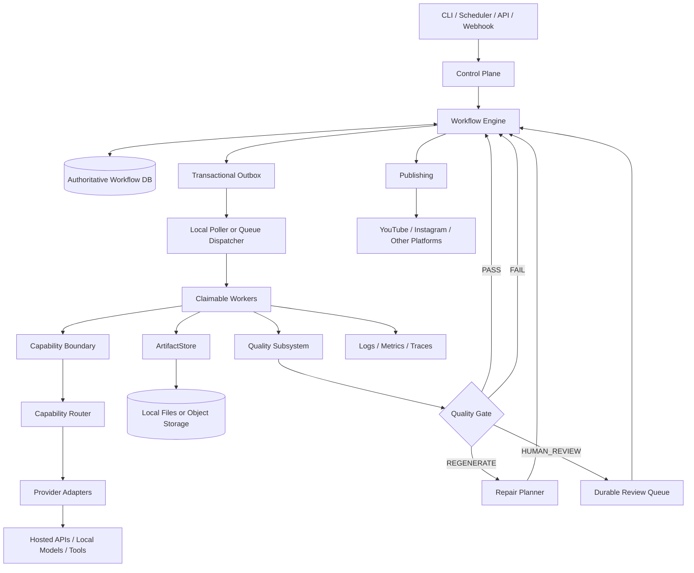
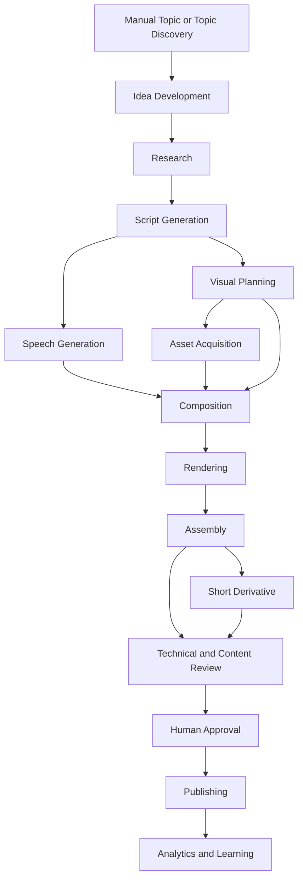

# AI Video Automation Pipeline — Canonical Architecture

**Status:** Implementation baseline

**Audience:** Human engineers, coding agents, architecture reviewers, and future maintainers

**This document is:** the canonical parent architecture for the repository. It records the stable mental model, boundaries, vocabulary, initial workflow, and deliberate deferrals.

**This document is not:** a request to implement every end-state component immediately. The fast implementation is defined in [the Fast Validation Plan](AI_Video_Pipeline_Fast_Validation_Plan.md); the later expansion is defined in [the End-to-End Implementation Plan](AI_Video_Pipeline_End_to_End_Implementation_Plan.md).

## 1. Executive summary

Read [the documentation guide](README.md) before using this document. The
machine-readable registries linked there are normative for names and fast-slice
fixtures.

The system is a deterministic, event-driven video production platform containing selectively probabilistic content capabilities.

The platform produces a canonical landscape long-form episode and derives vertical short-form cuts from it. The first production mode is a faceless narrated explainer. The initial validation uses a software-engineering topic as a concrete, low-risk fixture while keeping the platform domain-neutral and defining finance, mathematics/physics, and entertainment as configurable domain profiles.

The system must be able to:

1. accept a manual topic or discover one from configured sources;
2. create research, claims, evidence, ideas, scripts, audio, visual plans, assets, compositions, and renders as versioned artifacts;
3. run independent work where a stage has a meaningful artifact, retry, quality, or resource boundary;
4. evaluate quality at every important boundary, not only at the end;
5. repair the smallest affected subgraph after a failure;
6. preserve enough lineage and evidence to explain every accepted output;
7. pause for human review without keeping a process alive;
8. change providers, models, workers, and storage without changing domain-stage logic;
9. run locally first and move selected workers to remote compute later; and
10. publish only after explicit policy and human approval requirements pass.

The first implementation is a modular monolith with SQLite, a local filesystem
artifact store, an in-process/local worker, and an outbox-backed polling
dispatcher. The [Local Infrastructure Profile](AI_Video_Pipeline_Local_Infrastructure_Profile.md)
defines its startup barrier, workspace ownership, recovery scans, and promotion
gates. PostgreSQL, object storage, external queues, remote workers, and service
decomposition are extension points, not initial prerequisites.

## 2. Product scope and operating assumptions

### 2.1 Initial product

| Concern | Initial baseline |
|---|---|
| Canonical product | Landscape long-form YouTube episode |
| Long-form duration | At least 10 minutes; exact channel target is configuration |
| Derived product | Vertical short-form cuts for YouTube Shorts, Instagram, and similar platforms |
| Initial short validation | One short derived from one quality-accepted long-form episode |
| Initial locale | `en-US`; locale is not hard-coded in contracts |
| Initial production mode | Faceless narrated explainer |
| Initial visual sources | Procedural/code-generated, licensed stock, public-domain, and generated media |
| Publication | Human approval required |
| Target operating volume | Three long-form episodes per week and at least two shorts per day |
| First validation topic | Software-engineering explainer used as a concrete infrastructure fixture |
| Business expansion | Finance is a priority domain profile because of RPM, with stricter factuality policy |

The target volume informs the eventual concurrency, scheduling, and cost requirements. It is not an initial throughput acceptance criterion. The fast plan must prove correctness and recoverability before optimizing volume.

### 2.2 Domain-neutral platform, domain-specific policy

Finance, software engineering, mathematics/physics, and entertainment share the platform and most of the graph. They differ in:

- source and evidence requirements;
- claim types and severity;
- freshness and as-of-date rules;
- deterministic validators;
- evaluator rubrics and thresholds;
- asset and licensing policy;
- required human-review conditions;
- editorial style and audience contract.

These differences belong in `DomainProfile` and `ChannelProfile` configuration. They must not be implemented as separate workflow engines.

Entertainment may skip research or make claim evidence optional. It still uses immutable artifacts, composition, provenance, technical checks, continuity checks, review, and publication controls.

## 3. Canonical architecture

### 3.1 Logical system



The boxes are responsibilities, not mandatory services. In the first implementation, most boxes are Python modules in one repository and one or two processes.

### 3.2 Execution-plane separation

The system has two conceptual planes:

**Control plane**

- effective configuration;
- workflow definitions;
- run, stage-instance, attempt, and job state;
- readiness and dependency evaluation;
- retry, lease, recovery, and budget policy;
- outbox records;
- human-review state;
- operator status and inspection.

**Execution plane**

- claim a bounded job;
- revalidate eligibility;
- obtain routing and resource assignments;
- download input artifacts;
- execute a stage/capability;
- validate and upload outputs;
- commit structured result and usage metadata;
- emit diagnostics.

They may run in the same process initially. Keeping the boundary explicit makes a later worker or service move possible without changing stage business logic.

### 3.3 Quality plane

Quality is a parallel subsystem attached to artifact-producing boundaries:

```text
Stage output committed
        ↓
Quality check plan resolved
        ↓
Deterministic validators
        ↓
Specialized measurements
        ↓
Narrow semantic judges when needed
        ↓
Escalation / stronger judge / human review
        ↓
Quality gate decision
        ↓
Workflow readiness or targeted repair
```

The quality subsystem produces evaluations and evidence. It does not silently mutate artifacts, bypass retries, or own workflow transitions.

## 4. Canonical vocabulary

The following terms are normative. Existing notes use some synonyms; new code and new documents should use these names.

### 4.1 Product and media terms

| Term | Meaning |
|---|---|
| `ContentPackage` | All related editorial inputs, episode outputs, variants, metadata, and lineage for one production request |
| `Episode` | The canonical long-form editorial work, independent of a particular encoded file |
| `Cut` | A deliverable variant of an episode, such as a landscape master or vertical short |
| `Sequence` | A chapter or major section of a cut |
| `Scene` | A semantic narration unit with claims, narration, visual intent, and timing policy |
| `Shot` | A temporal visual treatment inside a scene |
| `LayerInstance` | A placed visual, audio, text, caption, or effect element on a timeline |
| `SourceAsset` | An immutable obtained/generated media record with provenance that points to an artifact |
| `AssetInstance` | A placement-specific use of a `SourceAsset` with crop, transform, timing, and visual treatment |
| `FrameSample` | A derived inspection artifact or observation; not normally a workflow unit |
| `CompositionSpec` | The declarative, renderer-neutral timeline specification |
| `RenderChunk` | An encoded render segment produced from a resolved composition manifest |
| `Assembly` | The ordered fan-in of render chunks into a complete cut/master |
| `TechnicalContentReview` | The aggregate final automated review of one or more cuts |
| `RenderArtifact` | An encoded output produced from a composition and media inputs; normally a `RenderChunk` or assembled cut |

### 4.2 Workflow terms

| Term | Meaning |
|---|---|
| `WorkflowDefinition` | Versioned graph and policies describing which major stages exist and how they depend |
| `StageNode` | A named node in a workflow definition |
| `StageInstance` | One logical work item for a node, such as `speech_generation/scene_03` |
| `StageAttempt` | One execution attempt for a stage instance |
| `Job` | A claimable execution notification/work record associated with a stage attempt |
| `CapabilityRequest` | Provider-neutral request for an operation |
| `RoutingDecision` | Recorded selection of implementation/provider/model/config |
| `ProviderInvocation` | One external or local provider operation |
| `Readiness` | Deterministic decision that a stage instance may run |
| `RecoveryDecision` | Recorded choice to resume, retry, reconcile, regenerate, wait, or fail |

### 4.3 Quality terms

| Term | Meaning |
|---|---|
| `QualityCheck` | One measurable requirement or evaluator invocation |
| `QualityEvaluation` | Immutable result for exact artifact versions and evaluator versions |
| `QualityGatePolicy` | Rules that combine checks into `PASS`, `REGENERATE`, `HUMAN_REVIEW`, or `FAIL` |
| `QualityGateResult` | Aggregate decision over a gate's required evaluations |
| `RepairPlan` | Scoped, policy-validated request to produce replacement artifacts |
| `GoldExample` | Versioned evaluation example with a trusted or explicitly provisional expected outcome |
| `HumanReview` | Durable workflow record waiting for a reviewer decision |
| `quality_accepted` | Required automated/specialized quality gate passed for exact artifact versions |
| `human_approved` | Reviewer approved exact artifact versions for the requested review scope |
| `publication_ready` | All quality, human, metadata, rights, and budget prerequisites pass |

Stage names, aliases, and boundaries are defined in the normative
[`stages.yaml`](registries/stages.yaml) registry. Terms such as `tts`, `render`,
`assemble`, and `final_review` may appear in historical notes, but new workflow
definitions must use the registry names.

## 5. Canonical production graph

The top-level graph uses major stages. Each major stage may contain substages and pure helper functions.



`Topic Discovery` is optional when a manual topic is supplied. `Analytics and Learning` is a later extension and is not required for the first vertical slice.

Visual planning and speech generation intentionally run in parallel from the
same immutable `Script` version. The script owns scene identity, order,
narration text, and scene boundaries; neither parallel branch may create a
competing scene structure. Speech may use the configured `CONTINUOUS` or
`SCENE_SEGMENTED` strategy, but both strategies must emit scene-addressable
alignment evidence. Composition is the synchronization boundary: it verifies
script/version and scene/text-hash compatibility, then resolves final frame
ranges from actual aligned audio rather than estimated script timing.

### 5.1 Major stage responsibilities

| Stage | Responsibilities | Typical substages |
|---|---|---|
| Topic Discovery | Find candidate subjects from configured inputs | ingest, normalize, deduplicate, extract topics, rank |
| Idea Development | Turn topics into production-worthy angles | generate ideas, filter constraints, compare, select |
| Research | Preserve source material and claim support | source snapshot, claim extraction, evidence linking, conflict detection |
| Script Generation | Create quality-gated narration and scene structure | outline, draft, claim mapping, revision, script QC |
| Visual Planning | Specify visual intent before asset retrieval | scene plan, shot plan, text overlays, transitions, asset requirements |
| Asset Acquisition | Obtain or generate media with provenance | stock search, procedural generation, image/video generation, asset QC |
| Speech Generation | Produce narration and timing using a configured continuity strategy | continuous or scene-segmented TTS/recording, ASR, alignment, loudness, mix |
| Composition | Synchronize accepted speech, visual plans, and assets into renderer-neutral timelines | scene composition, shot layout, captions, transitions, timing resolution, cut manifests |
| Rendering | Produce encoded render chunks from a resolved manifest | preview, chunk render, technical inspection |
| Assembly | Fan in render chunks into an ordered complete cut | chunk completeness, order, A/V continuity, master encode |
| Short Derivative | Select and recompose accepted long-form material | candidate extraction, vertical reframing, short captions, short render |
| Technical and Content Review | Aggregate final technical and content checks | complete-cut checks, semantic review, rights/metadata readiness |
| Human Approval | Record a durable reviewer decision for exact artifacts | approve, request repair, reject |
| Publishing | Publish approved deliverables and metadata | package validation, upload, scheduling, status reconciliation |

### 5.2 When a substage becomes a node

A substage starts as an internal function or local operation. Promote it to a first-class `StageNode` only when it has one or more of:

- a durable artifact that should be reused;
- a separate retry or idempotency boundary;
- a separate quality gate;
- a distinct CPU/GPU/provider requirement;
- meaningful fan-out or fan-in;
- a useful surgical repair scope;
- independent operational visibility.

This rule prevents premature orchestration complexity while preserving a path to the end-state graph.

## 6. Component boundaries

| Component | Owns | Must not own |
|---|---|---|
| Workflow Engine | transitions, dependencies, readiness, cardinality, recovery | provider selection or semantic content decisions |
| Stage | domain operation and stage-level input/output policy | vendor SDK calls or arbitrary workflow mutations |
| Capability | reusable provider-neutral operation | workflow transitions |
| Router | implementation/provider/model eligibility and selection | stage readiness or content mutation |
| Resource Broker | execution environment placement | provider/model quality policy |
| Provider Adapter | external API/local model integration and normalized errors | business workflow state |
| ArtifactStore | durable bytes and opaque URIs | workflow truth |
| Artifact Graph | immutable versions, dependencies, active pointers, invalidation | execution |
| Quality Engine | checks, evaluations, gate recommendations, escalation | silent artifact mutation |
| Review Queue | durable human decisions | in-memory waiting |
| Repository | authoritative metadata and transactions | large binary payloads |
| Logs/Metrics/Traces | diagnostics and measurements | authoritative workflow state |
| Publishing Adapter | platform upload/status reconciliation | bypassing approval gates |

## 7. Architecture invariants

These are implementation constraints, not suggestions.

1. Workflow transitions are deterministic and owned by the Workflow Engine.
2. Provider/model selection is separate from workflow control.
3. Resource placement is separate from provider/model selection.
4. Stages never call provider SDKs directly.
5. Providers never mutate workflow state.
6. Artifacts are immutable; replacement means a new version.
7. Artifact dependencies are explicit and descendant invalidation is graph-based.
8. Events notify; durable state decides whether work is still eligible.
9. At-least-once delivery is expected; exactly-once execution is not assumed.
10. Every retriable external side effect has idempotency or reconciliation behavior.
11. Large binaries are referenced by opaque artifact URIs, not embedded in events or normal DB rows.
12. Quality evaluations reference exact artifact versions and evaluator/rubric versions.
13. Hard failures cannot be averaged away by other quality dimensions.
14. Human review is durable state, not a blocking callback.
15. Paid fallback is never silent and never bypasses an effective budget policy.
16. Configuration, prompt, model, provider, and code versions are captured for reproducibility.
17. The local runner remains usable without a cloud orchestrator.
18. The control flow remains deterministic even when capability implementations are probabilistic.

## 8. Initial implementation versus end state

| Concern | Initial implementation | Extension trigger |
|---|---|---|
| Process model | One control/worker process, optional local worker subprocess | Long jobs, isolation, GPU, concurrency |
| Database | SQLite behind repository interfaces | Multiple concurrent machines |
| Binary storage | Local filesystem behind `ArtifactStore` | Remote workers or retention needs |
| Events | SQLite outbox plus polling dispatcher | Separate worker pools or low-latency wake-up |
| Workflow graph | One validated workflow definition with bounded cardinality | Multiple channels/workflow variants |
| Router | Explicit configured implementation per capability | Multiple providers, health, quotas, benchmarks |
| Quality | Deterministic checks plus selected evaluators | Larger gold sets, escalations, audits |
| Review | CLI/status record or lightweight endpoint | Multiple reviewers and queue volume |
| Rendering and assembly | One Remotion/FFmpeg profile with local chunk assembly | Multiple output profiles or render pools |
| Deployment | Local Python environment and one image later | Remote CPU/GPU workers |
| Publishing | Human-approved adapter or export package | Platform APIs and reconciliation |
| Runtime readiness | Local preflight, recovery scan, and dispatcher barrier | Multi-machine health, deployment orchestration, and backpressure |

## 9. Related documents

- [Fast Validation Plan](AI_Video_Pipeline_Fast_Validation_Plan.md)
- [End-to-End Implementation Plan](AI_Video_Pipeline_End_to_End_Implementation_Plan.md)
- [Contracts and Data Model](AI_Video_Pipeline_Contracts_and_Data_Model.md)
- [Workflow and Event Execution](AI_Video_Pipeline_Workflow_and_Event_Execution.md)
- [Content Model and Composition](AI_Video_Pipeline_Content_Model_and_Composition.md)
- [Quality System](AI_Video_Pipeline_Quality_System.md)
- [Domain Profiles](AI_Video_Pipeline_Domain_Profiles.md)
- [Routing and Providers](AI_Video_Pipeline_Routing_and_Providers.md)
- [Local Infrastructure Profile](AI_Video_Pipeline_Local_Infrastructure_Profile.md)
- [Remote Infrastructure Expansion](AI_Video_Pipeline_Remote_Infrastructure_Expansion.md)
- [Agent and Model Use](AI_Video_Pipeline_Agent_and_Model_Use.md)
- [Decisions](AI_Video_Pipeline_Decisions.md)
- [Design Discussion Log](AI_Video_Pipeline_Design_Discussion_Log.md)

### Source and supporting notes

Superseded supporting notes are retained in the
[non-normative archive](archive/README.md). Their examples may use older field
names or illustrative contracts. Coding agents must implement against this
parent, the focused documents linked above, and the registries. If an archived
example conflicts with a canonical contract, record the discrepancy in the
discussion log and follow the canonical contract.

The two original discussion notes are consolidated into the focused Markdown documents and preserved in Git history by the preceding source-notes commit.
