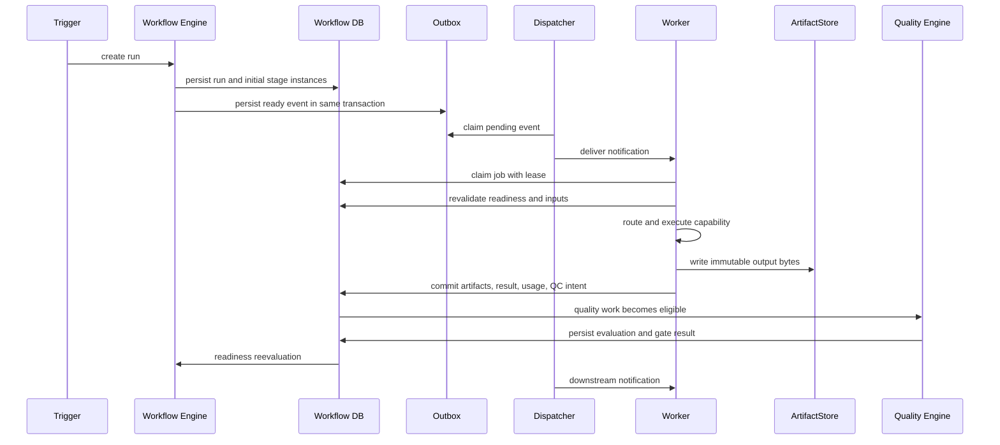

# AI Video Automation Pipeline — Workflow and Event-Driven Execution

**Status:** Canonical execution design

**Purpose:** Define how workflow state, jobs, events, workers, readiness, retries, leases, recovery, and fan-out/fan-in interact.

## 1. Core rule

> Events notify; durable state decides.

An event means that work may be ready. It does not prove that the work remains eligible, has not already completed, or should be executed by the receiving worker. The worker must claim and revalidate against authoritative state.

Canonical event names and payload roles are defined in
[`registries/events.yaml`](registries/events.yaml). The execution runtime must
not introduce PascalCase aliases or free-form event names. A `command` requests
work, a `notification` wakes a consumer, and a `fact` records a committed
transition; all three are delivered at least once and may be duplicated.

## 2. Logical flow



The first implementation may replace the dispatcher/worker network hop with an in-process polling loop. The transaction and state semantics remain the same.

## 3. State machines

### 3.1 Workflow run

```text
CREATED → RUNNING → COMPLETED
             │          │
             ├──────────┴→ FAILED
             ├→ WAITING_HUMAN → RUNNING
             ├→ WAITING_RETRY → RUNNING
             └→ CANCELLED
```

### 3.2 Stage instance

```text
PENDING → READY → CLAIMED → RUNNING → SUCCEEDED
                    │          │
                    │          ├→ WAITING_RETRY → READY
                    │          ├→ WAITING_HUMAN
                    │          ├→ UNKNOWN → reconciliation
                    │          ├→ FAILED
                    │          └→ INVALIDATED
                    └→ lease expired → READY
```

`StageInstance.execution_status` is the logical execution state. `StageAttempt.status`
is the state of one claimable attempt. `CLAIMED` means a lease exists;
`RUNNING` means execution has begun. Keeping them distinct makes stale claims
observable and prevents transport retries from being confused with quality
regeneration.

Execution status and quality acceptance are separate fields. After `SUCCEEDED`, a gated stage enters `acceptance_status=PENDING`; the quality subsystem writes a `QualityGateResult`. Only `acceptance_status=PASSED` makes the stage quality-accepted. `PASSED` is not the same as human publication approval.

```text
execution_status: RUNNING → SUCCEEDED
acceptance_status: NOT_REQUIRED | PENDING → PASSED
                                      ├→ REGENERATE
                                      ├→ HUMAN_REVIEW
                                      └→ FAILED
```

### 3.3 Job

```text
READY → CLAIMED → ACKED
  │       │
  │       ├→ RETRY → READY
  │       ├→ DEAD_LETTER
  │       └→ lease expiry → READY
  └→ cancelled
```

Cancellation is terminal for that job: the dispatcher removes it from delivery, an active lease is revoked, and a worker that later returns must not commit an output under the cancelled attempt. A deliberate retry creates a new attempt/job with a new attempt ID but preserves the recovery relationship.

## 4. Readiness evaluation

Readiness is a pure decision over durable state and effective configuration.

```python
class ReadinessResult:
    eligible: bool
    reason_codes: list[str]
    input_artifact_ids: list[str]
    expected_manifest_id: str | None
```

A stage is ready only when:

1. the workflow/run is not terminal or cancelled;
2. the stage is enabled by effective configuration;
3. all dependency stage instances have execution success and `acceptance_status=PASSED` (or `NOT_REQUIRED`);
4. the required aggregate quality gate result is `PASS`;
5. required input artifact pointers resolve to active, non-invalidated versions;
6. expected fan-in membership is complete;
7. no conflicting active attempt/lease exists;
8. budget and policy permit execution;
9. the logical stage instance does not already have an accepted result.

Readiness must not infer fan-in completion from an empty queue. Use explicit manifests, expected counts, or dependency edges.

## 5. Stage-instance creation

Stage instance identity is derived from:

```text
run_id
+ workflow node ID
+ logical item key
```

Examples:

```text
run_123 / speech_generation / scene_01
run_123 / speech_generation / scene_02
run_123 / long_form_render / chunk_01
run_123 / short_derivative / short_01
```

Creating the same logical stage instance twice must return the existing record. A new attempt is created only for a retry or deliberate regeneration.

## 6. Transactional outbox

### 6.1 Required protocol

When a durable state transition creates work:

```text
BEGIN TRANSACTION
  update workflow/stage state
  create or update job
  insert outbox message
COMMIT
```

The dispatcher then:

1. claims an unsent outbox row;
2. publishes/delivers the event;
3. marks it delivered only after acknowledgement;
4. retries unsent or failed rows with backoff;
5. permits duplicate delivery if a crash occurs after delivery and before marking delivered.

An outbox claim has a claimant and expiry. If the dispatcher exits while an outbox row is `CLAIMED`, the reconciliation loop returns it to `PENDING` after `lease_expires_at`. A permanently failed message is retained with its delivery attempts and a recovery/dead-letter reason.

### 6.2 Outbox payload rules

Include:

- event ID;
- event type;
- schema version;
- run/stage/attempt IDs;
- correlation and causation IDs;
- created time;
- small routing metadata;
- artifact IDs/URIs and hashes where needed.

Do not include:

- video/audio/image bytes;
- full raw provider responses by default;
- credentials;
- unbounded logs;
- mutable state snapshots that can become authoritative by accident.

## 7. Worker lifecycle

```text
1. receive or poll notification
2. locate job by stable ID
3. atomically claim job and lease
4. revalidate stage readiness
5. load input artifact metadata
6. obtain routing/resource decision
7. create capability/provider invocation record
8. execute bounded operation
9. validate result structure and technical invariants
10. write output bytes to temporary workspace
11. checksum and commit immutable artifacts
12. transactionally commit result, usage, `execution_status=SUCCEEDED`, `acceptance_status=PENDING`, a quality input manifest, a quality job, and a quality-event intent; downstream stage readiness is created only after the aggregate gate passes
13. acknowledge job
14. emit structured metrics/logs
```

If an exception occurs, classify it before choosing retry. Validation errors should not be retried unchanged. Quality failures are repairs, not transient execution failures.

Quality checks are themselves bounded work. A quality job has an input manifest,
check/gate policy version, evaluator requirements, idempotency key, lease, and
durable result. It may run in the same local process initially, but it must not
be an in-memory callback that disappears when the producing worker exits.

## 8. Lease behavior

Lease rules:

- lease duration is configurable per job class;
- worker heartbeat is optional for short jobs and required for long jobs;
- a worker may renew only its own lease;
- an expired lease makes a job reclaimable, but does not prove the old worker stopped;
- result commit must include lease-owner compare-and-set;
- result commit must include a monotonic fencing token so an expired worker
  cannot commit over a reclaimed lease;
- if an old worker later completes, its result is reconciled by idempotency and active-attempt rules;
- operators can force-cancel a lease with an audit record.

The system should prefer a harmless duplicate/no-op over accepting two competing outputs.

## 9. Retry and failure classification

| Failure | Default action |
|---|---|
| Malformed contract output | bounded repair or fail; do not repeat unchanged indefinitely |
| Missing input artifact | fail/reconciliation; do not fabricate input |
| Provider authentication | pause/configuration failure |
| Rate limit | retry with provider-specific backoff |
| Quota exhausted | alternate eligible provider, defer, pause, or authorized paid fallback |
| Network timeout | reconcile if provider supports it; otherwise `UNKNOWN` then bounded policy |
| Provider transient 5xx | retry with jitter |
| Provider permanent rejection | fail or alternate eligible implementation |
| Media decode error | regenerate/reacquire affected artifact |
| Quality failure | targeted repair or human review |
| Worker crash | lease recovery and idempotency/reconciliation |
| Budget exceeded | pause/fail; never silently spend more |

Backoff should include jitter. Retry limits belong to policy, not hard-coded stage loops.

## 10. Unknown external outcomes

An external call can succeed while the worker is unable to record its result. Recovery order:

1. look up the idempotency record;
2. inspect committed artifacts for the operation key;
3. query the provider operation ID if supported;
4. reconcile a provider result into the local artifact graph;
5. retry only if the operation is safe or policy explicitly permits it;
6. otherwise create a human-attention/recovery record.

Never convert a timeout directly into a blind new paid generation.

## 11. Fan-out and fan-in

### Fan-out examples

- one script → one continuous speech job, or one speech job per scene when the
  configured speech strategy is `SCENE_SEGMENTED`;
- one visual plan → one asset job per required shot;
- one composition → render chunks;
- one episode → multiple short candidates.

### Fan-in examples

- accepted speech output → an audio/timing manifest containing every script
  scene, whether the source is one continuous artifact or scene-level artifacts;
- all asset jobs → asset manifest;
- all render chunks → assembled master;
- selected scenes → short composition;
- multiple quality evaluations → gate decision.

Fan-in must record an immutable expected input manifest. The manifest owns the
expected child logical keys and count; duplicate child results are idempotent,
missing children remain incomplete, and late results for a closed manifest are
rejected or recorded as orphaned work. A partial result is not complete merely
because currently queued jobs are empty.

### Speech strategy and synchronization

The effective configuration selects one speech strategy for a run:

- `CONTINUOUS` generates one narration or recording pass and derives scene
  boundaries from ASR/forced alignment;
- `SCENE_SEGMENTED` generates or accepts one speech artifact per script scene
  and assembles an audio manifest after each scene passes its checks.

Both strategies consume the same immutable script scene manifest and produce the
same normalized speech contract. Every accepted result records the script ID
and version, scene IDs, narration text hashes, voice/recording configuration,
audio artifact references, and alignment evidence. Visual planning uses the
same script version and scene IDs. Composition rejects mismatches and resolves
final scene frame ranges from actual aligned audio. It must not use visual-plan
estimates or script word-count estimates as an independent timing authority.

## 12. Invalidation and repair

When artifact `A` is replaced:

1. mark the old artifact `SUPERSEDED` or `INVALIDATED` according to reason;
2. walk child dependency edges;
3. invalidate only affected descendants;
4. retain independent branches;
5. create repair stage instances with new logical attempts;
6. reevaluate only changed gates and downstream outputs.

Example:

```text
speech_generation/scene_03:v1 fails
         ↓
speech_generation/scene_03:v2
        ↓
invalidate composition/scene_03
        ↓
invalidate affected rendering chunk
        ↓
reassemble master
        ↓
rerun technical/final gates
```

## 13. Human review as durable workflow

On `HUMAN_REVIEW`:

1. persist exact target artifacts and evaluation evidence;
2. create `HumanReview` record;
3. pause the affected stage/run according to policy;
4. release worker resources;
5. expose a review command/UI later;
6. record the reviewer, decision, comments, and timestamp;
7. create repair/approval/rejection transition;
8. resume readiness evaluation.

The process may exit while review is pending.

Use these terms precisely:

- `quality_accepted`: the required automated/specialized gate result is `PASS`;
- `human_approved`: a reviewer approved the exact target artifact versions;
- `publication_ready`: all quality gates, required human decisions, metadata, rights, and budget checks pass.

A human `APPROVE` decision updates the relevant `HumanReview`, records `human_approved`, and allows the Workflow Engine to create `publication_ready`. It does not directly publish or mutate an artifact.

## 14. Local implementation

The detailed local startup, workspace, storage, process-role, and recovery
profile is defined in [Local Infrastructure Profile](AI_Video_Pipeline_Local_Infrastructure_Profile.md).
The first dispatcher can poll:

```text
while within invocation budget:
    reconcile stale leases and unknown attempts
    dispatch pending outbox rows
    claim one ready job
    execute bounded work
    commit result
    reevaluate downstream readiness
    stop when no work remains or budget is exhausted
```

This is event-driven at the state/eligibility level without requiring a broker.

## 15. Remote evolution

When the local semantics are tested, use the evidence-gated migration order in
ADR-024, the Local Infrastructure Profile, and the detailed
[Remote Infrastructure Expansion](AI_Video_Pipeline_Remote_Infrastructure_Expansion.md)
target document:

1. keep the same `Job`, `EventEnvelope`, artifact, and result contracts;
2. optionally package the local roles in one versioned image;
3. introduce an object-storage adapter and complete a migration/reconciliation
   rehearsal;
4. move authoritative metadata to PostgreSQL or another justified multi-machine
   store;
5. deploy one remote CPU worker using opaque artifact URIs;
6. deploy a bounded GPU/media worker only when measured workload evidence
   requires it;
7. add a queue adapter only if polling is a measured latency or load bottleneck;
8. add backpressure, resource placement, and independent worker pools;
9. keep the database authoritative throughout.

Do not make queue delivery, object storage, or a worker process the source of
truth. Each promotion must preserve at-least-once delivery, lease fencing,
idempotency, unknown-outcome reconciliation, and explicit quality/readiness
transitions.

## 16. Execution tests

- [ ] two triggers create the intended number of logical runs/jobs;
- [ ] duplicate outbox event is harmless;
- [ ] event arrives after stage already succeeded;
- [ ] process exits after claim;
- [ ] process exits after provider completion;
- [ ] process exits after artifact upload;
- [ ] process exits after DB commit before acknowledgement;
- [ ] lease renewal and expiry behave correctly;
- [ ] old worker cannot commit over a newer attempt;
- [ ] fan-in waits for explicit manifest completeness;
- [ ] failed QC blocks downstream readiness;
- [ ] scene repair preserves unrelated artifact pointers;
- [ ] human review survives process restart;
- [ ] queued jobs capture the intended effective configuration.
