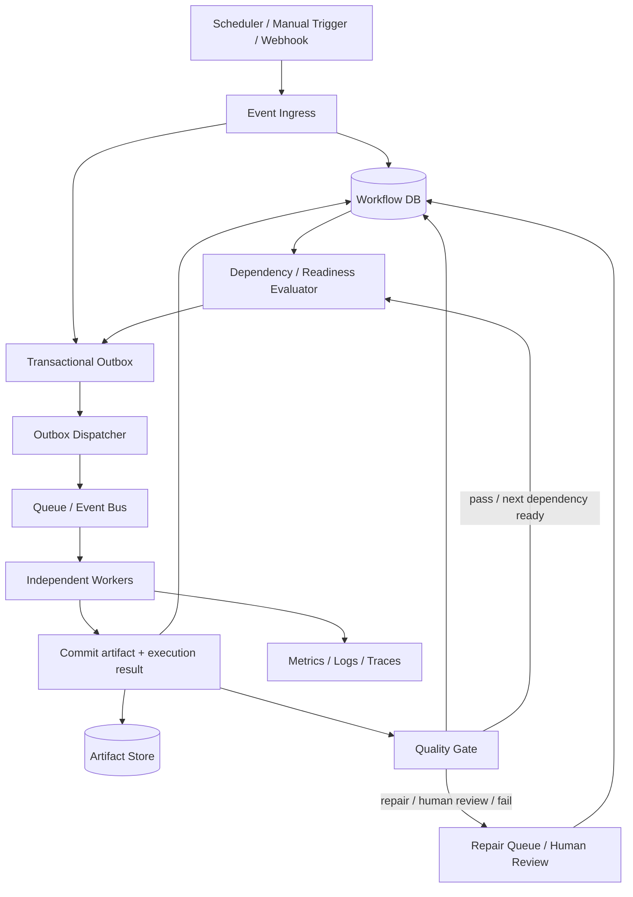

# AI Video Pipeline — Event-Driven Execution, Compute Strategy and Model Routing Addendum

**Document type:** HISTORICAL / NON-NORMATIVE companion addendum
**Canonical replacements:** [Workflow and Event Execution](../AI_Video_Pipeline_Workflow_and_Event_Execution.md), [Routing and Providers](../AI_Video_Pipeline_Routing_and_Providers.md), and [Quality System](../AI_Video_Pipeline_Quality_System.md)
**Prepared:** 17 October 2026
**Audience:** Human engineers, coding agents, architecture reviewers and future maintainers

> This document preserves earlier design discussion. It does not replace the
> canonical documents or registries. If a detail here conflicts with a current
> contract, follow the canonical replacement and record any required migration.
> Provider quotas, free tiers, model names and prices are time-sensitive; treat
> them as dated observations, not permanent guarantees.

## 1. Purpose and decisions at a glance

This addendum consolidates the discussion about making the pipeline event-driven, running independent stages across a mixture of free and paid compute, routing model calls by capability, evaluating outputs with layered quality controls, and developing locally before moving workers to cloud infrastructure.

The architecture should make it possible to change *where* and *how* a stage executes without changing the workflow's domain logic. The durable workflow state and artifact lineage are the source of truth; queues and events are delivery mechanisms, not the source of truth.

### Decisions to preserve

1. **Event-driven execution:** stage work is independently claimable and event-triggered. Do not implement the production pipeline as one long-lived sequential script.
2. **Deterministic orchestration, probabilistic content:** workflow transitions, dependency readiness, retries, idempotency, invalidation and budget enforcement are deterministic. LLMs may generate, classify, judge or recommend, but do not own durable workflow control.
3. **Outbox + dependency evaluator:** persist a state change and its event intent atomically; dispatch events from an outbox. A dependency/readiness evaluator decides whether a stage is actually ready.
4. **Capability router and resource broker are separate:** the router chooses an eligible implementation for a capability; the resource broker chooses an eligible execution environment for the resulting work. They solve different problems.
5. **Quality before cost, within a hard budget:** first enforce hard constraints, then minimum quality, then optimize cost/latency/free quota. Never silently exceed a user-configured spend cap.
6. **Layered evaluation:** deterministic checks → specialized measurements → narrow semantic judge → stronger judge only for borderline/high-impact/disagreement cases → human review when needed.
7. **Laptop-first development:** prove contracts and recovery locally with mocks; use real provider calls for integration; fault-inject; then deploy the same worker package to cloud execution.
8. **Portable artifacts:** use opaque artifact URIs and an ArtifactStore interface. Keep state in a repository/service rather than having distributed workers share a SQLite file over a network filesystem.
9. **Cost per accepted output:** record actual cost, latency, quality, retries and regeneration for each artifact/video. Optimize cost per accepted video, not just cost per API call.
10. **No automatic paid fallback by default:** quota exhaustion or provider failure can pause, queue, choose another eligible free implementation, or use a paid implementation only when policy and remaining budget explicitly permit it.

## 2. Fit with the existing architecture

The existing design already establishes WorkflowDefinition, layered configuration, the separation between workflow and router, capability requests, provider adapters, per-stage quality gates, immutable artifacts, dependency-aware invalidation, meaningful execution persistence, and recovery/reconciliation. Keep those concepts.

This addendum makes the execution and deployment implications explicit:

- **Workflow Definition** describes stage topology, dependencies, cardinality, gate policy and recovery behavior.
- **Workflow Engine** owns durable state transitions, dependency readiness, fan-out/fan-in, retry policy, reconciliation and human-review pauses.
- **Event Outbox / Dispatcher** turns committed state changes into deliverable work notifications.
- **Workers** claim a bounded unit of work, execute it, commit artifacts and results, and acknowledge/retry safely.
- **Capability Router** selects a provider/implementation for a capability based on hard constraints, quality history, availability, quota, latency and cost.
- **Resource Broker** selects an execution plane (local laptop, Oracle, Modal, rented GPU, notebook batch, etc.) based on workload requirements, availability, data constraints, price and execution limits.
- **ArtifactStore** hides local disk/object storage differences. Artifact URIs are opaque to stages.
- **Quality subsystem** returns explicit decisions with evidence, not merely a score.
- **Database / state repository** is authoritative for workflow and execution metadata. Large binary assets live in artifact storage; logs/metrics/traces are separate observability systems.

Do not introduce a new distributed platform merely because the design is event-driven. Start with the smallest implementation that honors the contracts.

## 3. Event-driven execution model

### 3.1 Logical architecture



The queue may be a simple local queue at first. The important property is not a particular broker; it is durable state, independently executable work, safe retries and a recoverable relationship between state and event delivery.

### 3.2 Events notify; state decides

Use events such as:

- `WorkflowRequested`
- `StageReady`
- `StageExecutionRequested`
- `StageExecutionStarted`
- `ArtifactCommitted`
- `QualityEvaluationCompleted`
- `StageAccepted`
- `StageRejected`
- `RepairRequested`
- `HumanReviewRequested`
- `ProviderQuotaLow` / `ProviderQuotaExhausted`
- `WorkflowPaused` / `WorkflowResumed`
- `PublishRequested` / `PublishCompleted`

Events should carry stable IDs and references, not large binaries. Example fields:

```json
{
  "event_id": "evt_...",
  "event_type": "StageExecutionRequested",
  "workflow_id": "wf_...",
  "stage_instance_id": "stage_...",
  "correlation_id": "video_...",
  "causation_id": "evt_previous_or_null",
  "created_at": "ISO-8601 timestamp",
  "schema_version": 1
}
```

A worker must not assume an event means the work is still eligible. It claims or validates the stage instance against durable state. The dependency evaluator confirms all required inputs and quality gates are satisfied before marking a stage ready.

### 3.3 Transactional outbox

Without an outbox, the database can commit “stage ready” while the process crashes before publishing the queue message, or the message can be published while the database transaction rolls back.

Recommended sequence:

1. In one database transaction, update workflow/stage state and insert an outbox row.
2. A dispatcher repeatedly claims unsent outbox rows.
3. Publish the event to the queue.
4. Mark the outbox row delivered only after the broker acknowledges it.
5. If the dispatcher crashes, retry. Duplicate delivery is expected and must be safe.

This provides reliable *at-least-once* delivery. Do not claim exactly-once execution. Use idempotency and deduplication to make repeated delivery harmless.

### 3.4 Worker lifecycle

A worker should perform a bounded unit of work:

1. Receive or poll for a work notification.
2. Claim the stage instance using a lease / compare-and-set transition.
3. Revalidate readiness and input artifact versions.
4. Obtain a routing decision and resource assignment.
5. Execute the capability through an adapter.
6. Validate output structure and technical invariants.
7. Write immutable artifacts to ArtifactStore.
8. Commit artifact metadata, stage result, evaluation state and downstream event intent.
9. Acknowledge the message.
10. Emit logs, metrics and cost/usage observations.

If the worker crashes after artifact upload but before commit, reconciliation should discover an unreferenced artifact or retry with the same idempotency key. If it commits the result but crashes before message acknowledgement, the duplicate message should find the completed result and become a no-op.

### 3.5 Fan-out, fan-in and concurrency

The workflow definition may express one-to-many and many-to-one stages. Examples:

- One topic request → N candidate ideas → select 1 or more.
- One script → N scene-level TTS jobs.
- One visual plan → N asset-generation/search jobs.
- One composition → N render chunks → assembler.
- N independent evaluator results → a policy decision.

A fan-in stage becomes ready only when its declared input set is complete and acceptable. A stage must not infer completeness from “the queue is empty”; use explicit expected-child counts, manifest IDs or dependency edges.

Concurrency limits belong in policy/configuration and resource accounting, not hidden inside stage code.

### 3.6 Event-driven does not mean every function becomes a service

Keep each stage independently executable, but do not split every helper function into a worker or microservice. The unit of independent execution should correspond to a meaningful artifact, retry boundary, resource profile or quality gate. Pure transformations can remain functions inside a worker.

## 4. Persistence, artifacts and recovery

### 4.1 What belongs in durable state

Persist meaningful boundaries, not every internal function call:

- workflow and stage-instance state transitions
- dependency edges and readiness decisions
- input/output artifact IDs and versions
- quality evaluations and gate decisions
- provider/model/resource routing decisions
- quota reservations and actual usage/cost
- retries, errors, leases and reconciliation findings
- human decisions and reasons
- outbox records and event delivery status
- experiment/policy/model versions needed to explain outcomes

Do not use logs as the authoritative workflow database.

### 4.2 Artifact rules

Artifacts are immutable and versioned. A regenerated artifact becomes the active version only after its result is committed and accepted according to policy. Preserve historical lineage and invalidation/replacement events even if old large binaries are later removed by retention policy.

Each artifact should record at minimum:

- artifact ID, type, version and opaque URI
- content hash (e.g. SHA-256), size and media metadata
- producer stage and producer version
- input artifact IDs / dependency edges
- relevant config, prompt, model and policy version hashes
- created time, active/superseded status and retention class

If a script changes, determine descendants that depend on that script version and invalidate only those descendants. Avoid rerunning unrelated scenes/chunks. Invalidation should be computed from the artifact dependency graph, not implemented as ad hoc stage-specific branches.

### 4.3 SQLite and migration path

- **Local prototype:** SQLite is appropriate for a single local process or tightly controlled local runner.
- **Do not** let multiple remote workers write to one SQLite file on a network filesystem.
- For remote concurrent workers, put state behind a repository/API and use a suitable shared database (e.g. PostgreSQL or a managed database). Cloudflare D1 may fit a lightweight control plane if its transaction/concurrency needs match the workload.
- Keep repository interfaces stable so persistence can change without rewriting stage logic.
- Keep binary artifacts out of the relational state database except for small metadata/manifests.

### 4.4 Reconciliation and unknown outcomes

External calls can time out after the provider has completed work. Represent ambiguous outcomes as `UNKNOWN` or an equivalent reconciliation state rather than assuming failure and blindly paying for the same generation again.

Reconciliation should ask, in order:

1. Does a completed result already exist under the idempotency key or provider job ID?
2. Is there a committed artifact/result for the stage instance?
3. Is a provider status lookup available?
4. Can the operation be safely retried?
5. If not, should it pause for human attention?

Use exponential backoff with jitter for transient failures, bounded attempts, and a dead-letter / human-attention path. Validation errors should not be retried unchanged. Quality failures should trigger a targeted repair, not a blind full-workflow restart.

## 5. Separate the capability router from the resource broker

### 5.1 Capability router: “which implementation should do this?”

A stage asks for a capability and requirements, not a vendor name. Examples:

- `TextGeneration`: structured JSON, creative diversity, low latency, or judge reliability.
- `TextEvaluation`: evidence-backed rationale, low false-accept rate, low temperature.
- `TextToSpeech`: target language/accent, voice consistency, scene-level generation, timing metadata.
- `SpeechRecognition`: language support and word timestamps.
- `ImageGeneration` / `VideoGeneration`: aspect ratio, duration, licensing/provenance requirements.
- `VisualSemanticEvaluation`: compare rendered frames with narration/scene intent.

The router filters providers by hard constraints first, then minimum validated quality, then availability/health and quotas, then optimizes cost/latency according to policy. It returns a versioned `RoutingDecision` including implementation, provider, model/version, config hash, reason and policy version.

A free provider with no quota, unacceptable quality, disallowed data terms or unreliable availability is not eligible just because it is free.

### 5.2 Resource broker: “where should this job run?”

The resource broker chooses the execution environment, independently of the model/provider choice. It considers:

- CPU, RAM, VRAM and accelerator requirements
- expected duration and startup time
- batchability and deadlines
- network/data access restrictions
- artifact transfer cost and size
- provider availability, quotas and concurrency
- total expected cost, including failures and retries
- whether the job can tolerate interruption
- whether the environment permits the intended unattended workload

Example mapping:

| Workload | Initial execution preference | Escalation |
|---|---|---|
| Schema checks, routing, dependency evaluation | Local CPU / small always-on control plane | Persistent low-cost control-plane host |
| Topic/idea/script text calls | Eligible free or low-cost hosted API | Alternate eligible provider; pause if paid spend is disallowed |
| Short semantic evaluations | Cheap capable hosted model | Stronger model only for borderline/high-risk cases |
| FFmpeg, metadata, basic render checks | CPU worker; local during development | CPU cloud worker if throughput requires it |
| Open-weight LLM inference / local TTS / image generation | Laptop only for measured tests or when privacy/offline matters | Short-lived GPU rental when benchmarks justify it |
| Render chunks | CPU/GPU based on measured renderer bottleneck | Parallel workers with bounded concurrency |
| Notebook-only GPU workloads | Explicit bounded batch job | Do not treat free notebook runtime as durable infrastructure |

### 5.3 Avoid one “super-router”

Keep separate policy decisions observable:
1. **Workflow readiness:** may this stage run now?
2. **Capability routing:** which provider implementation is eligible?
3. **Resource placement:** where should the job execute?
4. **Budget/quota authorization:** is the expected spend permitted?
5. **Quality gate:** is the resulting artifact acceptable?

They can share context and policy data, but each decision should have a clear contract and audit record.

## 6. Compute and provider strategy

This section is a practical options inventory, not a promise that any free tier is permanently available. Limits and terms change; re-check official provider pages before implementation and before relying on a quota.

### 6.1 Options discussed

| Option | Good fit | Main limitations / cautions | Recommended role |
|---|---|---|---|
| Existing laptop (Ryzen 7 5800H, 16 GB RAM, RTX 3060 6 GB VRAM) | Local development, deterministic tests, small quantized models, debugging, limited GPU experiments | VRAM/RAM limits; laptop availability and thermal/interactive contention; do not assume it should run continuously | Primary development and test environment; GPU fallback only when needed |
| Oracle Cloud Always Free | Persistent low-volume control-plane/CPU tasks if an eligible instance is available | Regional/capacity/account constraints; free-instance availability is not guaranteed | Candidate for a small persistent service, not assumed GPU inference |
| Cloudflare Workers + D1 | Lightweight API, event ingress, scheduler/dispatcher logic, small control-plane records | Runtime limits and service-specific constraints; not a general GPU worker | Optional lightweight ingress/control-plane component |
| AWS free account / credits | Short experiments and services already compatible with AWS | Eligibility, credit expiry, service-specific quotas and potential billable usage | Use only with budget alarms and explicit spend controls |
| Modal | On-demand containers, short-lived CPU/GPU jobs, scalable burst compute | Usage credits are finite; CPU/RAM/storage/egress may add cost; credits do not necessarily cover token-priced hosted endpoints | Strong candidate for burst workers after local benchmarks |
| Vast.ai | Flexible marketplace GPU rentals for open-weight models and GPU-heavy jobs | Live market prices vary; host reliability, interruption and data/security need assessment | Cost-sensitive GPU experiments; use checkpointing and avoid critical durable state on the instance |
| Kaggle notebooks | Bounded research/benchmarking jobs and notebook-friendly workloads | Quotas/availability can change; sessions are not durable workers; interactive constraints | Explicit batch experiments, not the production control plane |
| Google Colab free | Quick experiments and notebook workflows | Dynamic GPU access/runtime lifetime; no persistence guarantee; unattended always-on use is unsuitable | Manual/short bounded experiments |
| GitHub Actions | CI, contract tests, packaging, small scheduled tasks | Runner limits, job duration and usage quotas; not a general GPU pool | CI and lightweight scheduled tasks |
| Hosted LLM APIs | Text generation, structured extraction and semantic judging | Rate limits, terms/data handling, changing free quotas and model availability | Default low-volume path when terms and quality fit |
| Local open-weight models | Offline/privacy-sensitive work and repeated workloads where utilization is high | Setup, VRAM, speed, maintenance and quality variability | Use only after measuring quality and total cost |

**Oracle allocation correction:** The discussion's checked official documentation indicated an Always Free allocation of up to **2 OCPUs and 12 GB memory** for the relevant eligible compute option, subject to region/account/capacity and current terms. Do not design around the older incorrect assumption of 4 OCPUs / 24 GB. Verify current Oracle documentation and the actual instance shape available in the account.

### 6.2 Notebooks, tunnels and long-running workers

Do not expose a notebook GPU through a public tunnel and assume that makes it a durable production worker. A tunnel does not keep the notebook runtime alive and may introduce security risk or conflict with platform restrictions.

If a notebook is used, make it a **bounded batch executor**:
1. Authenticate to the pipeline using a narrowly scoped credential.
2. Poll or receive a bounded job request.
3. Claim one job or a small batch with a lease.
4. Download only required artifacts.
5. Execute and upload result artifacts.
6. Commit result/usage and acknowledge the job.
7. Exit or wait only within the platform's allowed runtime.

The durable scheduler, database, queue and artifact registry must remain outside the notebook session. The pipeline must tolerate the notebook disappearing at any time.

### 6.3 Modal and Vast.ai usage policy

Use rented compute only after a representative benchmark proves the workload benefits from it. Record:
- instance/GPU type and region
- startup/model-load time
- useful execution time
- input/output artifact sizes and transfer time
- cost of CPU, memory, GPU, storage and egress where applicable
- success/failure/retry rate
- quality result and cost per accepted artifact

Use checkpoints for long-running work. Never place the only copy of workflow state or an artifact on an interruptible instance. Shut down instances promptly and enforce a hard maximum runtime/spend per job.

### 6.4 Free-tier policy

A free-tier preference is a cost optimization, not a correctness rule. The provider registry should store quota source, unit, reset period, observed usage, last refresh time and confidence. Quotas may be approximate or stale, so enforce both local reservations and provider-side error handling.

Recommended behavior when quota is exhausted:
- use another **eligible** free provider if quality/privacy/availability requirements remain satisfied;
- enqueue for a later reset;
- reduce optional work or sample evaluations if policy permits;
- pause and notify;
- use paid fallback only when an explicit policy enables it and the spend cap permits it.

Do not let a free-tier provider silently route sensitive data into a service whose terms are unacceptable. For example, the discussion's checked Gemini pricing page marked free-tier data as potentially used to improve products, unlike its paid tier. Treat data terms as a hard eligibility constraint and re-check current terms.

## 7. Hosted LLM APIs, local models and provider aggregation

### 7.1 Provider categories discussed

- **Gemini API:** potentially useful for low-cost text and multimodal tasks. Check current model names, rate limits, free-tier data terms and pricing.
- **Groq:** hosted inference with model-specific rate limits; useful when an eligible model and quota fit the task.
- **Cerebras:** fast hosted inference options; promotional credits should not be mistaken for a permanent free tier.
- **OpenRouter:** aggregation across model providers, including some free models; free-model availability and limits can change.
- **OmniRoute:** optional local OpenAI-compatible routing/proxy approach that may help aggregate or fail over between configured endpoints. Treat third-party/keyless free endpoints as experimental, non-contractual and potentially unstable.
- **Ollama / llama.cpp:** local inference options for open-weight models; benchmark against the laptop's 6 GB VRAM and available RAM.

Do not make a third-party model aggregator the workflow control plane. Keep your own capability contracts, routing policy, usage ledger, budget enforcement, and provider adapters. Aggregation can be an adapter behind the router.

### 7.2 Data and security rules

For every provider/endpoint, track:
- permitted data classifications
- retention/training terms
- whether user text or source content may be sent
- secret handling and key rotation
- regional or contractual requirements where relevant
- request/response logging policy

Never log API keys, credentials, or raw sensitive payloads by default. Use least-privilege credentials and per-worker scope. If a provider's terms or data treatment are unknown, mark it ineligible for sensitive inputs until reviewed.

### 7.3 Structured outputs and retries

All model-backed stages should request and validate structured outputs where possible. Structured output does not prove semantic correctness. On malformed output:
1. attempt deterministic parse/validation;
2. optionally make a bounded repair request if policy permits;
3. record the failure and model/version;
4. stop or route to a fallback implementation if the retry budget is exhausted.

Do not use a model call to validate a property that a deterministic checker can verify exactly.

## 8. Quality-control and LLM-as-judge strategy

This section is historical context. Use the canonical [Quality System](../AI_Video_Pipeline_Quality_System.md) and `../registries/quality_gates.yaml` for the current stage-by-stage QC matrix and fixtures.

### 8.1 Evaluation cascade

**Layer 0 — deterministic checks (always where applicable):**
- schema, required fields, enums, ranges and references
- source URL/asset existence and provenance fields
- duplicate IDs and duplicate artifacts
- duration, dimensions, frame rate, codec/container, decode integrity
- audio presence, clipping, silence, loudness, sample rate
- subtitle timing and audio/video synchronization
- timeline gaps/overlaps, missing assets, safe areas and platform limits
- claim-ledger completeness and exact quote/date/number checks

**Layer 1 — specialized measurements:**
- ASR transcript versus approved script (WER/CER or a task-appropriate metric)
- word/scene timing and speaking rate
- duplicate/similarity detection
- source-claim retrieval and evidence-span checks
- image/video relevance features or frame sampling
- audio signal measurements and technical render inspection

**Layer 2 — cheap narrow semantic judge:**
- source entails the specific claim
- narration matches visual meaning
- script is clear, coherent and suitable for the target audience
- idea is distinct from recent channel output
- title/thumbnail promise matches actual content
- no obvious unsupported causal inference or misleading implication

**Layer 3 — stronger judge or independent evaluator, only when justified:**
- borderline decisions
- high-impact claims
- disagreement between specialized evaluators
- final cross-modal review of a sampled or high-value output
- new model/prompt rollout and shadow evaluation

**Layer 4 — human review:**
- unresolved factual disputes, licensing uncertainty or high-impact risk
- repeated evaluator disagreement
- cases outside the validated evaluator scope
- final editorial review where the workflow policy requires it

A hard failure must not be averaged away by high style scores. A technically corrupted render or an unsupported high-impact claim cannot pass because the video is entertaining.

### 8.2 Judge response contract

Each judge should return structured, inspectable evidence, not just “8/10.” A conceptual result:

```json
{
  "evaluation_id": "eval_...",
  "artifact_id": "artifact_...",
  "artifact_sha256": "...",
  "dimension": "visual_narration_alignment",
  "rubric_version": "visual-alignment-v1",
  "evaluator": {
    "provider": "provider-id",
    "model": "model-id",
    "model_version": "version-or-unknown"
  },
  "decision": "PASS | REGENERATE | HUMAN_REVIEW | FAIL",
  "score": 0.0,
  "confidence": "low | medium | high",
  "evidence": ["scene 3: narration describes X but visible frame depicts Y"],
  "failure_codes": ["VISUAL_MISMATCH"],
  "recommended_action": "regenerate_scene_3",
  "latency_ms": 0,
  "estimated_cost": 0.0
}
```

The numeric score is not automatically a calibrated probability. Define explicit decision thresholds and calibrate them against human-reviewed examples.

### 8.3 When to use a small or large model

Choose by measured task performance, not model size or brand:

- Use code/tools for exact properties.
- Use a specialized model or small/medium LLM for narrow, repetitive, well-specified tasks if false-pass rates are acceptable.
- Use a capable general model for bounded semantic questions that require context.
- Use a stronger frontier model only for complex, ambiguous, high-value or disagreement cases.
- Use human review where the risk or uncertainty is outside validated automation.

Benchmark **false acceptance** (bad artifacts incorrectly pass) and **false rejection** (good artifacts are unnecessarily regenerated). For quality gates, false acceptance is often more costly, but false rejection also drives cost and latency. Set thresholds per dimension and impact level.

### 8.4 Golden sets when the owner is not an expert

A golden set is a small versioned test suite with a trusted expected decision and reason. It can start imperfect and grow through four sources:

1. **Known-answer examples:** schema failures, missing assets, wrong durations, unsupported claims, script/transcript mismatches.
2. **Controlled defect injection:** intentionally break one thing at a time—remove a subtitle, shift audio, change a claim, mismatch a visual, introduce a duplicate, corrupt a render.
3. **Real pipeline samples:** save outputs that were accepted, rejected, repaired or escalated.
4. **Human-reviewed samples:** ask for a narrow judgment with a rubric and evidence, rather than requiring broad subject-matter expertise.

Start with roughly **100–200 examples for a meaningful first evaluation** if practical; fewer can validate wiring but provide weak confidence. Ensure the set includes borderline cases and known defects, not only easy examples. Keep a separate holdout set where possible.

For each example, store:
- input artifact(s) and hashes
- task/dimension and rubric version
- expected decision and reason/evidence
- severity/impact
- provenance and known defect type
- reviewer and review timestamp
- evaluator output, false-pass/false-reject outcome
- notes when the gold label is disputed

Do not treat another LLM's label as unquestionable truth. A model can propose labels and rationales, but the gold label should be confirmed by deterministic facts, a human review, or independent evidence. When uncertain, label the example `AMBIGUOUS` and define the expected policy action as `HUMAN_REVIEW`, rather than inventing a confident answer.

### 8.5 Evaluation and model rollout

For every model/prompt/rubric change:
1. run the fixed gold set;
2. compare false-accept and false-reject rates by dimension;
3. inspect disagreements and representative failures;
4. shadow-run on real traffic without controlling production decisions;
5. canary on a small share of work;
6. promote only when the policy's quality/cost/latency criteria are met;
7. retain rollback capability and version every decision.

Record `ModelVersion`, `PolicyVersion`, `Evaluation`, `Experiment`, `ProductionDecision` and `OutcomeObservation` (or the equivalent existing contract types). A model's average judge score is not enough; compare with human acceptance, regeneration rate, post-publication outcomes and cost per accepted video.

### 8.6 Avoid correlated judges

Two prompts to the same model family may share the same blind spots. If independence matters, vary the evaluator family or measurement method where practical. Agreement is evidence, not proof. Randomly audit a sample of accepted artifacts so false passes remain observable.

## 9. Cost model and budget enforcement

### 9.1 Optimize cost per accepted video

Track at least:
- provider/API cost
- GPU/CPU/memory runtime and startup cost
- artifact storage and transfer/egress
- retries and regeneration
- evaluation cost
- human review time (even if initially recorded as a proxy)
- time-to-accepted-output and failure rate

A cheap generation that is repeatedly rejected can cost more than a more capable model that passes first time. The relevant metric is:

**Cost per accepted video = total attributable pipeline cost / number of videos accepted under the defined quality policy.**

Also track cost per accepted artifact/stage so the system can learn where model or provider swaps help.

### 9.2 Illustrative API calculation

A pricing snapshot discussed on 14 October 2026 used an example hosted text model at **$0.75 per million input tokens and $3.75 per million output tokens** for paid standard usage. At 50,000 input tokens and 5,000 output tokens per video:

- input: 50,000 × $0.75 / 1,000,000 = $0.0375
- output: 5,000 × $3.75 / 1,000,000 = $0.01875
- total: **$0.05625 per video**, or about **$1.69 for 30 videos**, excluding retries and other calls.

This is an illustration of text-judge economics, not a guaranteed current price or a full video-production estimate. Confirm the model and current rate card before using it in a budget.

### 9.3 Modal pricing snapshot discussed

The checked Modal pricing page at the time of discussion described a Starter plan with $30/month of eligible compute credit. Example published GPU rates included approximately:
- T4: $0.000164/second (~$0.59/hour)
- L4: $0.000222/second (~$0.80/hour)
- A10: $0.000306/second (~$1.10/hour)
- A100 40 GB: $0.000583/second (~$2.10/hour)
- A100 80 GB: $0.000694/second (~$2.50/hour)

These are snapshots, not guaranteed total effective costs. CPU, memory, startup time, storage, egress, eligible-credit rules and actual utilization can affect the bill. Shared/token-priced endpoints may not be covered by compute credits. Verify the current rate card.

### 9.4 Broad initial monthly planning bands

Earlier discussion used the following **illustrative planning bands**, assuming a small Shorts-first workload around 30 videos/month and not assuming expensive proprietary video-generation calls for every scene:

| Strategy | Early planning band | What it assumes |
|---|---:|---|
| Mostly hosted APIs | $0–$30/month | Free quotas where eligible, modest paid text/API usage, limited external generation |
| Hybrid APIs + burst GPU | $0–$30/month initially, then usage-based | APIs for text/judging, short GPU rentals only for measured workloads; free credits may offset initial tests |
| Mostly self-hosted on rented GPU | $10–$100+/month | Repeated use of open-weight models, TTS or image/video models; utilization and runtime dominate |
| Dedicated always-on GPU | Potentially materially higher | Not recommended until measured demand justifies idle capacity |

These bands are intentionally broad and should not be treated as quotes. Actual video generation, commercial TTS, asset licensing, music, storage and egress can dominate the budget. A GPU rental solely to avoid low-cost text-judge calls is usually economically unjustified.

### 9.5 Budget guardrails

- Set a hard monthly spend cap and a per-workflow/per-stage maximum.
- Reserve estimated spend before launching expensive work; reconcile against actual provider charges.
- Define whether optional evaluations can be sampled or skipped when budget is low. Never skip mandatory hard checks.
- Disable paid fallback unless explicitly enabled by effective configuration.
- Pause rather than silently exceed budget.
- Include retry/regeneration spend in routing and evaluation comparisons.
- Alert before free credits or quotas are exhausted.
- Keep a dry-run mode that estimates cost without launching expensive work.

## 10. Laptop-first implementation and migration plan

### Phase 0 — Contracts and deterministic skeleton
- Read the base architecture, First-Class Contracts and QC playbook before editing core.
- Implement state transitions, dependency evaluator, outbox, worker protocol, artifact metadata and quality decision contracts.
- Use mock providers and fake artifacts; test without network access.
- Keep control flow deterministic and observable.

### Phase 1 — Local end-to-end vertical slice
- Run one manually supplied topic through idea → script → TTS or mock audio → visual plan → composition/render stub → QC.
- Use SQLite for the single-process local prototype.
- Store artifacts on local disk behind ArtifactStore.
- Confirm each stage is independently claimable and emits a versioned result.

### Phase 2 — Real API integration
- Add one provider adapter per capability, not provider SDK calls in stages.
- Add structured-output validation, timeouts, retry limits, quota accounting and explicit data eligibility.
- Capture cost, latency, raw provider status and normalized errors without logging secrets or unnecessary sensitive content.
- Benchmark small/large judge candidates against the same gold examples.

### Phase 3 — Fault injection
Test at minimum:
- duplicate event delivered twice;
- worker crashes before execution;
- worker crashes after provider success but before result commit;
- artifact uploaded but metadata commit fails;
- state commits but event dispatch fails;
- message is redelivered after result commit;
- lease expires while a worker is still running;
- provider returns malformed structured output;
- provider times out with unknown outcome;
- quota is exhausted mid-run;
- paid fallback is disallowed;
- accepted script changes after TTS has completed;
- one scene's audio fails QC but other scenes are valid;
- a render chunk is corrupt while other chunks are reusable;
- human review remains pending for hours/days;
- a model/prompt version changes while old jobs are queued.

Expected behavior: no silent duplicate acceptance, no uncontrolled repeated spending, no stale descendant artifact used as current, and no full-workflow restart when a surgical repair is sufficient.

### Phase 4 — Cloud worker pilot
- Keep the workflow database/control plane persistent and independent from worker lifetime.
- Deploy the same packaged worker to one low-cost persistent CPU environment and one burst-compute provider.
- Use object storage or another suitable remote ArtifactStore.
- Measure actual startup time, execution time, artifact transfer, failure/retry rate, quality and total cost.
- Verify the deployment can stop/restart without losing workflow state.

### Phase 5 — Gradual automation
- Add queue-backed concurrency and backpressure.
- Add provider health tracking and resource scheduling.
- Add shadow evaluation, canary routing and experiment comparisons.
- Add retention/garbage collection only after artifact lineage and active-version semantics are tested.
- Add human review UI/notifications only as needed; the durable review queue must exist first.

## 11. Suggested minimum contracts

These are conceptual interface shapes to align with the existing contracts, not a command to duplicate or replace existing types. Reuse the existing contract if an equivalent one already exists.

```python
class Worker:
    def can_execute(self, job) -> bool: ...
    def execute(self, job, context) -> "ExecutionResult": ...

class ArtifactStore:
    def put(self, content, metadata) -> "ArtifactRef": ...
    def get(self, artifact_ref) -> bytes: ...
    def exists(self, artifact_ref) -> bool: ...

class EventBus:
    def publish(self, event) -> None: ...
    def claim(self, queue_name, lease_seconds) -> "ClaimedEvent | None": ...
    def ack(self, claim) -> None: ...
    def retry(self, claim, reason, delay_seconds) -> None: ...

class CapabilityRouter:
    def decide(self, request, policy_context) -> "RoutingDecision": ...

class ResourceBroker:
    def place(self, workload, constraints, budget) -> "ResourceAssignment": ...

class QualityEvaluator:
    def evaluate(self, artifact_ref, rubric, context) -> "EvaluationResult": ...
```

Every operation that can be retried should define idempotency behavior. Contracts should include correlation IDs, versioning, normalized errors and explicit unknown outcomes. These interfaces are deliberately small; implementations may be in-process at first.

## 12. Observability and operational metrics

Every stage execution should have correlation IDs linking workflow, stage instance, event, artifact, evaluation, provider call and resource assignment.

Minimum metrics:
- queue depth and oldest-event age
- ready/running/paused/unknown stage counts
- stage latency p50/p95 and timeout rate
- provider availability, rate-limit errors and quota remaining
- retries per stage and duplicate-delivery no-op count
- artifact upload/commit failures
- quality pass/regenerate/human-review/fail rates by dimension
- false-pass/false-reject estimates from audits
- cost per stage and cost per accepted video
- regeneration count and downstream invalidation fan-out
- human-review queue age and outcome
- GPU startup/load/utilization versus useful work

Logs should be structured and privacy-aware. Metrics should not contain raw user content. Traces should connect the event and stage execution chain without making trace storage the source of workflow truth.

## 13. Open decisions and explicit non-goals

Resolve these with benchmarks or requirements rather than assumptions:

- Which queue/event bus is needed after local prototype?
- Which persistent database and artifact object store fit actual concurrency and budget?
- Which providers' current terms and quotas are acceptable for each data classification?
- Which small/medium/strong models meet the false-pass target for each evaluator dimension?
- Which workloads genuinely benefit from GPU execution after transfer and startup costs?
- What monthly volume, latency and quality target should determine resource placement?
- Which checks are mandatory, sampled, or human-gated for each channel/niche?

Non-goals:
- Do not adopt Kafka/Kubernetes/Temporal merely because the architecture is event-driven; introduce infrastructure when a concrete requirement warrants it.
- Do not make every function a microservice.
- Do not make an LLM the sole authority for workflow state or hard technical checks.
- Do not assume free notebook sessions are durable compute.
- Do not make OmniRoute or any external aggregator the control plane.
- Do not permit automatic paid fallback to bypass the budget policy.
- Do not choose a model solely by leaderboard, model size, or vendor reputation.

## 14. Source and freshness notes

The provider facts and prices below were checked during the discussion around 14 October 2026 and must be re-verified before implementation. This addendum intentionally separates architecture decisions from provider-specific details.

- Oracle Cloud Always Free documentation: https://www.oracle.com/cloud/free/ and https://docs.oracle.com/en-us/iaas/Content/FreeTier/freetier.htm
- Cloudflare Workers pricing/limits: https://developers.cloudflare.com/workers/platform/pricing/ and https://developers.cloudflare.com/d1/platform/pricing/
- Modal pricing: https://modal.com/pricing
- Vast.ai marketplace: https://vast.ai/
- Google Colab FAQ: https://research.google.com/colaboratory/faq.html
- Kaggle: https://www.kaggle.com/docs/notebooks
- Runway pricing: https://runwayml.com/pricing
- Gemini API pricing: https://ai.google.dev/gemini-api/docs/pricing
- Groq rate limits: https://console.groq.com/docs/rate-limits
- Cerebras pricing: https://www.cerebras.ai/pricing
- OpenRouter models and pricing: https://openrouter.ai/models
- OmniRoute repository/documentation: https://github.com/omni-route/omni-route

Some links, quotas and product pages may change or redirect. Provider-specific statements are not guarantees. Re-check current official terms, limits and prices and record the check date in configuration/documentation.

## 15. Implementation checklist for a coding agent

Before changing code:
- [ ] Read `kb/docs/README.md`, the canonical architecture, contracts, workflow, and quality documents before using this note.
- [ ] Identify existing contracts before adding new ones; reuse instead of duplicating.
- [ ] Keep core contracts and workflow state transitions human-owned; make focused changes.
- [ ] Describe the change, touched packages, migration impact and tests before implementation.

For each worker/stage:
- [ ] Has an explicit input/output contract and version.
- [ ] Can execute as a bounded, independently claimable job.
- [ ] Does not call provider SDKs directly; uses a capability adapter.
- [ ] Uses durable artifact references rather than passing large binaries through events.
- [ ] Is idempotent or has an explicit unknown-outcome reconciliation path.
- [ ] Emits structured logs, metrics, cost/usage and correlation IDs.
- [ ] Has deterministic validation before probabilistic judgment where applicable.
- [ ] Has a defined PASS / REGENERATE / HUMAN_REVIEW / FAIL policy.
- [ ] Supports targeted regeneration and descendant invalidation.
- [ ] Has tests for duplicate events, crashes and provider errors.

For routing and deployment:
- [ ] Capability routing and resource placement are separate decisions.
- [ ] Free-tier limits and terms are tracked as mutable data, not hard-coded truth.
- [ ] Paid fallback is bounded by explicit policy and budget.
- [ ] Resource selection includes startup, transfer, retries and useful runtime cost.
- [ ] Local tests use mocks; cloud workers use the same contracts/package.
- [ ] No network filesystem is used as a shared SQLite database.
- [ ] Notebook runtimes are treated as interruptible batch workers, not durable control-plane hosts.

For evaluators:
- [ ] Rubric and model versions are recorded.
- [ ] Gold-set examples cover known failures and borderline cases.
- [ ] False-pass and false-reject rates are measured.
- [ ] Stronger evaluation is escalated selectively.
- [ ] Human outcomes feed back into evaluation and routing policy.
- [ ] Random audits of accepted outputs are performed.

**Completion criterion:** A worker can be stopped or restarted at any point without losing authoritative workflow state; duplicate delivery does not cause uncontrolled duplicate work or spend; artifact changes invalidate only affected descendants; every important quality decision is explainable; and provider/compute choices can change without rewriting stage business logic.
